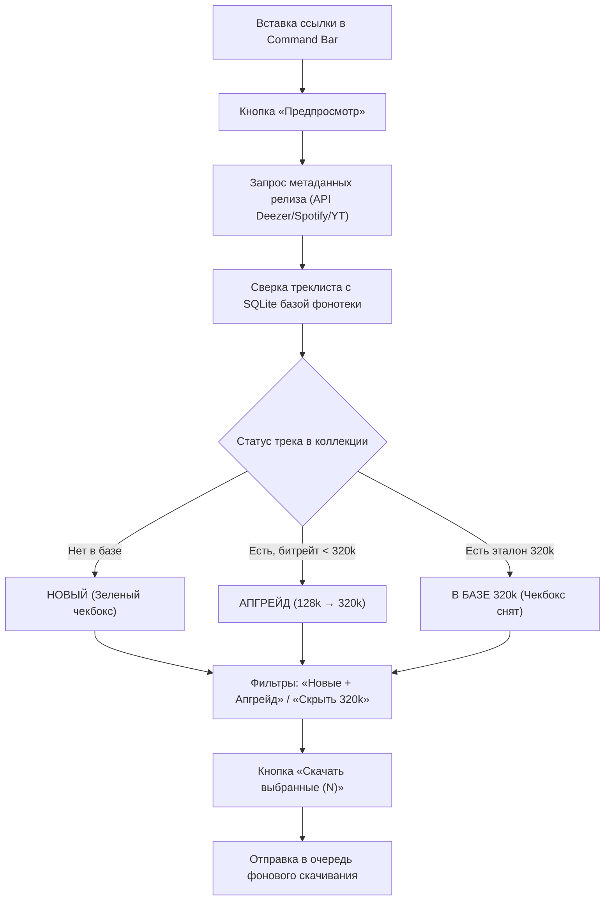

# Music Manager STUDIO — Практическое руководство пользователя

> **Версия:** 2.4 Studio Edition  
> **Стек:** Go Core Engine, SQLite WAL, yt-dlp + ffmpeg Audio Pipeline, ID3v2.4 Metadata Engine, Alpine.js / Tailwind CSS (No-Build Web GUI).

---

## 1. Обзор и концепция Music Manager STUDIO

**Music Manager STUDIO** — высокопроизводительная цифровая рабочая станция для загрузки, каталогизации, пакетного тегирования и аудита персональной музыкальной библиотеки.

```
                         МУЛЬТИСОРС-АРХИТЕКТУРА СЕРВИСА
                     
   [ Потоковые сервисы ]     [ Торренты / Magnet ]     [ Внешние каталоги ]
   Deezer / Spotify / YT      BitTorrent Engine        Deezer / MusicBrainz
   SoundCloud / Apple / ЯМ                                   Shazam
              │                         │                       │
              ▼                         ▼                       ▼
      ┌─────────────────────────────────────────────────────────────┐
      │               Music Manager STUDIO Core Engine              │
      │  ┌───────────────────────┐       ┌───────────────────────┐  │
      │  │ Pre-Flight Inspector  │       │ Candidate Matcher     │  │
      │  │  (Защита дубликатов)  │       │ (Контроль версий/LRC) │  │
      │  └───────────────────────┘       └───────────────────────┘  │
      └──────────────────────────────┬──────────────────────────────┘
                                     │
                                     ▼
      ┌─────────────────────────────────────────────────────────────┐
      │                      Медиатека на диске                     │
      │           MP3 320 kbps CBR / ID3v2.4 UTF-8 / .lrc           │
      └─────────────────────────────────────────────────────────────┘
```

### Ключевые возможности

- **Мультисорс-загрузчик с нормализацией аудио:** Загрузка треков, альбомов и дискографий по ссылкам или торрент-файлам с автоматической конвертацией в студийный стандарт **MP3 320 kbps CBR / 44.1 kHz**.
- **Интеллектуальный Pre-Flight Check:** Проверка релизов перед стартом загрузки по локальной базе данных SQLite. Выявление дубликатов, автоматическое предложение апгрейда треков низкого битрейта (например, `128 kbps → 320 kbps`) и предотвращение засорения медиатеки.
- **Верификация версий и Quick-Listen Spots:** Выбор правильной дорожки из нескольких альтернативных кандидатов (SoundCloud / YouTube) до финального сохранения: различение Explicit vs Clean, Original vs Remix, а также быстрый отслушивание контрольных точек цензуры и подозрительных слов по синхронизированным субтитрам (`.lrc`).
- **Студийный редактор тегов Puddletag Grid:** Плотная табличная рабочая станция в духе десктопного Puddletag/Mp3tag с инлайн-редактированием ячеек, боковым инспектором тегов, пакетной сменой регистра, генерацией нумерации, извлечением гостевых исполнителей (`feat.`) и двусторонней синхронизацией `Файл → Теги` и `Теги → Файл`.
- **Строгий ID3v2.4 UTF-8 движок:** Запись тегов в стандарте ID3v2.4 с поддержкой мульти-значений через нулевой байт (`\x00` в файле, `\\` в интерфейсе ввода), встроенных обложек (`APIC`) и сохранением текстов песен строго во внешние `.lrc` файлы рядом с треком.
- **Встроенный аудиокомбайн:** Нижний стики-плеер для непрерывного воспроизведения фонотеки, отдельная вкладка полноэкранного плеера с визуализатором спектра и радиостанция на основе библиотеки.

### Быстрый старт и авторизация

1. Откройте веб-интерфейс в браузере (по умолчанию `http://localhost:8080`).
2. В правом верхнем углу консоли нажмите кнопку **Войти**.
3. Введите учетные данные администратора, заданные в файле конфигурации `.env`.
4. После успешной проверки подлинности устанавливается защищенная сессионная cookie (`httpOnly`, `SameSite=Strict`), а в верхней панели отображается имя текущего пользователя с кнопкой **Выйти**.

---

## 2. Навигация и устройство интерфейса

Интерфейс спроектирован по канонам студийных инструментов управления (Ableton, Linear, Raycast) с фокусом на плотность данных, высокую контрастность и управление с клавиатуры.

```
 ┌────────────────────────────────────────────────────────────────────────────────────────┐
 │ [♪ Studio]  [ Поиск по медиатеке... (Ctrl+K) ]   [Загрузчик] [Файлы] [Аудит]... [User]│
 ├────────────────────────────────────────────────────────────────────────────────────────┤
 │                                                                                        │
 │                                                                                        │
 │                               РАБОЧАЯ ОБЛАСТЬ ВКЛАДКИ                                  │
 │                                                                                        │
 │                                                                                        │
 ├────────────────────────────────────────────────────────────────────────────────────────┤
 │ [Обложка] Трек — Исполнитель   ⏮ [ ▶ ] ⏭  01:23 ━━━━━●━━━━━ 03:45   🔊 ━━●━  [⤢] [✕]  │
 └────────────────────────────────────────────────────────────────────────────────────────┘
```

### Верхняя консоль (Studio Console Header)

- **Звуковой логотип:** Логотип со статусом `STUDIO Audio Engine`.
- **Глобальный поиск (`Ctrl+K`):** Полнотекстовый поиск по SQLite базе данных в стиле Raycast. Ищет одновременно по трем категориям:
  - **Исполнители:** Показывает имя артиста и количество найденных треков; клик перенаправляет в папку исполнителя.
  - **Альбомы:** Показывает название альбома, автора релиза и год выпуска; клик открывает каталог альбома в проводнике файлов.
  - **Треки:** Отображает название, исполнителя, бейджи наличия текстов (`LRC` / `TXT`) и кнопку мгновенного запуска воспроизведения ▶.
- **Переключатель рабочих пространств:**
  - `Загрузчик` — Command Bar загрузок, список задач, очередь и выбор версий.
  - `Файлы` — Рабочая станция Puddletag: файловый браузер, таблица тегов, инспектор метаданных.
  - `Аудит` — Диагностика медиатеки: отсутствующие обложки, битрейт, дубликаты, тексты песен.
  - `Радар` — Мониторинг новых релизов отслеживаемых артистов.
  - `Радио` — Станция автоматического воспроизведения с фильтрами по артистам.
  - `Плеер` — Полноэкранный студийный плеер с визуализатором спектра и текстом песни.

### Мобильная версия

Интерфейс полностью адаптирован для экранов смартфонов и планшетов без потери функциональности:
- **Компактная таблица треков:** Вторичные технические столбцы (Диск, Год, Жанр, Битрейт, Имя файла) скрываются, а критически важные метаданные (исполнитель, альбом, битрейт) переносятся в подстрочник под названием трека.
- **Нижний стики-плеер:** Фиксируется внизу экрана с оптимизированными сенсорными зонами для переключения дорожек и паузы.
- **Плавающая очередь задач:** Виджет очереди автоматически сдвигается вверх (`bottom-24`), освобождая место для панели воспроизведения.

---

## 3. Загрузка музыки (Command Bar)

Командная панель загрузчика расположена на вкладке **Загрузчик** и поддерживает три специализированных режима.

### Селектор источников

По умолчанию установлен режим **Автоопределение**. Парсер анализирует сигнатуру URL и направляет запрос в соответствующий драйвер. При необходимости источник можно зафиксировать вручную:
- **SoundCloud** — скачивание треков, альбомов, сетов и плейлистов.
- **Deezer** — извлечение релизов с 8-поточным сбором ISRC, соавторов и точных ID3v2.4 тегов.
- **Торрент / Magnet** — обработка magnet-ссылок и BitTorrent раздач.
- **Яндекс Музыка** — треки, альбомы, плейлисты исполнителей.
- **Spotify** — метаданные релизов и плейлистов с поиском качественных исходников.
- **Apple Music** — парсинг каталога Apple Music с подбором эталонного аудио.
- **YouTube / YouTube Music** — загрузка через внутренний yt-dlp пайплайн.

### Режимы работы

#### 1. Режим «Одна ссылка» (Single URL)
Базовый режим для загрузки одного трека, альбома или плейлиста.
1. Вставьте адрес страницы в поле ввода (поддерживается кнопка **Вставить** из буфера обмена).
2. Если вставлена ссылка на профиль музыканта, кнопка **Дискография** подсветится золотистым цветом, позволяя раскрыть список всех альбомов артиста.
3. Нажмите **Предпросмотр** для вызова предполетной проверки или **Скачать** для прямой отправки в очередь.

#### 2. Режим «Список» (Batch URL)
Пакетная обработка нескольких ссылок (от 1 до 20 штук за одну операцию).
1. Переключите режим на **Список**.
2. Вставьте по одной ссылке на каждую строку:
   ```text
   https://music.yandex.ru/album/12345678
   https://open.spotify.com/album/4aawyAB9vmqN3uQ7FjRGTy
   magnet:?xt=urn:btih:3b8c199c82e6d5b0b2e3e9d8e7c6b5a4...
   ```
3. Счетчик справа отобразит количество корректно распознанных адресов.
4. Нажмите **Добавить в очередь**. Задачи будут поставлены в фоновую обработку.

#### 3. Режим «.torrent» (Drag-and-Drop)
Загрузка через локальные торрент-файлы:
- Перетащите файл с расширением `.torrent` напрямую на область Command Bar в браузере.
- Либо нажмите кнопку **.torrent** и укажите файл через системный диалог.
- Сервис распакует метаданные торрента и добавит задание в фоновый пул скачивания.

---

## 4. Предпросмотр релиза и защита от дубликатов (Pre-Flight Check)

**Pre-Flight Check** предотвращает появление дубликатов и случайную перезапись качественных файлов треками с худшим битрейтом.



### Вызов предполетной проверки

После ввода URL в командную строку нажмите кнопку **Предпросмотр**. Сервис обратится к провайдеру метаданных, получит структуру треклиста и сопоставит каждую запись с локальной базой `music-manager`.

### Расшифровка статусов дорожек

| Статус в таблице | Цвет бейджа | Описание и логика системы |
|---|---|---|
| `НОВЫЙ` | Зеленый | Трек полностью отсутствует в локальной коллекции. Чекбокс загрузки **отмечен по умолчанию**. |
| `АПГРЕЙД (128k → 320k)` | Янтарный | Композиция уже есть в медиатеке, но текущий файл имеет низкий битрейт (например, 128, 192 или 256 kbps). Рекомендуется обновление. Чекбокс **отмечен по умолчанию**. |
| `В БАЗЕ (320k)` | Темно-серый | В коллекции уже присутствует эталонная копия трека в качестве 320 kbps. Чекбокс **снят по умолчанию**, чтобы исключить дублирование. |

> [!TIP]
> При наведении курсора на бейдж `АПГРЕЙД` или `В БАЗЕ (320k)` во всплывающей подсказке отображается точный относительный путь к уже существующему на диске файлу.

### Быстрые фильтры и выборочная загрузка

В шапке модального окна Pre-Flight Check доступны фильтры в один клик:
- **Кнопка «Новые + Апгрейд»:** Выбирает все недостающие дорожки, а также дорожки низкого качества, требующие обновления.
- **Кнопка «Только новые»:** Снимает выбор с апгрейдов, оставляя только те песни, которых вообще нет на диске.
- **Чекбокс «Скрыть треки 320k»:** Фильтрует таблицу, убирая из видимости уже имеющиеся эталонные файлы (удобно для сборников на 100+ композиций, где не хватает всего нескольких треков).
- **Главный чекбокс `#`:** Позволяет выделить все видимые дорожки альбома или полностью очистить выбор.
- **Кнопка «Скачать выбранные (N)»:** Запускает загрузку строго отмеченного набора композиций.

---

## 5. Активная загрузка, проверка версий и Очередь (Telemetry & Queue)

После запуска скачивания на панели отображается интерактивный блок активной задачи (**Studio Telemetry Bar**).

```
 ┌────────────────────────────────────────────────────────────────────────────────────────┐
 │ DOWNLOADING  Скачивание: The Midnight - Sunset               (3/10) 45% ━━━━━━●━━━━━  │
 ├────────────────────────────────────────────────────────────────────────────────────────┤
 │ 1. Shadows ................... 03:45  [Оригинал]  [▶ Preview]  [Версии (3) ▼]          │
 │ 2. Sunset .................... 05:24  [Совпадение] [▶ 01:14 «вещества» КоАП]           │
 └────────────────────────────────────────────────────────────────────────────────────────┘
```

### Жизненный цикл задачи (Статусы телеметрии)

1. `QUEUED` — задача ожидает освобождения слота в пуле воркеров.
2. `RESOLVING` — парсинг метаданных релиза, сопоставление треклиста и поиск источников звука.
3. `DOWNLOADING` — загрузка аудиопотока через yt-dlp во временный изолированный каталог `tmp_downloads/{job_id}/`.
4. `CONVERTING` — перекодирование через ffmpeg в MP3 320 kbps CBR с частотой дискретизации 44.1 kHz.
5. `TAGGING` — запись тегов ID3v2.4 UTF-8 и поиск/сохранение синхронизированного файла текста `.lrc`.
6. `READY` — релиз готов к проверке и переносу в основную медиатеку.
7. `ERROR` — сбой обработки с выводом детального лога ошибки.

### Проверка качества и цензуры (Quick-Listen Spots)

В треклисте активной задачи под названиями треков отображаются интерактивные чипы контрольных точек:

- **Отслушивание цензурных меток:** При наличии текста система автоматически анализирует текст песни на предмет нецензурной лексики, маркеров цензуры и рискованных тем.
  - Розовый бейдж с меткой `КоАП` (`DRUG_COAP_6_13`) — упоминание запрещенных веществ.
  - Янтарный бейдж — потенциально заглушенные или вырезанные фрагменты.
  - Клик по кнопке `▶ 01:24 «слово»` запускает воспроизведение аудио за 3 секунды до проблемного момента. Это позволяет за пару секунд убедиться, скачана ли версия **Explicit** (без купюр) или **Clean Edit** (с запикиванием).

### Сравнение кандидатов и переключение версий аудио

Если для трека найдено несколько кандидатов на SoundCloud или YouTube:
- **Бейджи соответствия:**
  - `Оригинал` (зеленый) — совпадение по официальному релизу/названию.
  - `Совпадение` (янтарный) — альтернативный источник с идентичным хронометражем (дельта $\le 2$ сек).
  - `Не проверено` (серый) — кандидат без подтверждения эталоном.
  - `Предупреждение совпадения (XX%)` — низкая точность соответствия названия.
- **Инструмент «Версии (N)»:** Клик по кнопке раскрывает список кандидатов:
  - Просмотр автора загрузки и дельты хронометража: `Δ: +0с`, `Δ: -4с`.
  - Кнопка **Preview** — потоковое предпрослушивание 15-секундного отрывка конкретного кандидата без скачивания на диск.
  - Кнопка **Выбрать** — мгновенная замена источника аудио для данного трека.

### Завершение загрузки

Когда задача переходит в статус `READY`, становятся доступны действия:
- **Принять в медиатеку:** Мгновенный перенос файлов из временной директории `tmp_downloads/{job_id}/` в постоянную структуру `MUSIC_DIR` через сервис органайзера (`{Artist}/{Album}/{Track} - {Title}.mp3`).
- **Редактировать теги / Открыть этот релиз:** Загрузка скачанных файлов в сетку Puddletag Grid для тонкой ручной доводки метаданных до окончательного импорта.
- **Редактировать всё (N):** Появляется при завершении нескольких релизов в очереди — открывает все готовые релизы единой пачкой в табличном редакторе.
- **Повторить:** Перезапуск задачи при ошибке сетевого подключения.

### Управление очередью (Queue Drawer)

- **Основной блок очереди:** Находится под Command Bar. Показывает активные задачи, количество готовых и ошибочных релиза.
- **Кнопки очереди:**
  - `Пауза` / `Возобновить` — остановка запуска новых фоновых задач.
  - `Ошибки (N)` — массовый перезапуск упавших заданий.
  - `В теги всё (N)` — пакетное открытие всех готовых релизов.
  - `Очистить` — удаление завершенных задач из истории.
- **Плавающий виджет (Queue Drawer):** Компактная кнопка в правом нижнем углу экрана доступна на любой вкладке сервиса, открывая всплывающую панель со статусом фоновых скачиваний.

---

## 6. Медиатека и студийный редактор тегов (Puddletag Grid)

Вкладка **Файлы** представляет собой профессиональную рабочую станцию тегирования, функционально эквивалентную Puddletag и Mp3tag.


### Навигация по медиатеке

- **Хлебные крошки (Breadcrumbs):** Интерактивная строка пути для мгновенного перехода в корень фонотеки или на уровень исполнителя.
- **Тумблер «Подпапки» (`recursiveMode`):** При активации чекбокса сервис рекурсивно загружает все аудиофайлы из всех вложенных каталогов выбранной папки в одну плоскую таблицу.
- **Фильтр таблицы (`searchFilter`):** Мгновенная фильтрация отображаемых строк на клиенте по исполнителю, названию песни или альбому.
- **Действия над папкой:** Кнопки **Перекачать** (повторная постановка альбома в Downloader) и **Удалить** (удаление каталога с диска с подтверждением).

### Работа с таблицей треков (Dense Data Grid)

- **Инлайн-редактирование по двойному клику:** Двойной клик на любой текстовой или числовой ячейке (Название, Исполнитель, Альбом, Год, Жанр, Номер трека/диска) переводит её в режим редактирования.
  - `Enter` — сохранить значение и автоматически перейти к редактированию ячейки строкой ниже.
  - `Tab` / `Shift+Tab` — сохранить и перейти к следующей/предыдущей колонке в текущей строке.
  - `Escape` — отменить правку без сохранения.
- **Индикация несохраненных изменений (Staged Dirty State):**
  - Строки с несохраненными изменениями помечаются **желтой вертикальной полосой слева**.
  - Измененные ячейки подсвечиваются янтарным цветом (`text-amber-400 font-bold bg-amber-500/10`).
  - Счетчик несохраненных файлов отображается на кнопке сохранения: `Сохранить (3)`.
- **Технические индикаторы:**
  - `Кбит` — битрейт файла (например, `320k`).
  - `Время` — форматированный хронометраж `MM:SS`.
  - `LRC` — индикатор синхронизированного текста песни: белый бейдж `LRC` (файл `.lrc` на диске), голубой бейдж `TXT` (текст без таймкодов `.txt`), прочерк `—` (текст отсутствует).

### Боковая панель инспектора тегов (Studio Tag Inspector)

Расположена справа от таблицы и предназначена для пакетной модификации метаданных:
- **Блок обложки (Artwork Box):**
  - Поддерживает перетаскивание графического файла (Drag & Drop) формата JPEG, PNG или WebP прямо на блок обложки.
  - Кнопка **Загрузить** — выбор файла обложки с диска.
  - Кнопка **Удалить** — удаление встроенного APIC-фрейма из выбранных файлов.
- **Пакетное редактирование:**
  - При выделении нескольких композиций поля с различающимися значениями помечаются янтарным курсивом: `<Разные значения>`.
  - Ввод нового текста в поле инспектора (например, изменение жанра на `Synthwave` или года на `2024`) немедленно применяется ко **всем выделенным трекам**.

> [!IMPORTANT]
> Для сохранения нескольких исполнителей в одном треке разделяйте их **двойным обратным слэшем** `\\` (например: `The Midnight\\Ollie Wride`). При сохранении движок запишет их в ID3v2.4 фрейм через нулевой байт `\x00` в строгом соответствии со стандартом ID3v2.4.

### Инструменты автоматизации

#### 1. Базы тегов (Интеграция с онлайн-каталогами)
Кнопка **Базы** в тулбаре открывает диалог мульти-источникового поиска:
- Одновременный опрос каталогов **Deezer**, **MusicBrainz** (включая Cover Art Archive) и **Shazam** (акустический фингерпринтинг аудиофайла).
- Просмотр треклиста релиза и автоматическое интеллектуальное сопоставление треков базы с файлами в таблице.
- Выборочный перенос метаданных (только недостающие теги, обложка высокого разрешения, ISRC).

#### 2. Файл → Теги (`Ф→Т`)
Извлечение метаданных из имен файлов по маске с предварительным просмотром различий (Side-by-Side Diff Preview).

**Поддерживаемые переменные шаблонов:**
- `%artist%` — исполнитель
- `%title%` — название дорожки
- `%album%` — альбом
- `%track%` (синонимы: `%tracknumber%`, `%track_number%`) — номер дорожки
- `%year%` — год релиза
- `%genre%` — музыкальный жанр
- `%disc%` (синонимы: `%discnumber%`, `%disc_number%`) — номер диска
- `%albumartist%` (синоним: `%album_artist%`) — альбомный исполнитель
- `%totaltracks%` (синоним: `%tracktotal%`) — всего треков в релизе
- `%totaldiscs%` (синоним: `%disctotal%`) — всего дисков

**Примеры использования шаблонов `Файл → Теги`:**

```text
Шаблон: %track% - %artist% - %title%
Имя файла: 01 - The Midnight - Sunset.mp3
Результат:
  • Номер: 01
  • Артист: The Midnight
  • Название: Sunset
```

```text
Шаблон: %artist% - %album% - %track% - %title%
Имя файла: Gunship - Dark All Day - 04 - Tech Noir.mp3
Результат:
  • Артист: Gunship
  • Альбом: Dark All Day
  • Номер: 04
  • Название: Tech Noir
```

#### 3. Теги → Файл (`Т→Ф`)
Пакетное переименование аудиофайлов на диске по маске на основе тегов с санитизацией запрещенных символов операционной системы (`/ \ : * ? " < > |`).

```text
Шаблон: %track% - %title%
Теги: track_number=7, title="Crystalline"
Имя на диске: 07 - Crystalline.mp3
```

> [!NOTE]
> При генерации имени файла числовые номера дорожек менее 10 автоматически дополняются ведущим нулем: `1 → 01`.

#### 4. Регистр (`Aa`)
Конвертер регистра символов для полей Название, Исполнитель и Альбом:
- **Title Case:** Каждое Слово С Заглавной Буквы (сохраняет апострофы внутри слов: `Don't`, `Rock'n'Roll`).
- **Sentence case:** Как в обычном предложении (заглавная только первая буква).
- **UPPERCASE:** ВСЕ БУКВЫ ПРОПИСНЫЕ.
- **lowercase:** все буквы строчные.

#### 5. Нумератор (`1..N`)
Мастер автоматической нумерации треков:
- Выбор начального номера (по умолчанию `1`).
- Опция **Ведущие нули** (`01`, `02`, `03` ...).
- Опция **Сбрасывать нумерацию на 1 при смене номера диска** (для многодисковых изданий Box Set).
- Опция **Проставить общее количество треков** (заполнение поля `track_total`).

#### 6. Очистка (`✨`)
Интеллектуальная нормализация названий песен:
1. Вырезает мусорные префиксы номеров из названия: `"01. Song" → "Song"`, `"track_05 - Title" → "Title"`.
2. Извлекает соавторов и фиты из круглых и квадратных скобок `(feat. Artist)`, `[ft. Artist]`, `with Artist` и автоматически добавляет их в поле **Исполнитель** через `\\`.
3. Удаляет видео-суффиксы: `[Official Video]`, `(Lyrics Video)`, `[4K 60FPS]`, `(Remastered 2021)`.
4. Схлопывает двойные пробелы и очищает крайние знаки препинания.

#### 7. Замена (`Замена`)
Глобальный поиск и замена подстроки в выбранных тегах:
- Поддержка регулярных выражений (**Regex**).
- Переключатель учета регистра символов.
- Выбор целевых полей: Название, Исполнитель, Альбом.

### Сохранение изменений

- Нажмите кнопку **Сохранить (N)** в правом верхнем углу тулбара или нажмите горячую клавишу **Ctrl+S** (**Cmd+S** на macOS).
- Сервис атомарно запишет обновленные ID3v2.4 теги в MP3-файлы и перестроит индексы SQLite.
- Кнопка **Сброс (↺)** позволяет откатить все несохраненные правки до исходного состояния файлов на диске.

---

## 7. Аудиоплеер и прослушивание

В нижней части экрана расположен непрерывный аудиоплеер (**Studio Audio Console**), позволяющий слушать треки без остановки воспроизведения при переходе между разделами.

```
 [Обложка]  Sunset                        ⏮  [ ▶ ]  ⏭   01:14 ━━━━━●━━━━━━━ 05:24   🔊 ━━●━  [⤢] [✕]
            The Midnight • Endless Summer               (Space)                    (M)
```

### Управление воспроизведением

- **Кнопка Play / Pause:** Запуск и приостановка воспроизведения (также по клавише `Space`).
- **Кнопки ⏮ / ⏭:** Переход к предыдущему или следующему треку в текущей таблице или очереди.
- **Таймлайн (Scrubber):** Плавная перемотка кликом или перетаскиванием ползунка. Клавиши `←` и `→` перематывают трек на 5 секунд назад/вперед.
- **Громкость и Mute:** Слайдер громкости справа. Клик по иконке динамика или нажатие клавиши `M` мгновенно глушит звук.
- **Переход к консоли плеера:** Клик по обложке или кнопке `[⤢]` переключает интерфейс на полноэкранную вкладку **Плеер** с анализатором спектра реального времени и бегущей строкой текста песни (`.lrc`).

---

## 8. Шпаргалка: Горячие клавиши и Типичные сценарии (Workflows)

### Сводная таблица горячих клавиш

| Клавиша / Комбинация | Область действия | Назначение |
|---|---|---|
| `Ctrl+K` (`Cmd+K`) | Глобально | Открыть командную строку глобального поиска по медиатеке |
| `Ctrl+S` (`Cmd+S`) | Файлы / Теги | Записать все несохраненные изменения ID3v2.4 тегов в файлы на диске |
| `Escape` | Глобально | Закрыть любое открытое модальное окно / отменить инлайн-редактирование |
| `Delete` (`Del`) | Таблица треков | Запросить удаление выделенных треков с диска |
| `Двойной клик` | Таблица треков | Начать инлайн-редактирование ячейки |
| `Enter` | Ячейка таблицы | Сохранить правку и перейти к редактированию ячейки строкой ниже |
| `Tab` | Ячейка таблицы | Сохранить правку и перейти к следующей ячейке вправо |
| `Shift + Tab` | Ячейка таблицы | Сохранить правку и перейти к предыдущей ячейке влево |
| `Shift + Клик` | Таблица треков | Выделить непрерывный диапазон треков от последнего выбранного |
| `Ctrl + Клик` | Таблица треков | Точечное множественное выделение отдельных треков |
| `Space` (Пробел) | Аудиоплеер | Воспроизведение / Пауза (если фокус не находится в текстовом поле) |
| `→` (Стрелка вправо)| Аудиоплеер | Перемотка аудио на 5 секунд вперед |
| `←` (Стрелка влево) | Аудиоплеер | Перемотка аудио на 5 секунд назад |
| `M` | Аудиоплеер | Включить / Выключить звук (Mute / Unmute) |
| `L` | Аудиоплеер | Переключить режим циклического повтора текущего трека (Loop) |

---

### Пошаговые сценарии (Workflows)

#### Сценарий 1: Как обновить старый альбом в фонотеке до 320 kbps без создания дубликатов
1. Скопируйте ссылку на альбом из Spotify, Deezer или Яндекс Музыки.
2. Вставьте ссылку в Command Bar загрузчика и нажмите кнопку **Предпросмотр**.
3. В открывшемся окне Pre-Flight Check обратите внимание на столбец «Статус»:
   - Треки, которые уже присутствуют в коллекции в 128 kbps, получат янтарный статус `АПГРЕЙД (128k → 320k)` и будут отмечены галочками.
   - Треки, которые уже есть в 320 kbps, получат статус `В БАЗЕ (320k)` со снятыми галочками.
4. Нажмите кнопку **Скачать выбранные**.
5. По завершении скачивания нажмите кнопку **Принять в медиатеку**. Старые файлы низкого качества будут заменены эталонными 320 kbps копиями с сохранением структуры каталогов.

#### Сценарий 2: Как навести порядок в папке с кривыми именами файлов и проставить теги
1. Откройте вкладку **Файлы** и перейдите в целевую папку через список директорий.
2. Если файлы лежат во вложенных папках, включите тумблер **Подпапки**.
3. Выделите все композиции нажатием главного чекбокса `#` в левом верхнем углу таблицы.
4. В тулбаре нажмите кнопку **Очистка (`✨`)**: мусорные префиксы `01. ` и видеосуффиксы удалятся, а гостевые артисты `feat.` переместятся в поле исполнителя.
5. Нажмите **Регистр (`Aa`)**, выберите **Title Case** и нажмите **Применить**.
6. Нажмите **Нумератор (`1..N`)**, включите опции «Ведущие нули» и «Проставить общее количество треков», нажмите **Пронумеровать**.
7. Нажмите кнопку **Теги→Файл (`Т→Ф`)**, выберите шаблон `%track% - %title%`, проверьте в таблице предпросмотра отсутствие конфликтов и нажмите **Переименовать файлы на диске**.
8. Нажмите **Ctrl+S** для записи метаданных в заголовки MP3.

#### Сценарий 3: Как скачать только 3 нужных трека из плейлиста на 100 песен
1. Вставьте ссылку на плейлист в Command Bar и нажмите кнопку **Предпросмотр**.
2. Дождитесь загрузки треклиста в модальном окне Pre-Flight Check.
3. Снимите выбор со всех дорожек, сняв главный чекбокс `#` в шапке таблицы.
4. Отметьте чекбоксами только 3 необходимые композиции.
5. Нажмите кнопку **Скачать выбранные (3)**. Сервис загрузит и конвертирует исключительно эти 3 трека, сэкономив трафик и дисковое пространство.

---

### FAQ / Решение частых проблем

#### Почему кнопка «Сохранить» в Puddletag неактивна?
Кнопка сохранения активна только тогда, когда в таблице есть реальные несохраненные изменения (`hasDirtyChanges === true`), либо открыт режим приемки свежезагруженного релиза из Downloader. Если вы не вносили правок, кнопка отображается серым цветом для предотвращения лишней перезаписи файлов на диске.

#### Как сохранить нескольких артистов у трека?
Введите имена артистов через двойной обратный слэш: `Артист 1\\Артист 2\\Артист 3`. Сервис ID3v2.4 автоматически запишет их во фрейм `TPE1` с null-byte разделителем `\x00`.

#### Почему трек скачался без обложки?
Если исходный аудиострим не содержал встроенного изображения, выделите альбом во вкладке **Файлы**, нажмите кнопку **Базы**, выберите найденный релиз в Deezer или MusicBrainz и нажмите «Применить обложку». Либо перетащите любую картинку из браузера в квадрат **Artwork Box** на правой панели тегов.

#### Что делать, если трек скачался в Clean-версии (с цензурой)?
В строке активной задачи нажмите кнопку **Версии (N)**, найдите в списке альтернативного кандидата с пометкой `Explicit` или другого автора, нажмите **Preview** для 15-секундной проверки фрагмента, после чего нажмите **Выбрать**. Аудиодорожка будет заменена автоматически.

#### Где хранятся тексты песен?
Тексты песен сохраняются строго во внешние файлы с расширением `.lrc` (синхронизированные построчные) или `.txt` (простой текст) в одной папке с соответствующим MP3 файлом. Тексты никогда не вшиваются внутрь MP3 тегов во избежание раздувания размера аудиофайлов.
