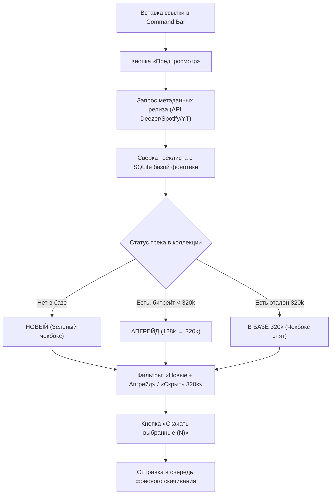
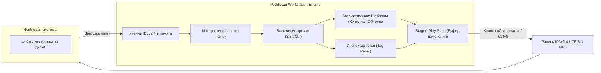

# Music Manager STUDIO — Руководство пользователя

> **Версия:** 2.4 Studio Edition  
> **Стек:** Go Core Engine, SQLite WAL, yt-dlp + ffmpeg Audio Pipeline, ID3v2.4 Metadata Engine, Alpine.js / Tailwind CSS (No-Build Web GUI).

---

## 1. Что умеет Music Manager STUDIO

**Music Manager STUDIO** — персональная веб-станция для загрузки, каталогизации, пакетного редактирования тегов и аудита музыкальной коллекции.

Сервис решает главную задачу коллекционера: сохраняет всю фонотеку в едином студийном качестве без дубликатов, битых файлов и мусорных метаданных.

```
                         МУЛЬТИСОРС-АРХИТЕКТУРА СЕРВИСА
                     
   [ Потоковые сервисы ]     [ Торренты / Magnet ]     [ Внешние каталоги ]
   Deezer / Spotify / YT      BitTorrent Engine        Deezer / MusicBrainz
   SoundCloud / Apple / ЯМ                                   Shazam
              │                         │                       │
              ▼                         ▼                       ▼
      ┌─────────────────────────────────────────────────────────────┐
      │               Music Manager STUDIO Core Engine              │
      │  ┌───────────────────────┐       ┌───────────────────────┐  │
      │  │ Pre-Flight Inspector  │       │ Candidate Matcher     │  │
      │  │  (Защита дубликатов)  │       │ (Контроль версий/LRC) │  │
      │  └───────────────────────┘       └───────────────────────┘  │
      └──────────────────────────────┬──────────────────────────────┘
                                     │
                                     ▼
      ┌─────────────────────────────────────────────────────────────┐
      │                      Медиатека на диске                     │
      │           MP3 320 kbps CBR / ID3v2.4 UTF-8 / .lrc           │
      └─────────────────────────────────────────────────────────────┘
```

### Основные термины

При первом знакомстве с системой вам встретятся четыре ключевых понятия:

- **CBR 320 kbps** (*Constant Bitrate*, постоянный битрейт) — максимальный стандарт качества MP3. В отличие от плавающего битрейта (VBR), звук кодируется с постоянной плотностью 320 килобит в секунду без потерь на сложных фрагментах.
- **ID3v2.4 UTF-8** — современный международный стандарт тегов аудиофайлов. Корректно отображает имена исполнителей и названия на любых языках, поддерживает несколько артистов и обложки высокого разрешения.
- **LRC** — текстовый файл с расширением `.lrc`, где каждая строка песни синхронизирована с таймкодом. Плеер использует его для бегущей строки караоке.
- **Pre-Flight Check** (предполетная проверка) — автоматическая сверка треклиста релиза с вашей базой на диске перед запуском скачивания.

---

### Ключевые возможности системы

- **Скачивание и нормализация:** загружаем треки, альбомы и дискографии по ссылкам или торрентам. Автоматически перекодируем аудио в стандарт **MP3 320 kbps CBR / 44.1 kHz**.
- **Защита от дубликатов:** перед скачиванием сверяем треки с локальной базой SQLite. Предлагаем обновить треки с низким качеством (например, 128 kbps до 320 kbps) и отсекаем повторы.
- **Выбор дорожек и проверка цензуры:** находим альтернативные версии трека на SoundCloud и YouTube. Быстро отслушиваем сомнительные фрагменты по таймкодам, отличая Explicit-версии от запиканных Clean-версий.
- **Студийный редактор тегов Puddletag Grid:** редактируем теги в таблице с поддержкой горячих клавиш. Массово меняем регистр, нумеруем треки, убираем мусор из названий и синхронизируем имена файлов.
- **Чистота метаданных:** записываем теги строго в стандарте ID3v2.4 с поддержкой мульти-артистов через нулевой байт (`\x00`). Тексты сохраняем во внешние файлы рядом с треком, не утяжеляя сам MP3.
- **Встроенный плеер:** слушаем музыку в нижнем стики-плеере без прерывания навигации. Доступен полноэкранный режим с анализатором спектра и радиостанция фонотеки.

---

### Как войти в систему

1. Откройте адрес сервиса в браузере (по умолчанию `http://localhost:8080`).
2. В правом верхнем углу нажмите кнопку **Войти**.
3. Введите логин и пароль администратора из файла конфигурации `.env`.
4. Сервис сохранит безопасную сессионную cookie (`httpOnly`, `SameSite=Strict`). В верхней панели появится имя пользователя и кнопка выхода.

---

## 2. Как устроен интерфейс

Интерфейс спроектирован по принципам профессиональных аудиостанций: высокая контрастность, плотное размещение данных и полное управление с клавиатуры.

```
 ┌────────────────────────────────────────────────────────────────────────────────────────┐
 │ [♪ Studio]  [ Поиск по медиатеке... (Ctrl+K) ]   [Загрузчик] [Файлы] [Аудит]... [User]│
 ├────────────────────────────────────────────────────────────────────────────────────────┤
 │                                                                                        │
 │                                                                                        │
 │                               РАБОЧАЯ ОБЛАСТЬ ВКЛАДКИ                                  │
 │                                                                                        │
 │                                                                                        │
 ├────────────────────────────────────────────────────────────────────────────────────────┤
 │ [Обложка] Трек — Исполнитель   ⏮ [ ▶ ] ⏭  01:23 ━━━━━●━━━━━ 03:45   🔊 ━━●━  [⤢] [✕]  │
 └────────────────────────────────────────────────────────────────────────────────────────┘
```

### Верхняя панель (Studio Console)

- **Индикатор статуса:** показывает активность движка `STUDIO Audio Engine`.
- **Быстрый поиск (`Ctrl+K`):** полнотекстовый поиск по всей локальной фонотеке. Ищет одновременно исполнителей, альбомы и отдельные треки.
- **Вкладки рабочих пространств:**
  - `Загрузчик` — командная строка загрузок, прогресс и управление очередью.
  - `Файлы` — таблица тегов Puddletag, инспектор метаданных и проводник.
  - `Аудит` — проверка фонотеки: битрейт, дубликаты, обложки и тексты песен.
  - `Радар` — отслеживание свежих релизов любимых артистов.
  - `Радио` — бесконечное воспроизведение треков библиотеки по жанрам и авторам.
  - `Плеер` — полноэкранная панель с визуализатором спектра и бегущей строкой текста.

---

### Адаптация для мобильных устройств

Интерфейс удобно открывать со смартфона с шириной экрана от 375 px:
- **Умная таблица:** второстепенные колонки скрываются. Исполнитель, альбом и битрейт отображаются под названием песни.
- **Крупные сенсорные зоны:** кнопки воспроизведения, паузы и навигации увеличены для комфортного нажатия пальцем.
- **Нижний плеер:** надежно фиксируется внизу экрана. Очередь загрузок сдвигается выше, не перекрывая кнопки плеера.

---

## 3. Как скачивать треки и альбомы

Командная панель загрузчика находится на вкладке **Загрузчик**. Она поддерживает три режима работы: одну ссылку, список адресов и локальные торрент-файлы.

### Доступные источники загрузки

По умолчанию включен режим **Автоопределение**: парсер распознает тип ссылки сам. При необходимости выберите источник вручную.

| Источник | Что можно скачать | Особенности |
|---|---|---|
| **Deezer** | Треки, альбомы, дискографии | Загрузка с метаданными ISRC и точными тегами ID3v2.4 |
| **YouTube / YT Music** | Видео, треки, плейлисты | Быстрый аудиопоток с конвертацией в 320 kbps |
| **SoundCloud** | Треки, сеты, плейлисты | Прямой поиск независимых треков и ремиксов |
| **Spotify** | Метаданные альбомов и плейлистов | Поиск эталонного аудиопотока в потоковых базах |
| **Apple Music** | Релизы и треклисты | Парсинг официальных метаданных каталога Apple |
| **Яндекс Музыка** | Альбомы, сборники, плейлисты | Полный треклист с сохранением обложек |
| **Торренты / Magnet** | Раздачи BitTorrent | Скачивание целых альбомов и дискографий |

---

### Режимы добавления задач

#### 1. Режим «Одна ссылка» (Single URL)
Подходит для загрузки отдельного трека, альбома или плейлиста.
1. Вставьте ссылку в поле ввода. Можно использовать кнопку **Вставить** из буфера.
2. Для профиля артиста загорится кнопка **Дискография** — нажмите её, чтобы увидеть все релизы музыканта.
3. Нажмите **Предпросмотр** для проверки треклиста или **Скачать** для прямой отправки в очередь.

#### 2. Режим «Список» (Batch URL)
Подходит для пакетной загрузки от 1 до 20 ссылок за раз.
1. Переключите тумблер режима на **Список**.
2. Вставьте ссылки — по одной ссылке на каждую строку.
3. Проверьте количество распознанных адресов на счетчике справа.
4. Нажмите **Добавить в очередь**. Задачи запустятся в фоновом режиме.

#### 3. Режим «.torrent» (Торрент-файлы)
Подходит для скачивания раздач через локальные `.torrent` файлы:
- Перетащите файл `.torrent` прямо в поле командной строки.
- Либо нажмите кнопку **.torrent** и выберите файл на диске.
- Сервис распакует список дорожек и запустит фоновое скачивание.

---

## 4. Как избежать дубликатов с помощью Pre-Flight Check

Режим **Pre-Flight Check** проверяет треклист до начала загрузки. Он защищает фонотеку от повторов и не позволяет случайно перезаписать качественный трек плохим файлом.



### Как запустить проверку

1. Вставьте адрес релиза в командную строку.
2. Нажмите кнопку **Предпросмотр**.
3. Сервис обратится к источнику, получит треклист и сравнит каждую дорожку с базой на диске.

---

### Что означают статусы треков

| Бейдж | Цвет | Что означает | Реакция системы |
|---|---|---|---|
| `НОВЫЙ` | Зеленый | Трека еще нет в вашей коллекции. | Чекбокс отмечен. Трек готов к загрузке. |
| `АПГРЕЙД` | Янтарный | Песня уже есть на диске, но с низким битрейтом (128–256 kbps). | Чекбокс отмечен. Рекомендуем обновить до 320 kbps. |
| `В БАЗЕ` | Серый | В коллекции уже лежит эталонная копия 320 kbps. | Чекбокс снят. Защищает от дублирования. |

> [!TIP]
> Наведите курсор на статус `АПГРЕЙД` или `В БАЗЕ`, чтобы увидеть путь к уже сохраненному файлу на диске.

---

### Быстрые фильтры выбора

В шапке окна предпросмотра расположены кнопки быстрой настройки выбора:
- **Новые + Апгрейд:** отмечает недостающие треки и композиции, требующие улучшения качества.
- **Только новые:** снимает отметки с апгрейдов и оставляет только треки, которых совсем нет на диске.
- **Скрыть треки 320k:** убирает из таблицы песни, которые уже есть в коллекции в идеальном качестве.
- **Чекбокс `#` в шапке:** выделяет все видимые строки или снимает выбор со всех треков сразу.
- **Скачать выбранные (N):** отправляет в очередь только отмеченные композиции.

---

## 5. Как контролировать загрузку и выбирать версии треков

После старта загрузки статус отображается в строке активной задачи (**Studio Telemetry Bar**).

```
 ┌────────────────────────────────────────────────────────────────────────────────────────┐
 │ DOWNLOADING  Скачивание: The Midnight - Sunset               (3/10) 45% ━━━━━━●━━━━━  │
 ├────────────────────────────────────────────────────────────────────────────────────────┤
 │ 1. Shadows ................... 03:45  [Оригинал]  [▶ Preview]  [Версии (3) ▼]          │
 │ 2. Sunset .................... 05:24  [Совпадение] [▶ 01:14 «вещества» КоАП]           │
 └────────────────────────────────────────────────────────────────────────────────────────┘
```

### Этапы обработки задачи

1. `QUEUED` — задача ждет свободный рабочий поток в пуле.
2. `RESOLVING` — парсим метаданные и находим источники звука.
3. `DOWNLOADING` — скачиваем аудиопоток во временную папку `tmp_downloads/{job_id}/`.
4. `CONVERTING` — перекодируем аудио через ffmpeg в MP3 320 kbps CBR (44.1 kHz).
5. `TAGGING` — записываем теги ID3v2.4 UTF-8 и сохраняем файл текста `.lrc`.
6. `READY` — файлы готовы к переносу в основную медиатеку.
7. `ERROR` — произошла ошибка. Сервис выведет подробное пояснение в логе.

---

### Как проверить цензуру (Quick-Listen Spots)

Если к треку найден текст, система проверяет слова на ненормативную лексику и цензурные пропуски:
- **Розовый бейдж `КоАП`:** упоминание запрещенных тем или веществ.
- **Янтарный бейдж:** подозрение на заглушенный или вырезанный фрагмент.
- **Кнопка `▶ 01:24 «слово»`:** запускает воспроизведение за 3 секунды до спорного фрагмента. Вы за секунды поймете, скачалась полная версия (*Explicit*) или запиканная версия (*Clean Edit*).

---

### Как выбрать альтернативную версию трека

Если найдено несколько вариантов дорожки на YouTube или SoundCloud, используйте меню версий:
- **Бейджи точности:**
  - `Оригинал` (зеленый) — официальный релиз исполнителя.
  - `Совпадение` (янтарный) — альтернативный источник с разницей времени не более 2 секунд.
  - `Не проверено` (серый) — совпадение без подтверждения эталоном.
  - `Предупреждение` — низкая точность совпадения по названию.
- **Кнопка «Версии (N)»:** открывает список всех найденных источников.
  - Кнопка **Preview** — включает 15-секундный отрывок трека прямо из сети без сохранения на диск.
  - Кнопка **Выбрать** — мгновенно меняет аудиоисточник для этого трека.

---

### Что делать по завершении загрузки

Когда релиз перейдет в статус `READY`, выберите действие:
- **Принять в медиатеку:** перемещает файлы из временной папки в структуру `MUSIC_DIR` (`{Artist}/{Album}/{Track} - {Title}.mp3`).
- **Редактировать теги:** открывает скачанный релиз в таблице Puddletag Grid для ручной доводки названий и авторов.
- **Редактировать всё (N):** открывает сразу все завершенные релизы одной общей таблицей.
- **Повторить:** перезапускает упавшую задачу при сетевом сбое.

---

### Управление фоновой очередью

- **Пауза / Возобновить:** временно останавливает запуск следующих задач.
- **Ошибки (N):** перезапускает упавшие задачи одним кликом.
- **В теги всё (N):** открывает все готовые альбомы в редакторе метаданных.
- **Очистить:** удаляет выполненные задачи из истории списка.
- **Плавающая кнопка очереди:** доступна в нижнем правом углу на любой вкладке сервиса.

---

## 6. Как редактировать теги в Puddletag Grid

Вкладка **Файлы** — это полноценная рабочая станция для работы с тегами, аналогичная десктопным программам Puddletag и Mp3tag.



### Навигация по папкам

- **Хлебные крошки:** строка пути для быстрого возврата к папке исполнителя или в корень коллекции.
- **Чекбокс «Подпапки»:** загружает все аудиофайлы из вложенных папок в одну общую таблицу.
- **Фильтр таблицы:** мгновенно ищет нужные строки по автору, песне или альбому прямо в браузере.
- **Действия с папкой:** кнопка **Перекачать** отправляет альбом в загрузчик заново, а кнопка **Удалить** стирает папку с диска после подтверждения.

---

### Работа с таблицей тегов

- **Быстрое редактирование:** дважды кликните по любой ячейке, чтобы изменить текст или номер.
  - `Enter` — подтвердить ввод и перейти к строке ниже.
  - `Tab` / `Shift+Tab` — сохранить и перейти к следующей или предыдущей колонке.
  - `Escape` — отменить правку.
- **Подсветка несохраненных правок:**
  - Измененные строки отмечаются желтой полосой слева.
  - Отредактированные ячейки подсвечиваются мягким янтарным фоном.
  - Количество измененных треков видно на кнопке: `Сохранить (3)`.
- **Индикаторы формата:**
  - `Кбит` — битрейт файла (например, `320k`).
  - `Время` — длительность в формате `ММ:СС`.
  - `LRC` — наличие текста: белый значок `LRC` (синхронизированный), голубой значок `TXT` (обычный текст), прочерк `—` (текста нет).

---

### Боковой инспектор тегов (Studio Tag Inspector)

Панель расположена справа от таблицы и предназначена для пакетной правки выделенных песен:
- **Управление обложкой:**
  - Перетащите файл картинки (JPEG, PNG или WebP) прямо на окно обложки.
  - Кнопка **Загрузить** — выбирает изображение через стандартный проводник.
  - Кнопка **Удалить** — убирает встроенную обложку из выделенных файлов.
- **Пакетная замена полей:**
  - Если у выделенных песен разные значения (например, разные названия), поле покажет подсказку `<Разные значения>`.
  - Если ввести новое значение (например, общий Жанр или Год), оно применится ко всем выбранным песням одновременно.

> [!IMPORTANT]
> Если у песни несколько исполнителей, разделяйте их **двойным обратным слэшем** `\\` (например: `The Midnight\\Ollie Wride`). Сервис запишет их в ID3v2.4 через байт `\x00` по международному стандарту.

---

### Инструменты автоматизации

#### 1. Базы тегов (Онлайн-каталоги)
Кнопка **Базы** опрашивает каталоги **Deezer**, **MusicBrainz** и распознает треки через **Shazam**:
- Сверяет треклист найденного альбома со строками вашей таблицы.
- В один клик переносит недостающие данные: обложку высокого разрешения, год выпуска, жанр и коды ISRC.

#### 2. Теги → Файл (`Т→Ф`)
Переименовывает файлы на диске на основе сохраненных тегов. Автоматически заменяет запрещенные символы файловой системы (`/ \ : * ? " < > |`) на безопасные аналоги.

#### 3. Очистка (`✨`)
Убирает лишний мусор из названий в один клик:
- Удаляет стартовые номера: `"01. Song"` превращается в `"Song"`.
- Переносит соавторов из скобок `(feat. Artist)` или `[ft. Artist]` прямо в поле «Исполнитель».
- Удаляет технические суффиксы: `[Official Video]`, `(Remastered 2021)`, `[4K]`.
- Убирает двойные пробелы и висячие точки на концах строк.

#### 4. Поиск и замена (`Замена`)
Находит и заменяет текст во всех выделенных дорожках. Поддерживает регулярные выражения (**Regex**) и выбор целевых колонок (только Название, Исполнитель или Альбом).

#### 5. Мультисервисный подбор обложек (Боковая панель)
В блоке «Инспектор тегов» доступна кнопка **Поиск** (а также быстрое действие при наведении на обложку):
- Ищет обложки ультравысокого разрешения сразу в 4 сервисах: **Apple Music** (1400×1400), **Deezer** (1400×1400), **Яндекс Музыка** (1000×1000) и **MusicBrainz Cover Art Archive** (1000×1000).
- Предоставляет удобную фильтрацию по каталогам, отображение разрешения и размера.
- При нажатии «Выбрать» сразу привязывает обложку ко всем трекам альбома и вшивает её при сохранении.

---

### Как сохранить изменения на диск

- Нажмите кнопку **Сохранить (N)** вверху таблицы или комбинацию **Ctrl+S** (**Cmd+S** на macOS).
- Сервис перезапишет теги в файлах MP3 и обновит поисковую базу данных.
- Кнопка **Сброс (↺)** отменяет все несохраненные правки и возвращает исходные значения.

---

## 7. Как слушать музыку во встроенном плеере

Внизу экрана закреплена панель воспроизведения (**Studio Audio Console**). Она позволяет слушать треки без пауз во время поиска, скачивания или редактирования тегов.

```
 [Обложка]  Sunset                        ⏮  [ ▶ ]  ⏭   01:14 ━━━━━●━━━━━━━ 05:24   🔊 ━━●━  [⤢] [✕]
            The Midnight • Endless Summer               (Space)                    (M)
```

### Основные элементы управления

- **Воспроизведение и пауза:** кнопка по центру или клавиша `Space` (Пробел).
- **Переключение треков:** кнопки ⏮ и ⏭ для перехода к следующей или предыдущей песне.
- **Перемотка (Scrubber):** кликните в любое место полосы времени или используйте стрелки клавиатуры `←` и `→` (шаг 5 секунд).
- **Громкость и отключение звука:** ползунок справа, клик по иконке динамика или клавиша `M` для мгновенного отключения звука.
- **Полноэкранный режим:** клик по обложке или кнопке `[⤢]` переносит вас на вкладку **Плеер** с анализатором частот и караоке-текстом.

---

## 8. Горячие клавиши и сценарии работы

### Сводная таблица горячих клавиш

| Клавиша | Где работает | Действие |
|---|---|---|
| `Ctrl+K` (`Cmd+K`) | Везде | Открыть строку глобального поиска по медиатеке |
| `Ctrl+S` (`Cmd+S`) | Таблица тегов | Записать все изменения тегов в файлы на диске |
| `Escape` | Везде | Закрыть модальное окно или отменить редактирование ячейки |
| `Delete` | Таблица тегов | Удалить выбранные треки с диска |
| `Двойной клик` | Таблица тегов | Начать редактирование ячейки |
| `Enter` | Ячейка таблицы | Сохранить значение и перейти к строке ниже |
| `Tab` | Ячейка таблицы | Сохранить значение и перейти к следующей ячейке |
| `Shift + Tab` | Ячейка таблицы | Сохранить значение и перейти к предыдущей ячейке |
| `Shift + Клик` | Таблица треков | Выделить непрерывный список треков от последнего выбранного |
| `Ctrl + Клик` | Таблица треков | Выбрать несколько отдельных треков |
| `Space` (Пробел) | Вне полей ввода | Воспроизведение / Пауза в аудиоплеере |
| `→` (Стрелка вправо)| Вне полей ввода | Перемотка аудио на 5 секунд вперед |
| `←` (Стрелка влево) | Вне полей ввода | Перемотка аудио на 5 секунд назад |
| `M` | Вне полей ввода | Включить или выключить звук (Mute) |
| `L` | Вне полей ввода | Зациклить текущую песню по кругу (Loop) |

---

### Пошаговые сценарии

#### Как обновить старый альбом со 128 до 320 kbps без дубликатов
1. Скопируйте ссылку на альбом из Spotify, Deezer или Яндекс Музыки.
2. Вставьте адрес в командную строку загрузчика и нажмите **Предпросмотр**.
3. В окне Pre-Flight Check обратите внимание на статус:
   - Треки, которые уже лежат в папке в низком качестве, получат статус `АПГРЕЙД` и будут отмечены галочками.
   - Треки, которые уже есть в качестве 320 kbps, получат статус `В БАЗЕ` со снятыми галочками.
4. Нажмите **Скачать выбранные**.
5. После загрузки нажмите **Принять в медиатеку**. Старые файлы низкого качества заменятся новыми файлами 320 kbps с сохранением названий папок.

#### Как быстро привести в порядок теги, обложки и имена файлов в новой папке
1. Перейдите на вкладку **Файлы** и откройте нужный каталог.
2. Нажмите главный чекбокс `#` в верхнем левом углу, чтобы выделить все файлы.
3. В панели инструментов нажмите **Очистка (`✨`)**: номера уберутся из названий, а соавторы перенесутся в поле артиста.
4. В боковой панели обложки нажмите **Поиск** и выберите подходящую обложку высокого разрешения из Apple Music, Deezer, Яндекс Музыки или MusicBrainz.
5. Нажмите **Теги→Файл (`Т→Ф`)**, выберите шаблон `%track% - %title%` и нажмите **Переименовать файлы на диске**.
6. Нажмите **Ctrl+S** для окончательной записи тегов в MP3 файлы.

#### Как скачать всего 3 нужных трека из плейлиста на 100 песен
1. Вставьте ссылку на плейлист в строку загрузчика и нажмите **Предпросмотр**.
2. Дождитесь появления треклиста в окне проверки.
3. Снимите выбор со всех песен кликом по главному чекбоксу `#` в шапке таблицы.
4. Отметьте галочками только 3 нужные композиции.
5. Нажмите **Скачать выбранные (3)**. Система скачает только выбранные песни и сбережет дисковое пространство.

---

### Часто задаваемые вопросы (FAQ)

#### Почему кнопка «Сохранить» в Puddletag не нажимается?
Кнопка активна только тогда, когда в таблице есть реальные несохраненные правки, либо открыта приемка только что скачанного релиза. Если изменений нет, кнопка неактивна, чтобы защитить файлы от лишней перезаписи на диске.

#### Как правильно указать нескольких исполнителей?
Указывайте артистов через двойной обратный слэш: `Артист 1\\Артист 2`. Система запишет их в стандартный ID3v2.4 фрейм через нулевой байт `\x00`.

#### Что делать, если трек скачался без обложки?
Выделите альбом во вкладке **Файлы**, нажмите кнопку **Базы**, выберите найденный релиз в Deezer или MusicBrainz и нажмите «Применить обложку». Также можно перетащить любую картинку прямо в квадрат **Artwork Box** на правой панели тегов.

#### Что делать, если скачалась версия с цензурой?
В строке активной задачи нажмите кнопку **Версии (N)**, найдите альтернативный источник с пометкой `Explicit`, нажмите **Preview** для 15-секундного прослушивания и нажмите **Выбрать**. Аудиопоток заменится автоматически.

#### Где сохраняются тексты песен?
Тексты песен сохраняются во внешние файлы `.lrc` (синхронизированные с таймкодами) или `.txt` (простой текст) рядом с файлом MP3. Тексты никогда не вшиваются внутрь MP3 тегов, сохраняя компактный размер аудиофайла.
