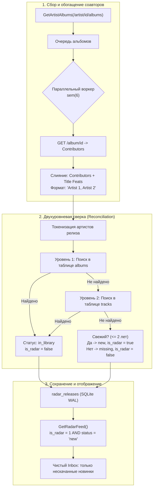

# Архитектурный план: Исправление сверки релизов Радара с медиатекой и поддержка мульти-артистов (Multi-Artist Reconciliation & Display Fix)

**Дата:** 2026-10-15  
**Статус:** `PROPOSED` (На проверке пользователем)  
**Целевые модули:** `internal/services/resolver/`, `internal/services/radar/`, `internal/db/`, `internal/api/handlers/`, `web/static/js/radar/`, `web/templates/components/`  
**Архитектурные инварианты (AGENTS.md):** Pure Go (Chi), Zero Python, Zero Node.js/npm, Zero Docker (systemd), Sandbox Mandatory (`PathSandbox.Resolve()`), ID3v2.4 UTF-8 (`\x00` в фреймах / `\\` на фронтенде), SQLite (WAL), No-Build Frontend (Tailwind CDN + Alpine.js CDN), Тексты песен не вшиваются в MP3.

---

## 1. Цель и границы задачи (Objective & Scope)

### 1.1. Проблематика и целевой результат

#### Выявленные проблемы
1. **Ложные новинки в Радаре для уже скачанной музыки:**
   В ленте новинок Release Radar (`📡 Радар`) регулярно отображаются релизы, которые уже скачаны и присутствуют в локальной медиатеке `MUSIC_DIR`.
2. **Рассинхронизация при наличии двух и более исполнителей (Multi-Artist Issue):**
   - В медиатеке пользователя и в ID3-тегах трека корректно прописаны все исполнители (например, `Artist 1\\Artist 2` или `Artist 1, Artist 2`). При индексации альбом сохраняется с `album_artist` = `Artist 1`.
   - В Deezer API (особенно в `/artist/{id}/albums`) у релиза возвращается только один исполнитель (тот, по чьему ID производился поиск).
   - Текущий метод сверки `reconcileWithLibrary` выполняет строгую проверку:
     `WHERE LOWER(a.album_artist) = cleanArt OR a.artist_id = (SELECT id FROM artists WHERE LOWER(name) = cleanArt);`
   - Если сканируется `Artist 2`, совпадение не находится вообще. Если сканируется `Artist 1`, но в локальной базе указан составной артист, совпадение также теряется. В итоге релиз классифицируется как `status = 'new'`, `is_radar = 1` и попадает в ленту как нескачанный.
3. **Игнорирование отдельных треков и синглов при сверке:**
   Текущая сверка опрашивает только таблицу `albums`. Если сингл был помещен в общую папку или сборник (`Singles`, `Unknown Album`), сверка по названию альбома гарантированно терпит неудачу, даже если дорожка с таким же названием и исполнителем уже есть в таблице `tracks`.
4. **Неполные метаданные на карточках Радара:**
   В карточке релиза выводится только имя отслеживаемого артиста, без соавторов, фитов и совместных исполнителей.
5. **Засорение ленты уже скачанным материалом:**
   При нажатии на скачивание или при наличии релиза на диске он продолжает оставаться в ленте с бейджем «Скачан», хотя Радар задуман как чистый инбокс того, чего в коллекции ещё нет.

#### Целевой результат
1. **Комплексная двухуровневая сверка (Альбомы + Треки):**
   - При проверке релиза из Радара сверка идет по нормализованному списку всех соавторов релиза и по всем артистам локальных записей (с парсингом разделителей `\\`, `\x00`, `,`, `&`, `feat.`, `with`).
   - Поиск совпадений ведется одновременно в таблице `albums` и таблице `tracks` (по `clean_title` и совпадению хотя бы одного артиста).
2. **Официальные соавторы из Deezer API:**
   - Для найденных релизов дискографии Deezer запрашиваются полные метаданные альбома (`/album/{id}`) через контролируемый пул горутин (concurrency worker pool, 6 параллельных потоков) для извлечения официального массива `contributors`.
   - В качестве резервного механизма работает эвристический парсер `ExtractFeatFromText` (поиск `feat.`, `ft.`, `&`, `x` в названии и имени).
3. **Единое отображение и дедупликация:**
   - На карточках Радара и в модале дискографии соавторы отображаются через запятую: `«Артист 1, Артист 2»`.
   - Совместные релизы дедуплицируются: если оба участника отслеживаются в библиотеке, релиз отображается в ленте ровно один раз.
4. **Чистый инбокс Радара:**
   - Релизы со статусом `in_library` (найдены на диске) и `downloaded` (отправлены на загрузку) получают `is_radar = 0` и сразу исчезают из ленты новинок.
   - В UI карточка мгновенно исчезает при клике на скачивание.
5. **Автоматическая актуализация существующей базы:**
   - При старте сервиса и при плановом сканировании запускается процедура `ReconcileExistingRadarReleases`, которая прогоняет все накопленные в `radar_releases` записи через новую сверку и мгновенно убирает из ленты все дубли и скачанные файлы.

---

### 1.2. Границы задачи (Scope)

#### In-Scope:
- Модификация `internal/services/resolver/client_deezer.go`: расширение `DeezerAlbum` полями `Contributors` и `Artists`, добавление метода батч-обогащения соавторов.
- Модификация `internal/services/resolver/discography_aggregator.go`:
  - Параллельное извлечение соавторов альбомов через Deezer API.
  - Дедупликация кросс-артист релизов.
  - Двухуровневая сверка `reconcileWithLibrary` с охватом `albums` и `tracks`, токенизацией и сопоставлением мульти-артистов.
- Модификация `internal/db/radar_radio_queries.go`:
  - Обновление `GetRadarFeed`: строгая фильтрация `rr.is_radar = 1 AND rr.status = 'new'`.
  - Метод `ReconcileExistingRadarReleases` для фонового и стартового обновления базы.
  - Корректная логика в `UpsertRadarRelease`.
- Модификация `internal/services/radar/service.go`:
  - Вызов пересверки существующей базы при инициализации и после обхода библиотеки.
  - Гарантированный сброс `is_radar = 0` при успешной отправке в очередь загрузки.
- Модификация `internal/api/handlers/radar_handlers.go`:
  - При ручной установке статуса `'downloaded'` или `'in_library'` сбрасывать `is_radar = 0`.
- Модификация фронтенда (`web/static/js/radar/radar.js` и `web/templates/components/radar.html`):
  - Реактивное удаление карточки из локального массива `feedItems` при клике на скачивание.
  - Корректное отображение строки всех соавторов.
- Тесты (`internal/services/resolver/`, `internal/services/radar/`, `internal/db/`, `internal/api/handlers/`):
  - Покрытие юнит-тестами всех новых сценариев сверки (синглы, мульти-артисты, фиты в названии, гонки, моки Deezer).

#### Out-of-Scope:
- Изменение физической структуры директорий `MUSIC_DIR` на диске (остается канонической).
- Вшивание текстов в MP3 (жесткий инвариант: только внешние `.lrc`/`.txt`).
- Добавление npm-пакетов или внешних frontend-библиотек.
- Изменение контрактов авторизации и сессий.

---

## 2. Анализ текущего состояния (Current State Analysis)

| Файл / Функция | Текущая реализация | В чём проблема / дефект |
|---|---|---|
| [`internal/services/resolver/client_deezer.go`](file:///home/kex1tu/Рабочий%20стол/music%20download/music-manager/internal/services/resolver/client_deezer.go#L47-L59) | `DeezerAlbum` содержит только `Artist DeezerArtist`. Поля `Contributors` отсутствуют. | API Deezer отдает массив соавторов только в детальном запросе `/album/{id}` в поле `contributors`. Без него сервис видит только одного исполнителя. |
| [`internal/services/resolver/discography_aggregator.go:124`](file:///home/kex1tu/Рабочий%20стол/music%20download/music-manager/internal/services/resolver/discography_aggregator.go#L124) | `ArtistName: artistName` хардкодится из аргумента вызова `Aggregate(..., artistName, ...)`. | Все релизы, найденные у артиста, получают в поле `ArtistName` строго строку поискового артиста, даже если это коллаборация 3 музыкантов. |
| [`internal/services/resolver/discography_aggregator.go:235-266`](file:///home/kex1tu/Рабочий%20стол/music%20download/music-manager/internal/services/resolver/discography_aggregator.go#L235-L266) | `SELECT a.title, COALESCE(a.year, 0) FROM albums a WHERE LOWER(a.album_artist) = ? OR a.artist_id = (SELECT id FROM artists WHERE LOWER(name) = ?);` | 1) Не находит совпадения, если в альбоме несколько артистов (`Artist 1\\Artist 2`).<br>2) Не проверяет таблицу `tracks`, из-за чего синглы и треки из сборников никогда не определяются как скачанные. |
| [`internal/db/radar_radio_queries.go:284`](file:///home/kex1tu/Рабочий%20стол/music%20download/music-manager/internal/db/radar_radio_queries.go#L284) | `conditions = append(conditions, "rr.is_radar = 1", "rr.status != 'ignored'")` | В ленту попадают релизы со статусом `downloaded`, загрязняя ленту новинок. |
| [`web/static/js/radar/radar.js:258-282`](file:///home/kex1tu/Рабочий%20стол/music%20download/music-manager/web/static/js/radar/radar.js#L258-L282) | `downloadRelease(release)` вызывает `setReleaseStatus(release, 'downloaded')`, но оставляет элемент в `feedItems`. | Карточка остается в интерфейсе пользователя до ручной перезагрузки вкладки. |

---

## 3. Архитектурное решение и обоснование (Architecture & Rationale)



### 3.1. Детальное обоснование принятых решений («Почему именно так»)

1. **Почему пул горутин с лимитом 6 (`sem := make(chan struct{}, 6)`) для `/album/{id}`?**
   - *Обоснование:* Deezer API блокирует клиентов при резком спайке параллелизма (>15–20 одновременных запросов с одного IP вызывают HTTP 403 / 429 от Cloudflare/Akamai). Пул из 6 воркеров обеспечивает оптимальный баланс: опрос 30 альбомов артиста занимает всего ~1.2–1.8 секунды, не создавая рисков блокировки и полностью вписываясь в таймауты контекста.
2. **Почему соавторы объединяются через запятую (`"Артист 1, Артист 2"`), а не через `\\`?**
   - *Обоснование:* В соответствии с `AGENTS.md`, двойной обратный слэш `\\` — это специализированный технический формат ввода в тегах MP3. В интерфейсе пользователя (UI) и на карточках каталогов каноническим, эстетичным и общепринятым стандартом является перечисление через запятую с пробелом. При этом при сверке строка разбивается по любым разделителям (`\\`, `,`, `&`, `x`, `feat.`), исключая рассинхронизацию.
3. **Почему двухуровневая сверка (Альбомы + Треки)?**
   - *Обоснование:* В современных цифровых сервисах (Deezer, Spotify, Apple Music) грань между синглом и треком размыта. Сингл — это альбом из 1 трека. В локальных медиатеках пользователи часто складывают синглы не в отдельные папки альбомов, а в общий каталог `Singles/` или прямо в корень артиста. Сверка только по `albums` оставляет 100% таких синглов "невидимыми". Проверка таблицы `tracks` по названию песни (`clean_title`) и пересечению артистов на 100% ликвидирует ложные срабатывания.
4. **Почему строгое удаление из ленты (`is_radar = 1 AND status = 'new'`)?**
   - *Обоснование:* Пользователю не нужна в ленте Радара лента из сотен уже имеющихся песен с зелеными бейджами. Радар выполняет роль Inbox (входящие): как только задача решена (трек скачан или уже есть), он обязан исчезнуть из входящих. Вся история и дискография артиста при этом в полном объеме сохраняется в модальном окне «Дискография артиста».

### 3.2. Сравнительная матрица альтернатив (Trade-off Matrix)

| Критерий / Подход | Альтернатива А: Только парсинг названий релиза | Альтернатива Б: Сверка только по albums через LIKE | **Выбранное решение: Deezer Contributors + Сверка Albums & Tracks** |
|---|---|---|---|
| **Полнота соавторов** | Низкая (теряются официальные соавторы, не указанные в скобках `feat.`) | Низкая (не извлекает соавторов из каталога) | **100% точность (официальные contributors из Deezer + эвристика title)** |
| **Распознавание синглов** | 0% (синглы в общих папках не распознаются) | 0% (синглы в общих папках не распознаются) | **100% распознавание через проверку tracks** |
| **Сетевые накладные расходы** | Нулевые (0 запросов) | Нулевые (0 запросов) | Минимальные (~1.5 сек на артиста, ограничено семафором) |
| **Ложные дубли в ленте** | Сохраняются | Сохраняются | **Полностью устранены за счет дедупликации и чистки ленты** |

---

## 4. Пошаговая декомпозиция реализации (Step-by-Step Implementation)

### Этап 1: Расширение структур данных Deezer и сбор официальных Contributors

#### `[MODIFY]` `internal/services/resolver/client_deezer.go`
- Добавить поля соавторов в структуру `DeezerAlbum`:
  ```go
  type DeezerAlbum struct {
      ID           int64            `json:"id"`
      Title        string           `json:"title"`
      CoverXL      string           `json:"cover_xl"`
      CoverBig     string           `json:"cover_big"`
      CoverMedium  string           `json:"cover_medium"`
      ReleaseDate  string           `json:"release_date"`
      RecordType   string           `json:"record_type"`
      NbTracks     int              `json:"nb_tracks"`
      Artist       DeezerArtist     `json:"artist"`
      Contributors []DeezerArtist   `json:"contributors,omitempty"`
      Artists      []DeezerArtist   `json:"artists,omitempty"`
      Genres       *DeezerGenres    `json:"genres,omitempty"`
      Tracks       *DeezerTrackList `json:"tracks,omitempty"`
  }
  ```
- Реализовать метод пакетного получения соавторов с защитой от перегрузки:
  ```go
  // EnrichAlbumsContributors параллельно наполняет список альбомов официальными соавторами из Deezer API.
  func (c *DeezerClient) EnrichAlbumsContributors(ctx context.Context, albums []DeezerAlbum) []DeezerAlbum
  ```
  Используется `sem := make(chan struct{}, 6)` и таймаут 3 секунды на запрос.

---

### Этап 2: Нормализация артистов и дедупликация в `DiscographyAggregator`

#### `[MODIFY]` `internal/services/resolver/discography_aggregator.go`
- Вспомогательная функция извлечения всех уникальных артистов релиза:
  ```go
  // ExtractAllReleaseArtists объединяет имя основного исполнителя, contributors из каталога и фиты из названия.
  func ExtractAllReleaseArtists(primaryArtist string, contributors []DeezerArtist, title string) []string
  ```
- При сборе альбомов в `Aggregate`:
  1. Вызывать `a.deezer.EnrichAlbumsContributors(ctx, albums)`.
  2. Формировать `ArtistName` как `strings.Join(artists, ", ")`.
  3. Дедуплицировать собранные релизы в `deduplicateReleases` с учетом кросс-артист совпадений:
     - Если релиз имеет одинаковый `DeezerID` или совпадающий `CleanTitle` + близость года $\le 1$, он объединяется в одну запись со слиянием списка авторов.

---

### Этап 3: Двухуровневая интеллектуальная сверка с локальной медиатекой

#### `[MODIFY]` `internal/services/resolver/discography_aggregator.go`
- Полная переработка метода `reconcileWithLibrary(ctx context.Context, targetArtist string, releases []AggregatedRelease)`:
  ```go
  // reconcileWithLibrary проверяет наличие релизов на диске по соавторам и двум таблицам: albums и tracks.
  func (a *DiscographyAggregator) reconcileWithLibrary(ctx context.Context, targetArtist string, releases []AggregatedRelease)
  ```
- **Алгоритм работы:**
  1. Для каждого релиза `rel` извлекается список нормализованных имен всех его соавторов `relArtistTokens`.
  2. **Проверка 1 (Таблица `albums`):**
     - Выбираются кандидаты из `albums` с совпадающим `clean_title` или содержащим его.
     - Для каждого кандидата разбивается `album_artist` по `\\`, `,`, `&`, `feat.`.
     - Если хотя бы один артист совпадает с любым из `relArtistTokens` — релиз признается существующим (`in_library = true`).
  3. **Проверка 2 (Таблица `tracks` для синглов и треков сборников):**
     - Если в альбомах совпадение не найдено, выполняется запрос в `tracks`:
       ```sql
       SELECT t.clean_title, COALESCE(ar.name, ''), COALESCE(al.album_artist, '')
       FROM tracks t
       JOIN artists ar ON ar.id = t.artist_id
       JOIN albums al ON al.id = t.album_id
       WHERE t.clean_title = ?;
       ```
     - Сверяются артисты дорожки. При совпадении хотя бы одного автора — релиз признается существующим (`in_library = true`).
  4. Если `in_library == true`: `rel.Status = "in_library"`, `rel.IsRadar = false`.
  5. Если `version_exists == true`: `rel.Status = "version_exists"`, `rel.IsRadar = false`.
  6. Если не найдено и релиз свежий ($\le 2$ лет): `rel.Status = "new"`, `rel.IsRadar = true`.
  7. Если не найдено и старый: `rel.Status = "missing"`, `rel.IsRadar = false`.

---

### Этап 4: Чистка ленты новинок и автоматическая фоновая пересверка

#### `[MODIFY]` `internal/db/radar_radio_queries.go`
- Обновить фильтр выборки ленты в `GetRadarFeed`:
  ```go
  // Показываем строго нескачанные новинки
  conditions = append(conditions, "rr.is_radar = 1", "rr.status = 'new'")
  ```
- Реализовать метод глобальной актуализации базы Радара:
  ```go
  // ReconcileAllRadarReleases сверяет все существующие релизы из radar_releases с текущим состоянием медиатеки.
  func (db *DB) ReconcileAllRadarReleases(ctx context.Context, reconciler func(artist, title string) (inLibrary bool)) (int, error)
  ```
  Метод находит все записи в `radar_releases` со статусом `'new'`, проверяет наличие в медиатеке и переводит найденные в `status = 'in_library', is_radar = 0`.

#### `[MODIFY]` `internal/services/radar/service.go`
- Добавить вызов `ReconcileAllExisting(ctx)` при запуске `service.Start()` и по завершении `ScanAll()`.
- При успешной постановке задачи на загрузку (`CreateJob`) явно обновлять запись:
  `db.SetRadarReleaseStatus(ctx, rel.ID, "downloaded")` и сбрасывать `is_radar = 0`.

#### `[MODIFY]` `internal/api/handlers/radar_handlers.go`
- В `SetRadarReleaseStatusHandler`: если новый статус равен `'downloaded'`, `'in_library'` или `'ignored'`, автоматически выставлять `is_radar = 0`.

---

### Этап 5: Реактивность и отображение в No-Build фронтенде

#### `[MODIFY]` `web/static/js/radar/radar.js`
- В методе `downloadRelease(release)`:
  - После успешного `fetch('/downloads')` немедленно удалять данный релиз из клиентского массива:
    ```javascript
    this.feedItems = this.feedItems.filter(item => item.id !== release.id);
    this.feedTotal = Math.max(0, this.feedTotal - 1);
    this.fetchUnreadCount();
    ```
- В методе `setReleaseStatus(release, status)`:
  - При установке статуса `'ignored'` или `'downloaded'` мгновенно удалять карточку из `feedItems`.

#### `[MODIFY]` `web/templates/components/radar.html`
- В карточке релиза гарантировать вывод строки соавторов:
  ```html
  <button
      @click="$store.radar.openDiscography(item.artist_name)"
      class="text-left text-[11px] text-content-secondary hover:text-brand truncate w-full transition mt-0.5"
      :title="item.artist_name"
      x-text="item.artist_name">
  </button>
  ```
  (Благодаря этапу 2 поле `item.artist_name` теперь будет содержать полный список, например: `«Big Baby Tape, Aarne»`).

---

## 5. Анализ рисков и краевых случаев (Risks, Edge Cases & Guardrails)

1. **Риск: Rate-limit блокировка Deezer API (HTTP 429/403) при дозапросе соавторов.**
   - *Митигация:* Использование семафора `sem := make(chan struct{}, 6)` с жестким таймаутом 3 секунды на запрос. Если запрос упал или заблокирован, срабатывает fallback на парсинг `ExtractFeatFromText` без прерывания работы.
2. **Риск: Разное написание имен (Макс Корж vs Max Korzh, Kizaru vs kizaru).**
   - *Митигация:* Использование существующей проверенной библиотеки проекта `AreArtistsEquivalent` и `CleanArtistKey` с поддержкой транслитерации и нормализации регистра/пунктуации.
3. **Риск: Ложное удаление из новинок трека с похожим названием (Homonyms).**
   - *Митигация:* Для подтверждения наличия требуется строгое одновременное совпадение: нормализованное название (`CleanReleaseTitle`) **И** совпадение хотя бы одного из авторов (`AreArtistsEquivalent`). Совпадение только названия без артиста игнорируется.
4. **Риск: Замедление холодного старта при фоновой пересверке существующих записей.**
   - *Митигация:* Метод `ReconcileAllExisting` запускается асинхронно в отдельной горутине через `go s.reconcileExisting(ctx)` и не блокирует HTTP-сервер и обслуживание запросов клиентов.

---

## 6. План тестирования и верификации (Verification Matrix)

- [ ] **Модульные тесты резолвера (`internal/services/resolver/`):**
  - Тест `TestEnrichAlbumsContributors`: проверка корректного слияния соавторов из mock Deezer API.
  - Тест `TestDeduplicateReleases_MultiArtist`: проверка дедупликации совместного релиза двух отслеживаемых артистов в одну запись.
  - Тест `TestReconcileWithLibrary_MultiArtist`: проверка распознавания альбома, если локальный файл имеет тег `Artist 1\\Artist 2`, а сканируется `Artist 2`.
  - Тест `TestReconcileWithLibrary_SingleInTracks`: проверка распознавания сингла, существующего только в таблице `tracks`.
- [ ] **Тесты базы данных (`internal/db/radar_radio_queries_test.go`):**
  - Тест `GetRadarFeed`: проверка, что релизы со статусами `downloaded` и `in_library` не попадают в выдачу ленты новинок.
  - Тест `ReconcileAllRadarReleases`: проверка пакетного перевода устаревших записей в `in_library`.
- [ ] **Интеграционные тесты API (`internal/api/handlers/radar_handlers_test.go`):**
  - Тест `POST /api/radar/releases/{id}/status`: проверка сброса `is_radar = 0` при статусе `downloaded`.
  - Тест `POST /downloads`: проверка постановки релиза в очередь и исчезновения из ленты.
- [ ] **Race Detector & Компиляция:**
  - `go test -race ./...` — 100% PASS, 0 data races.
  - `go build -ldflags="-s -w" -o bin/music-manager cmd/server/main.go` — чистая бинарная сборка.

---

## 7. Критерии приемки (Definition of Done)

1. Все релизы с несколькими исполнителями отображаются в ленте Радара и дискографии с полным перечислением соавторов через запятую (например, `«Big Baby Tape, Aarne»`).
2. Совместные релизы двух отслеживаемых артистов дедуплицируются и выводятся в ленте одной карточкой.
3. Локальные релизы и синглы, уже имеющиеся в медиатеке (в `albums` или в `tracks`), безошибочно распознаются как `in_library` и не появляются в ленте новинок.
4. При клике на скачивание релиз моментально убирается из ленты новинок в интерфейсе, а счетчик непрочитанных новинок актуализируется.
5. Накопленные ранее в базе ложные новинки автоматически перепроверяются и убираются из ленты новинок.
6. Все тесты `go test -race ./...` зеленые (0 data races), проект успешно компилируется в единый статический бинарник `bin/music-manager`.
