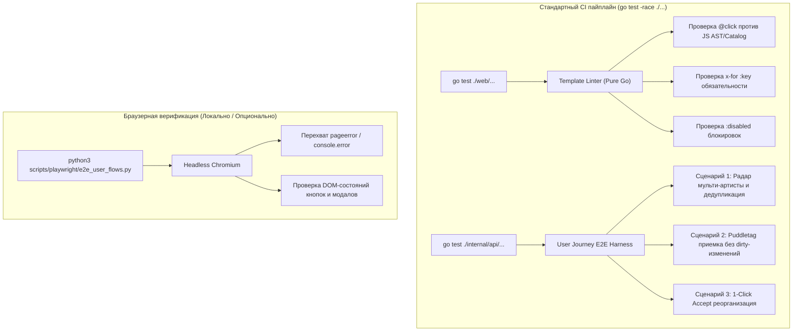

# Архитектурный план: Комплексное тестирование пользовательских сценариев (User Interaction Flows), статический анализ No-Build шаблонов и верификация E2E-пайплайнов

**Дата:** 2026-10-15  
**Статус:** `PROPOSED` (Ожидает подтверждения пользователем)  
**Целевые модули:** `web/`, `internal/api/`, `scripts/playwright/`, `cmd/server/`  
**Архитектурные инварианты (AGENTS.md):** Pure Go (Chi), Zero Python в сервере, Zero Node.js/Zero npm, Zero Docker, Sandbox Mandatory (`PathSandbox.Resolve()`), ID3v2.4 UTF-8, SQLite WAL, No-Build Frontend (Tailwind CDN + Alpine.js CDN).

---

## 1. Цель и границы задачи (Objective & Scope)

### 1.1. Проблематика
При разработке No-Build веб-сервиса на Alpine.js + Go отсутствие традиционного компилятора клиентского кода (Vite/Webpack/TypeScript) приводит к тому, что ошибки во взаимодействии пользователя с UI обнаруживаются только вручную:
1. **Сломанные обработчики и опечатки в шаблонах:**
   - Например, опечатка `@click="saveChanges()"` вместо `saveAllChanges()`. В обычном HTML браузер не выдает видимой ошибки пользователю, но метод не вызывается, а в консоли падает `TypeError: ... is not a function`.
2. **Конфликты логики блокировки действий (`:disabled` state lock):**
   - Например, блокировка кнопки сохранения тегов `:disabled="!hasDirtyChanges"` в режиме загрузчика (`isDownloaderMode`). Треки уже скачаны со всеми метаданными, пользователю не нужно ничего редактировать, но принять релиз в библиотеку невозможно без искусственного изменения полей.
3. **Дублирование сущностей в интерфейсе (Реактивность Alpine.js):**
   - При наличии совместных релизов или при отсутствии уникального `:key="item.id"` в циклах `<template x-for="...">` Alpine.js путает узлы DOM или оставляет фантомные дубликаты карточек после удаления/скачивания.
4. **Сквозные разрывы жизненного цикла (Queue & Sandbox):**
   - После сохранения треков задача должна атомарно удаляться из очереди `tmp_downloads` и обновлять отображение файлового менеджера без рассинхронизации.

### 1.2. Целевой результат
1. **Статический валидатор шаблонов Alpine.js на чистом Go (`web/template_validator_test.go`):**
   - Автоматически выполняется при каждом `go test ./web/...` и `go test ./...` (< 50 мс).
   - Сверяет все вызовы `@click`, `x-on:click`, `@submit` в шаблонах `web/templates/**/*.html` с объявленными функциями в `web/static/js/**/*.js` и методами `Alpine.store(...)`.
   - Проверяет наличие обязательного атрибута `:key` во всех циклах `x-for`.
   - Выявляет потенциально заблокированные кнопки действий (`:disabled`).
2. **Сквозные тесты пользовательских сценариев (Go User Journey Tests в `internal/api/`):**
   - Сквозное тестирование на реальном сокете `httptest.NewServer` с временной БД SQLite и тестовой песочницей.
   - Сценарии:
     - Радар: сканирование совместного релиза двух артистов -> дедупликация в 1 карточку -> скачивание -> исчезновение из ленты.
     - Puddletag в режиме загрузчика: сохранение чистого релиза без dirty-изменений -> реорганизация в медиатеку -> очистка `tmp_downloads`.
     - 1-Click Accept: мгновенное принятие из очереди задач.
3. **Headless Browser Test Harness на Python Playwright (`scripts/playwright/`):**
   - Изолированный от продакшена инструмент для тестирования реального браузерного DOM:
   - Перехватывает любые JS-ошибки (`pageerror`, `console.error`).
   - Проверяет интерактивность кнопок и переходов по вкладкам.

### 1.3. Границы задачи (Scope)
- **In-Scope:**
  - Создание `web/template_validator_test.go` (валидация шаблонов, вызовов методов, `:key`, `:disabled`).
  - Создание `internal/api/e2e_user_journey_test.go` (пользовательские сценарии Радара, Загрузчика, 1-Click Accept).
  - Создание `scripts/playwright/e2e_user_flows.py` и обновление скриптов проверки.
  - Создание `scripts/test_user_flows.sh` для быстрого запуска комплексной проверки.
- **Out-of-Scope:**
  - Добавление `package.json`, Node.js или npm в репозиторий проекта.
  - Изменение API-контрактов сервисов медиатеки или схемы БД.

---

## 2. Архитектурное решение и обоснование (Architecture & Rationale)



### Почему именно так:
1. **Валидация шаблонов на Go, а не на Node.js:**
   - Соответствует правилу `AGENTS.md` (Zero-Node.js инвариант).
   - Запускается мгновенно при обычном `go test ./...` на любой машине и в CI без внешних установок.
2. **Journey-тесты в `internal/api/` на `httptest.NewServer`:**
   - Тестируют не просто отдельные функции, а полные последовательности действий пользователя через HTTP-интерфейс, SQLite и файловую систему песочницы.
3. **Playwright на Python:**
   - Python 3 уже установлен на сервере и рабочих станциях Linux. Это позволяет запускать реальный браузер без необходимости внедрять npm/node_modules.

---

## 3. Пошаговая декомпозиция реализации (Step-by-Step Implementation)

### Этап 1: Статический валидатор No-Build шаблонов (`web/template_validator_test.go`)
- **[NEW] `web/template_validator_test.go`**
  - Чтение всех файлов из `web.Assets` (`templates/` и `static/js/`).
  - Парсинг HTML-узлов и атрибутов через регулярные выражения и токенизацию.
  - Сбор всех сигнатур функций:
    - Поиск `function funcName(` и `funcName(...) {` в `.js`.
    - Поиск методов объектов `return { method() { ... } }` в компонентах Alpine.
    - Поиск методов сторов `Alpine.store('app', { ... })`, `queue`, `player`.
  - Сверка каждого вызова `@click="name(...)"`:
    - Исключение встроенных выражений (например, `activeTab = 'radar'`, `show = false`).
    - Проверка имен вызываемых функций на присутствие в каталоге.
  - Проверка циклов `x-for`:
    - Если тег содержит `x-for=`, он обязан содержать `:key=`.
  - Проверка кнопок с `:disabled`:
    - Анализ условий блокировки.

### Этап 2: E2E тесты пользовательских сценариев (`internal/api/e2e_user_journey_test.go`)
- **[NEW] `internal/api/e2e_user_journey_test.go`**
  - Создание изолированного тестового сервера: чистая SQLite БД, временная папка `tmp_downloads` и временный `MUSIC_DIR`.
  - `TestUserJourney_RadarDeduplication`:
    - Вставка двух отслеживаемых артистов.
    - Симуляция релиза соавторов через `UpsertRadarRelease`.
    - Проверка `GetRadarFeed`: ровно 1 запись, отсутствие дубликатов.
    - Отправка запроса на скачивание `POST /api/radar/releases/{id}/download`.
    - Проверка: статус стал `downloaded`, в `GetRadarFeed` запись больше не возвращается.
  - `TestUserJourney_PuddletagDownloaderMode`:
    - Создание завершенной задачи в `tmp_downloads/{job_id}/` с MP3 файлом.
    - Вызов `POST /tags/batch` с параметрами: `reorganize: true`, `dirtyIndices: []` (без ручных правок).
    - Проверка: файл перемещен в `MUSIC_DIR/{Artist}/{Album}/{Track}.mp3`, задача удалена.
  - `TestUserJourney_OneClickAccept`:
    - Проверка логики `acceptJobDirectly` через эндпоинт пакетного сохранения.

### Этап 3: Браузерный тестовый скрипт Playwright (`scripts/playwright/e2e_user_flows.py`)
- **[NEW] `scripts/playwright/e2e_user_flows.py`**
  - Автоматический старт `./bin/music-manager` на порту 8099.
  - Авторизация сессии.
  - Проверка вкладок и перехват консольных ошибок:
    - Любой `pageerror` (ошибка JS) приводит к моментальному падению теста с указанием файла и строки.
  - Проверка кликабельности кнопок «Принять в медиатеку» и «Редактировать теги».

### Этап 4: Единый скрипт запуска аудита (`scripts/test_user_flows.sh`)
- **[NEW] `scripts/test_user_flows.sh`**
  - Запуск валидатора шаблонов и E2E тестов.
  - Вывод понятного отчета для разработчика.

---

## 4. План тестирования и верификации (Verification Matrix)

1. **Компиляция проекта:**
   ```bash
   go build -ldflags="-s -w" -o bin/music-manager cmd/server/main.go
   ```
2. **Запуск валидатора шаблонов:**
   ```bash
   go test -v ./web/ -run TestTemplate
   ```
3. **Запуск сквозных сценариев Go:**
   ```bash
   go test -v -race ./internal/api/ -run TestUserJourney
   ```
4. **Общий регрессионный прогон:**
   ```bash
   go test -race ./...
   ```
5. **Запуск браузерной верификации:**
   ```bash
   bash scripts/test_user_flows.sh
   ```

---

## 5. Критерии приемки (Definition of Done)

1. Валидатор `web/template_validator_test.go` успешно компилируется и проверяет 100% HTML-шаблонов проекта.
2. При намеренном внесении опечатки в `@click` в любом шаблоне тест `web/template_validator_test.go` падает с понятным описанием ошибки.
3. Все `x-for` в проекте имеют валидные `:key`.
4. Сквозные тесты `internal/api/e2e_user_journey_test.go` проверяют дедупликацию совместных релизов в Радаре и сохранение треков в Puddletag без dirty-изменений.
5. `go test -race ./...` выполняется со статусом 100% PASS и 0 состояний гонки.
