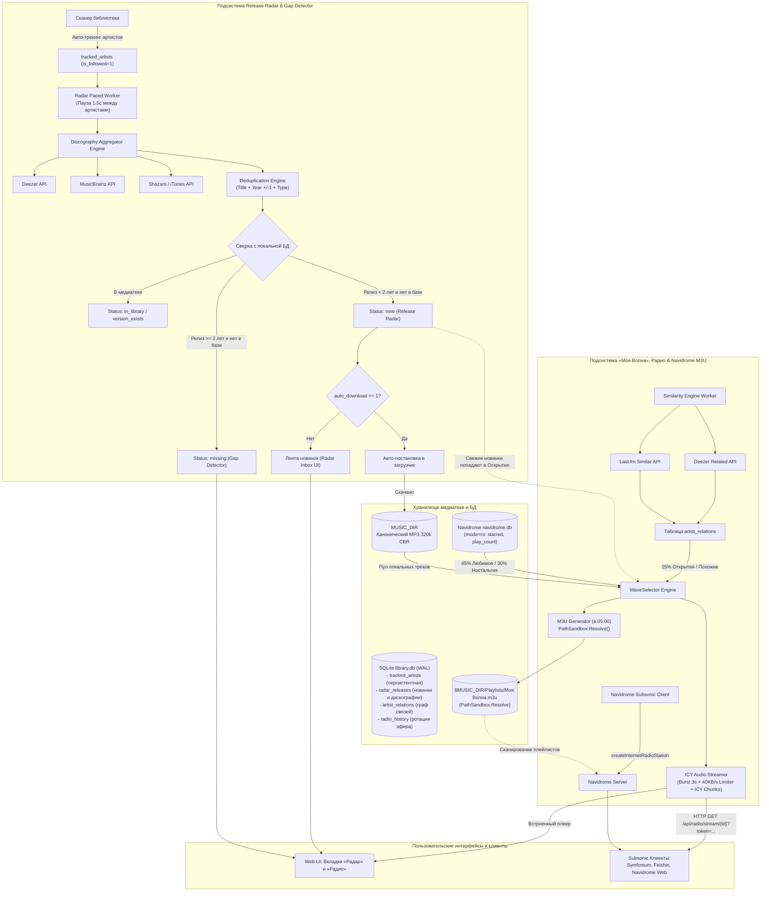

# Генеральный план реализации: Release Radar (Автозагрузка новинок & Gap Detector) и «Моя Волна» (Персональное радио, ICY-вещание & M3U для Navidrome)

**Дата:** 2026-10-14  
**Статус:** `PROPOSED`  
**Целевые модули:** `internal/config/`, `internal/db/`, `internal/services/resolver/`, `internal/services/radar/`, `internal/services/radio/`, `internal/services/scanner/`, `internal/api/handlers/`, `web/templates/`, `web/static/js/`  
**Архитектурные инварианты (AGENTS.md):** Pure Go (Chi), Zero Python, Zero Node.js/npm, Zero Docker (systemd), Sandbox Mandatory (`PathSandbox.Resolve()`), ID3v2.4 UTF-8 (`\x00` в фреймах / `\\` на фронтенде), SQLite (WAL), No-Build Frontend (Tailwind CDN + Alpine.js CDN), Тексты песен не вшиваются в MP3 (только внешние `.lrc`/`.txt` рядом с треком).

---

## 1. Цель и границы задачи (Objective & Scope)

### 1.1. Проблематика и целевой результат

#### Выявленные проблемы текущей архитектуры
1. **Отсутствие средств автоматического мониторинга новинок любимых артистов:**
   Пользователю приходится вручную отслеживать релизы сотен исполнителей на внешних платформах (Deezer, YouTube Music, Яндекс Музыка, Spotify) и поштучно отправлять их ссылки в загрузчик.
2. **Слепая зона в дискографиях артистов (Catalog Gaps):**
   В сервисе отсутствует наглядный инструмент аудита полноты медиатеки: невозможно быстро понять, какие студийные альбомы, синглы или EP исполнителя отсутствуют в локальной коллекции на диске `MUSIC_DIR`.
3. **Сложность воспроизведения локальной коллекции в фоновом режиме («Паралич выбора»):**
   В медиатеках на тысячи треков пользователь тратит много времени на ручной сбор очередей или плейлистов. Отсутствует персональный "умный поток" музыки, автоматически подстраивающийся под вкусы слушателя.
4. **Ограниченность интеграции со стримерами медиатеки (Navidrome / Symfonium / Feishin / Substreamer):**
   Локальная коллекция отдаётся как статичный каталог файлов без динамических радиостанций («Моя Волна», жанровые потоки, радио артиста) и без ежедневно обновляемых плейлистов с поддержкой нативных функций (❤️ Лайк, ⏭ Скип, перемотка, оффлайн-кэш на телефоне).

#### Целевой результат (Единая синергетическая экосистема обнаружения, пополнения и прослушивания)
1. **Подсистема Release Radar & Gap Detector (Вкладка «📡 Радар»):**
   - **Автоматический трекинг:** Каждый артист, найденный в локальной медиатеке `MUSIC_DIR`, автоматически берется на мониторинг (`is_followed = 1` в таблице `tracked_artists`) с возможностью точечного отключения (Mute) или активации «Автозагрузки новинок» (`auto_download = 1`).
   - **Лента новинок (Radar Inbox):** Единый хронологический поток релизов за последние 2 года с бесшумными бейджами `NEW`, 1-click скачиванием, пакетированием («Скачать выбранные») и скрытием нежелательных треков.
   - **Мультипровайдерная агрегация каталогов:** Сбор релизов одновременно из Deezer API, MusicBrainz API и Shazam/iTunes API с нечетким слиянием дубликатов по нормализованному названию, году выпуска ($| \Delta \text{Year} | \le 1$) и типу релиза.
   - **Карта дискографии и детекция пробелов (Gap Detection):** В карточке артиста отображается полный таймлайн его релизов со статусами: `🟢 В медиатеке`, `🟡 Частично`, `⚪ Отсутствует / Gap`, `🔵 Версия уже есть` (отсечение ложных делюкс/ремастер дублей). Возможность докачки любого альбома в один клик.
   - **Деликатный фоновый планировщик (Paced Worker):** Фоновый обход библиотеки раз в 24 часа с шагом 1.5 секунды между запросами к артистам для защиты от внешних блокировок по IP (Rate Limit HTTP 429).
2. **Подсистема «Моя Волна», Радиовещание & Navidrome M3U (Вкладка «📻 Радио»):**
   - **Бесконечный HTTP ICY Audio Stream («Моя Волна» & Радиостанции):** Полноценное интернет-радио по протоколу ICY Metadata (Shoutcast/Icecast compatible) со стримингом нативного MP3 320 kbps CBR без перекодирования (Zero-Transcoding), динамической сменой метаданных трека на лету и 3-секундным Burst-буфером для быстрого старта без задержек.
   - **Автообновляемый смарт-плейлист «Моя Волна.m3u»:** Ежедневная генерация (в 05:00 или по кнопке в UI) плейлиста на 50–100 треков в `$MUSIC_DIR/Playlists/Моя Волна.m3u` через `PathSandbox`. Обеспечивает нативные функции в клиентах Navidrome (Symfonium, Feishin, Substreamer): ❤️ Лайк, ⏭ Скип, перемотка, оффлайн-кэш на телефоне.
   - **Интеллектуальный селектор треков (WaveSelector):**
     - **45% Любимое (Comfort):** лайкнутые (`starred = 1`) или часто прослушиваемые (`play_count >= 5`) треки из `navidrome.db`.
     - **30% Ностальгия (Forgotten):** треки с давней датой прослушивания (> 30–60 дней) или малым числом прослушиваний.
     - **25% Открытия (Discovery):** треки с `play_count = 0` (включая свежескачанные новинки из Радара!) или треки похожих артистов из графа связей.
     - **Правила ротации:** минимум 3 трека между песнями одного автора, запрет повтора трека в течение 6 часов.
   - **Граф связей исполнителей (Similarity Engine):** Построение графа похожих артистов (`artist_relations`) через Deezer Related API и Last.fm API с кэшированием в SQLite WAL.
   - **Интеграция с Navidrome:** Чтение `navidrome.db` в режиме строго `?mode=ro` (история и лайки) и экспорт радиостанций в Subsonic REST API Navidrome (`createInternetRadioStation`) в 1 клик.

---

### 1.2. Границы задачи (Scope)

#### In-Scope:
- **База данных и персистентность:**
  - Расширение схемы SQLite (`internal/db/schema.sql`): таблицы `tracked_artists` (персистентные настройки артистов), `radar_releases` (каталог новинок и дискографий), `artist_relations` (граф похожести), `radio_history` (ротация эфира), `app_settings` (системные параметры).
  - Защита персистентных настроек от очистки при перезапуске сервера: исключение таблиц `tracked_artists`, `radar_releases`, `artist_relations`, `radio_history` из метода `ResetLibraryTables`.
  - Автоматическая регистрация артистов в `tracked_artists` со статусом `is_followed = 1` при сканировании медиатеки (`internal/services/scanner/indexer.go` и `artist_album.go`).
- **Каталожные клиенты и резолверы:**
  - Deezer API: методы `SearchArtist` и `GetRelatedArtists`.
  - MusicBrainz API: метод `GetArtistReleaseGroups`.
  - Last.fm API: новый чистый HTTP-клиент `GetSimilarArtists`.
  - Модуль кросс-агрегации дискографий `internal/services/resolver/discography_aggregator.go`.
  - Модуль графа связей артистов `internal/services/resolver/similarity.go`.
- **Подсистема Радио и Navidrome:**
  - Движок потокового вещания ICY с Burst-буфером (120 КБ) и 1.0x Rate Limiter (40 КБ/с) `internal/services/radio/streamer.go`.
  - Селектор треков «Моей Волны» `internal/services/radio/selector.go` с весовой формулой 45/30/25 и защитой от повторов.
  - Генератор плейлиста `internal/services/radio/m3u.go` с валидацией через `PathSandbox`.
  - Клиент Navidrome (Subsonic API + read-only SQLite) `internal/services/radio/navidrome.go`.
- **Фоновый планировщик Release Radar:**
  - Воркер с шагом 1.5 секунды между запросами к артистам для защиты от банов (HTTP 429) `internal/services/radar/service.go`.
- **HTTP API и маршрутизация:**
  - HTTP API эндпоинты `/api/radar/*` и `/api/radio/*`, регистрация в `internal/api/router.go`.
  - Поддержка стриминга аудио по URL с токеном `?token=...` в `auth.Middleware`.
  - Инициализация и Graceful Shutdown сервисов в `cmd/server/main.go`.
- **No-Build фронтенд (Alpine.js + Tailwind CDN + Material Symbols):**
  - Верхняя панель навигации в `web/templates/components/header.html`: вкладки `📡 Радар` с бейджем новинок и `📻 Радио`.
  - Компоненты вкладки «Радар»: `radar.html`, `radar_feed.html`, `radar_artists.html`, `radar_artist_modal.html`.
  - Компоненты вкладки «Радио»: `radio.html`, `radio_wave.html`, `radio_stations.html`, `radio_navidrome.html`.
  - Клиентские скрипты Alpine.js `web/static/js/radar/radar.js` и `web/static/js/radio/radio.js`.
  - Интеграция радиовещания в плеер `web/static/js/player.js` и шаблоны плеера.
- **Тестирование и верификация:**
  - Модульные тесты с моками внешних HTTP-серверов (`httptest.Server`).
  - Проверка на отсутствие состояний гонки (`go test -race ./...`).

#### Out-of-Scope:
- Вшивание текстов песен в MP3-файлы (жесткий инвариант: только внешние `.lrc`/`.txt` рядом с файлом).
- Добавление Node.js, npm, webpack, vite или frontend-сборщиков (инвариант: Pure Go + No-Build CDN).
- Создание Dockerfile или docker-compose (деплой строго через `systemd`).
- Навязчивые системные Push-уведомления браузера или ОС (тихая лента в UI с бейджами `NEW`).
- Перекодирование звука на лету в реальном времени (инвариант: zero-transcoding MP3 320k CBR).

---

## 2. Анализ текущего состояния кодовой базы

| Файл / Компонент | Текущее состояние | Что требуется доработать |
|---|---|---|
| [`internal/db/schema.sql`](file:///home/kex1tu/Рабочий%20стол/music%20download/music-manager/internal/db/schema.sql) | Таблица `artists` хранит базовые метаданные, но удаляется в `ResetLibraryTables`; отсутствуют таблицы новинок, графа связей и истории радио | Добавить таблицы `tracked_artists` (персистентные настройки пользователя), `radar_releases` (новинки и пробелы), `artist_relations` (граф похожих), `radio_history` (ротация эфира) |
| [`internal/db/queries.go`](file:///home/kex1tu/Рабочий%20стол/music%20download/music-manager/internal/db/queries.go) | `ResetLibraryTables` делает `DELETE FROM artists;`, затирая кастомные настройки при перезапуске | Отрефакторить: не удалять `tracked_artists`, реализовать методы выборок для Радара, Волны, похожих артистов и истории прослушиваний |
| [`internal/config/config.go`](file:///home/kex1tu/Рабочий%20стол/music%20download/music-manager/internal/config/config.go) | Конфигурация не содержит параметров радиовещания и Navidrome | Добавить `RadioStreamToken`, `RadioWaveSize`, `NavidromeDBPath`, `NavidromeURL`, `NavidromeUser`, `NavidromePassword`, `LastfmAPIKey`, `RadarScanIntervalHours`, `RadarAutoDownload` |
| [`internal/services/resolver/client_deezer.go`](file:///home/kex1tu/Рабочий%20стол/music%20download/music-manager/internal/services/resolver/client_deezer.go) | Имеет выборку треков и альбомов по известному ID | Добавить методы `SearchArtist(ctx, name)` и `GetRelatedArtists(ctx, artistID)` |
| [`internal/services/resolver/client_musicbrainz.go`](file:///home/kex1tu/Рабочий%20стол/music%20download/music-manager/internal/services/resolver/client_musicbrainz.go) | Имеет базовый поиск релизов и OAuth2 | Добавить метод выборки всех релиз-групп дискографии `GetArtistReleaseGroups(ctx, mbid)` |
| [`internal/services/downloader/downloader.go`](file:///home/kex1tu/Рабочий%20стол/music%20download/music-manager/internal/services/downloader/downloader.go) | Очередь принимает внешние URL вручную | Предоставить метод постановки задач автозагрузки релизов из Радара |
| [`internal/services/scanner/indexer.go`](file:///home/kex1tu/Рабочий%20стол/music%20download/music-manager/internal/services/scanner/indexer.go) & [`artist_album.go`](file:///home/kex1tu/Рабочий%20стол/music%20download/music-manager/internal/services/scanner/artist_album.go) | Регистрирует исполнителей из тегов файлов в таблице `artists` | Автоматически инициализировать запись в `tracked_artists` со статусом `is_followed = 1` через `ON CONFLICT DO NOTHING` |
| [`internal/api/router.go`](file:///home/kex1tu/Рабочий%20стол/music%20download/music-manager/internal/api/router.go) | Маршрутизирует скачивание, файлы, аудит, теги и плеер | Зарегистрировать маршруты `/api/radar/*` и `/api/radio/*`, поддержать аутентификацию по стрим-токену в `/api/radio/stream/*` |
| [`cmd/server/main.go`](file:///home/kex1tu/Рабочий%20стол/music%20download/music-manager/cmd/server/main.go) | Выполняет сброс кэша при старте, запускает fsnotify и сканер | Добавить DI для Радара и Радио, запустить фоновые таймеры (M3U в 05:00, Радар раз в 24 часа) и Graceful Shutdown |
| [`web/templates/components/header.html`](file:///home/kex1tu/Рабочий%20стол/music%20download/music-manager/web/templates/components/header.html) | Навигация содержит 4 вкладки: Загрузчик, Файлы, Аудит, Плеер | Добавить вкладки `📡 Радар` (`activeTab === 'radar'`) и `📻 Радио` (`activeTab === 'radio'`) с бейджем непрочитанных новинок |
| [`web/static/js/player.js`](file:///home/kex1tu/Рабочий%20стол/music%20download/music-manager/web/static/js/player.js) | Воспроизводит только локальные файлы по `/api/tracks/{id}/stream` | Добавить режим радиовещания `playRadioStream(url, name, genre)` с индикатором эфира |

---

## 3. Архитектурное решение и обоснование («Почему именно так»)

### 3.1. Концептуальная архитектурная схема



---

### 3.2. Синергетический цикл Discovery-to-Listening Loop

Почему Радар и Радио объединены в общую экосистему:
1. **Замкнутый цикл музыкального опыта:**
   - **Шаг 1 (Discovery):** Релиз-Радар автоматически отслеживает артистов медиатеки и обнаруживает новый сингл/альбом.
   - **Шаг 2 (Ingestion):** Новинка загружается (автоматически или вручную в 1 клик) в каноническую структуру медиатеки `MUSIC_DIR`.
   - **Шаг 3 (First Play):** Свежескачанный трек имеет `play_count = 0` и моментально попадает в сектор **«Открытия» (25%)** алгоритма «Моей Волны».
   - **Шаг 4 (Feedback):** Пользователь слушает радиопоток или M3U в смартфоне через Symfonium/Feishin и ставит треку ❤️ Лайк.
   - **Шаг 5 (Comfort Loop):** Navidrome сохраняет лайк в `navidrome.db` (`starred = 1`). При следующей ротации трек переходит в ядро **«Любимое» (45%)** «Моей Волны».
2. **Единый граф исполнителей (Similarity Engine):**
   - Граф связей `artist_relations`, построенный через Deezer Related и Last.fm, используется одновременно:
     - В **«Моей Волне»** — для подмешивания треков похожих артистов в сектор «Открытия».
     - В **«Радаре»** — в карточке артиста для рекомендаций: «Похожие исполнители, которых ещё нет в медиатеке».
3. **Единая персистентная модель данных:**
   - Таблицы `tracked_artists`, `radar_releases`, `artist_relations` и `radio_history` сосуществуют в одном SQLite WAL файле `data/library.db`, исключая фрагментацию и повторный опрос внешних API.

---

### 3.3. Архитектура ICY Streamer: Burst Buffer, 1.0x Rate Limiter и Zero-Transcoding

1. **Zero-Transcoding (0% CPU Overhead):**
   - Все файлы в медиатеке сервиса стандартизированы: MP3 320 kbps CBR, 44.1 kHz, 16-bit stereo.
   - Движок `IcyStreamer` не запускает внешний процесс ffmpeg. Он открывает файл через `PathSandbox.Resolve()`, считывает заголовок ID3v2 (первые 10 байт + syncsafe размер), пропускает его и транслирует чистые MPEG audio фреймы напрямую в сокет клиента через `http.ResponseWriter`. Это снижает потребление CPU практически до нуля (< 0.5% на поток).
2. **Burst Buffer (3 секунды ~ 120 КБ):**
   - При подключении любого плеера (Symfonium, VLC, браузер) устройству требуется мгновенно заполнить внутренний буфер воспроизведения, чтобы начать звук без заикания. Первые 120 КБ (3 секунды звука при 320 kbps) передаются клиенту мгновенно без ограничения скорости.
3. **1.0x Pacing Rate Limiter (40 000 байт/сек):**
   - 320 kbps = 40 000 байт в секунду. После burst-фазы включается строгий тикер (`time.Ticker` на 100 мс порциями по 4 000 байт). Это гарантирует:
     - Аудиотрек воспроизводится строго секунда-в-секунду.
     - Внедряемые метаданные ICY (`StreamTitle='Artist - Title';\0`) переключаются на экране смартфона ровно в момент перехода на новую песню в звуке.

---

### 3.4. Двойная модель вещания: ICY-поток против M3U-плейлиста для Navidrome

| Характеристика | Бесконечный ICY Audio Stream | Автообновляемый плейлист «Моя Волна.m3u» |
|---|---|---|
| **Режим использования** | «Включил и забыл» (фоновое радио) | Интерактивное персональное прослушивание |
| **Управление очередью** | Не требуется (бесконечный динамический поток) | Сформированный список на 50–100 треков |
| **Нативные функции Navidrome** | Нет (только Play/Stop и отображение названия) | **Да:** ❤️ Лайк, ⏭ Скип, перемотка по таймлайну |
| **Оффлайн-кэш на телефоне** | Невозможен | **Да:** Symfonium скачивает плейлист в память телефона |
| **Синхронизация с сервером** | Непрерывный HTTP-сокет с токеном | Автообновление в 05:00 или по кнопке в UI |

**Вывод:** Радио и M3U дополняют друг друга. ICY-стрим идеален для умных колонок, веб-браузера и рабочего фона, а плейлист M3U даёт полный контроль, лайки и оффлайн в мобильных плеерах.

---

### 3.5. Сравнительная матрица альтернатив (Trade-off Matrix)

| Критерий | Альтернатива А: Раздельные модули с ffmpeg-транскодингом | Альтернатива Б: Стриминг через внешний Icecast/Liquidsoap | Выбранный подход: Единое Pure Go ядро + Zero-Transcoding ICY + Read-Only Navidrome |
|---|---|---|---|
| **Потребление CPU и RAM** | ❌ Высокое: постоянные процессы ffmpeg грузят CPU до 80% | ⚠️ Лишний софт, сложный конфиг, зависимости | ✅ Минимальное: Zero-Transcoding читает MP3 напрямую, RAM ~4–8 МБ, CPU <1% |
| **Синхронизация метаданных** | ❌ Рассинхрон из-за неконтролируемой буферизации | ⚠️ Задержки до 15-30 секунд между звуком и названием | ✅ Идеальная точность за счет 1.0x Rate Limiter (40 KB/s) |
| **Полнота дискографии и новинок** | ⚠️ Привязка к одному Deezer теряет инди и старые релизы | ❌ Нет поиска новинок и сверки дискографии | ✅ Тройная сверка (Deezer + MusicBrainz + iTunes) с дедупликацией |
| **Удобство в Navidrome / Symfonium** | ❌ Только радиопоток без лайков и скипов | ❌ Только радиопоток | ✅ Дуэт: бесконечный ICY-поток + ежедневный M3U-плейлист для лайков/скипов |
| **Деплой и надежность** | ❌ Риск падения процессов перекодирования | ❌ Нарушение инварианта No-Docker / No-Extra-Services | ✅ Единый статический бинарник Pure Go под systemd |

---

### 3.6. Инварианты, гарантии и управление ресурсами

1. **Безопасность файловой системы (Sandbox Mandatory):**
   Любая файловая операция (чтение трека для ICY-стрима, запись M3U плейлиста) проходит обязательную валидацию через `musicSandbox.Resolve(relPath)`. Прямое обращение по путям от клиента категорически запрещено.
2. **Гарантии целостности Navidrome:**
   База данных Navidrome открывается исключительно в режиме `file:%s?mode=ro&_journal_mode=WAL&_busy_timeout=5000`. Наш сервис выполняет только чтение (`SELECT`) и никогда не блокирует транзакции Navidrome.
3. **Безопасность горутин и сокетов (Resource Leaks Prevention):**
   В цикле `IcyStreamer` передача каждого чанка обернута в проверку `r.Context().Done()`. При закрытии вкладки или выключении телефона горутина немедленно завершается, освобождая файловый дескриптор.
4. **Защита персистентности:**
   Таблица `tracked_artists` сохраняет состояние отслеживания артистов, псевдонимы и внешние ID при любых перезапусках сервера.

---

## 4. Пошаговая декомпозиция реализации

```text
Блок 1: Конфигурация, Схема SQLite и Защита персистентности
   │
Блок 2: Каталожные клиенты, кросс-агрегатор дискографий и Similarity Engine
   │
Блок 3: Подсистема радиовещания «Моя Волна», ICY-стример и Navidrome
   │
Блок 4: Фоновый сервис Release Radar и Gap Detector
   │
Блок 5: HTTP API эндпоинты, маршрутизация и сборка приложения
   │
Блок 6: No-Build Фронтенд (Alpine.js + Tailwind CDN + Material Symbols)
```

---

### Блок 1: Конфигурация, Схема SQLite и Защита персистентности

#### Этап 1.1: Конфигурация приложения (`internal/config/config.go`, `.env.example`)
- **[MODIFY] [`internal/config/config.go`](file:///home/kex1tu/Рабочий%20стол/music%20download/music-manager/internal/config/config.go)**:
  - Добавить поля в структуру `Config`:
    ```go
    // Radio & Wave Settings
    RadioStreamToken  string
    RadioWaveSize     int
    NavidromeDBPath   string
    NavidromeURL      string
    NavidromeUser     string
    NavidromePassword string
    LastfmAPIKey      string

    // Radar Settings
    RadarScanIntervalHours int
    RadarAutoDownload      bool
    ```
  - В методе `Load()` считывать переменные из окружения:
    - `RADIO_STREAM_TOKEN` — дефолт: случайный токен UUIDv4.
    - `RADIO_WAVE_SIZE` — дефолт: 60 треков.
    - `NAVIDROME_DB_PATH` — путь к `navidrome.db` (опционально).
    - `NAVIDROME_URL`, `NAVIDROME_USER`, `NAVIDROME_PASSWORD` — реквизиты Subsonic API.
    - `LASTFM_API_KEY` — ключ Last.fm API.
    - `RADAR_SCAN_INTERVAL_HOURS` — дефолт: 24 часа.
    - `RADAR_AUTO_DOWNLOAD` — дефолт: `false`.
- **[MODIFY] `.env.example`**:
  - Добавить секции `# Radio & Wave Engine` и `# Release Radar & Gap Detector` с комментариями.

#### Этап 1.2: Расширение схемы базы данных (`internal/db/schema.sql`)
- **[MODIFY] [`internal/db/schema.sql`](file:///home/kex1tu/Рабочий%20стол/music%20download/music-manager/internal/db/schema.sql)**:
  - Создать таблицу персистентных настроек отслеживания артистов `tracked_artists`:
    ```sql
    -- 11. Персистентные настройки отслеживания артистов (не сбрасываются при рестарте)
    CREATE TABLE IF NOT EXISTS tracked_artists (
        id INTEGER PRIMARY KEY AUTOINCREMENT,
        name TEXT NOT NULL UNIQUE,
        clean_name TEXT NOT NULL,
        is_followed BOOLEAN DEFAULT 1,
        auto_download BOOLEAN DEFAULT 0,
        custom_search_alias TEXT,
        deezer_id TEXT,
        musicbrainz_id TEXT,
        yandex_id TEXT,
        last_checked_at DATETIME,
        created_at DATETIME DEFAULT CURRENT_TIMESTAMP,
        updated_at DATETIME DEFAULT CURRENT_TIMESTAMP
    );
    CREATE INDEX IF NOT EXISTS idx_tracked_artists_clean ON tracked_artists(clean_name);
    CREATE INDEX IF NOT EXISTS idx_tracked_artists_followed ON tracked_artists(is_followed);
    ```
  - Создать таблицу каталожных релизов и новинок `radar_releases`:
    ```sql
    -- 12. Релизы Радара и дискографий (новинки и пробелы)
    CREATE TABLE IF NOT EXISTS radar_releases (
        id INTEGER PRIMARY KEY AUTOINCREMENT,
        artist_name TEXT NOT NULL,
        clean_artist_name TEXT NOT NULL,
        title TEXT NOT NULL,
        clean_title TEXT NOT NULL,
        release_type TEXT NOT NULL, -- 'album', 'single', 'ep', 'compilation'
        release_date TEXT,          -- 'YYYY-MM-DD' or 'YYYY'
        year INTEGER,
        cover_url TEXT,
        track_count INTEGER DEFAULT 1,
        deezer_id TEXT,
        musicbrainz_id TEXT,
        shazam_id TEXT,
        source_url TEXT NOT NULL,
        status TEXT NOT NULL DEFAULT 'new', -- 'new', 'in_library', 'version_exists', 'downloaded', 'ignored'
        is_radar BOOLEAN DEFAULT 0,         -- 1 если дата релиза за последние 2 года
        created_at DATETIME DEFAULT CURRENT_TIMESTAMP,
        updated_at DATETIME DEFAULT CURRENT_TIMESTAMP,
        UNIQUE(clean_artist_name, clean_title, release_type)
    );
    CREATE INDEX IF NOT EXISTS idx_radar_releases_artist ON radar_releases(clean_artist_name);
    CREATE INDEX IF NOT EXISTS idx_radar_releases_status ON radar_releases(status);
    CREATE INDEX IF NOT EXISTS idx_radar_releases_is_radar ON radar_releases(is_radar);
    ```
  - Создать таблицу графа похожести артистов `artist_relations`:
    ```sql
    -- 13. Граф связей и похожих артистов (для Моей Волны и рекомендаций)
    CREATE TABLE IF NOT EXISTS artist_relations (
        artist_name TEXT NOT NULL,
        related_name TEXT NOT NULL,
        score REAL NOT NULL, -- 0.0 to 1.0
        source TEXT NOT NULL, -- 'deezer', 'lastfm', 'manual'
        updated_at DATETIME DEFAULT CURRENT_TIMESTAMP,
        PRIMARY KEY (artist_name, related_name)
    );
    CREATE INDEX IF NOT EXISTS idx_artist_rel_source ON artist_relations(artist_name);
    ```
  - Создать таблицу ротации эфира `radio_history`:
    ```sql
    -- 14. История воспроизведения радиостанций (анти-повторы)
    CREATE TABLE IF NOT EXISTS radio_history (
        id INTEGER PRIMARY KEY AUTOINCREMENT,
        track_id INTEGER REFERENCES tracks(id) ON DELETE CASCADE,
        station_type TEXT NOT NULL, -- 'wave', 'genre', 'artist'
        station_param TEXT,         -- жанр или имя артиста
        played_at DATETIME DEFAULT CURRENT_TIMESTAMP
    );
    CREATE INDEX IF NOT EXISTS idx_radio_hist_track_time ON radio_history(track_id, played_at);
    ```
  - Создать таблицу системных настроек `app_settings`:
    ```sql
    -- 15. Персистентные настройки приложения
    CREATE TABLE IF NOT EXISTS app_settings (
        key TEXT PRIMARY KEY,
        value TEXT NOT NULL,
        updated_at DATETIME DEFAULT CURRENT_TIMESTAMP
    );
    ```

#### Этап 1.3: Защита персистентности и методы базы данных (`internal/db/queries.go`)
- **[MODIFY] [`internal/db/queries.go`](file:///home/kex1tu/Рабочий%20стол/music%20download/music-manager/internal/db/queries.go)**:
  - **Защита от сброса в `ResetLibraryTables`:**
    Убедиться, что метод очищает только кэш библиотеки:
    ```go
    queries := []string{
        "DELETE FROM track_genres;",
        "DELETE FROM audit_issues;",
        "DELETE FROM missing_tracks;",
        "DELETE FROM tracks;",
        "DELETE FROM albums;",
        "DELETE FROM artists;",
        "DELETE FROM genres;",
    }
    ```
    Таблицы `tracked_artists`, `radar_releases`, `artist_relations`, `radio_history`, `app_settings`, `pinned_track_sources`, `soundcloud_uncensored_cache`, `download_jobs` **никогда не удаляются** при рестарте!
  - **Методы для артистов Радара:**
    ```go
    func (db *DB) UpsertTrackedArtist(ctx context.Context, name string) error
    func (db *DB) GetTrackedArtists(ctx context.Context, onlyFollowed bool) ([]TrackedArtistEntity, error)
    func (db *DB) SetArtistFollowed(ctx context.Context, artistName string, followed bool) error
    func (db *DB) SetArtistAutoDownload(ctx context.Context, artistName string, auto bool) error
    func (db *DB) UpdateArtistCustomLinks(ctx context.Context, artistName, alias, deezerID, mbID string) error
    func (db *DB) UpdateArtistLastChecked(ctx context.Context, artistName string) error
    ```
  - **Методы для релизов Радара и дискографий:**
    ```go
    func (db *DB) UpsertRadarRelease(ctx context.Context, r *RadarReleaseEntity) error
    func (db *DB) GetRadarFeed(ctx context.Context, releaseType, search string, limit, offset int) ([]RadarReleaseItem, int, error)
    func (db *DB) GetArtistDiscography(ctx context.Context, artistName string) ([]RadarReleaseItem, error)
    func (db *DB) SetRadarReleaseStatus(ctx context.Context, releaseID int64, status string) error
    ```
  - **Методы для графа связей и ротации радио:**
    ```go
    func (db *DB) SaveArtistRelations(ctx context.Context, artistName string, relations []ArtistRelationItem) error
    func (db *DB) GetRelatedArtists(ctx context.Context, artistName string, limit int) ([]string, error)
    func (db *DB) RecordRadioPlay(ctx context.Context, trackID int64, stationType, stationParam string) error
    func (db *DB) GetRecentRadioTracks(ctx context.Context, stationType string, hours int) ([]int64, error)
    func (db *DB) GetRecentRadioArtists(ctx context.Context, stationType string, count int) ([]string, error)
    ```

#### Этап 1.4: Интеграция авто-трекинга в сканер библиотеки
- **[MODIFY] [`internal/services/scanner/artist_album.go`](file:///home/kex1tu/Рабочий%20стол/music%20download/music-manager/internal/services/scanner/artist_album.go)**:
  - При обнаружении нового артиста в `getOrCreateArtist`:
    ```go
    _, _ = s.database.Conn().ExecContext(context.Background(), `
        INSERT INTO tracked_artists (name, clean_name, is_followed)
        VALUES (?, ?, 1)
        ON CONFLICT(name) DO NOTHING;
    `, name, cleanName)
    ```
  - Это обеспечивает 100% покрытие артистов библиотеки с сохранением пользовательских настроек (если пользователь ранее выставил `is_followed = 0`, `ON CONFLICT DO NOTHING` сохранит его выбор).

---

### Блок 2: Каталожные клиенты, кросс-агрегатор дискографий и Similarity Engine

#### Этап 2.1: Доработка Deezer клиента (`internal/services/resolver/client_deezer.go`)
- **[MODIFY] [`internal/services/resolver/client_deezer.go`](file:///home/kex1tu/Рабочий%20стол/music%20download/music-manager/internal/services/resolver/client_deezer.go)**:
  - Добавить метод поиска артиста:
    ```go
    func (c *DeezerClient) SearchArtist(ctx context.Context, name string) (*DeezerArtist, error)
    ```
  - Добавить метод получения похожих артистов:
    ```go
    func (c *DeezerClient) GetRelatedArtists(ctx context.Context, artistID string) ([]DeezerRelatedArtist, error)
    // URL: https://api.deezer.com/artist/{id}/related
    ```
  - Добавить метод выборки полной дискографии артиста:
    ```go
    func (c *DeezerClient) GetArtistAlbums(ctx context.Context, artistID string, limit int) ([]DeezerAlbumSummary, error)
    // URL: https://api.deezer.com/artist/{id}/albums?limit={limit}
    ```

#### Этап 2.2: Доработка MusicBrainz клиента (`internal/services/resolver/client_musicbrainz.go`)
- **[MODIFY] [`internal/services/resolver/client_musicbrainz.go`](file:///home/kex1tu/Рабочий%20стол/music%20download/music-manager/internal/services/resolver/client_musicbrainz.go)**:
  - Добавить метод выборки всех релиз-групп дискографии артиста:
    ```go
    func (c *MusicBrainzClient) GetArtistReleaseGroups(ctx context.Context, mbid string) ([]CatalogReleaseSummary, error)
    // URL: /ws/2/release-group?artist={mbid}&type=album|ep|single|compilation&limit=100
    ```

#### Этап 2.3: Реализация клиента Last.fm (`internal/services/resolver/client_lastfm.go`)
- **[NEW] `internal/services/resolver/client_lastfm.go`**:
  - Реализовать чистый HTTP-клиент к Last.fm API без внешних зависимостей:
    ```go
    type LastfmClient struct {
        apiKey     string
        httpClient *http.Client
    }
    func NewLastfmClient(apiKey string) *LastfmClient
    func (c *LastfmClient) GetSimilarArtists(ctx context.Context, artistName string, limit int) ([]LastfmSimilarArtist, error)
    // Endpoint: http://ws.audioscrobbler.com/2.0/?method=artist.getsimilar&artist={artist}&api_key={key}&format=json
    ```

#### Этап 2.4: Мультипровайдерный агрегатор дискографий (`internal/services/resolver/discography_aggregator.go`)
- **[NEW] `internal/services/resolver/discography_aggregator.go`**:
  - Структура агрегированного релиза:
    ```go
    type AggregatedRelease struct {
        ArtistName    string `json:"artist_name"`
        CleanArtist   string `json:"clean_artist"`
        Title         string `json:"title"`
        CleanTitle    string `json:"clean_title"`
        ReleaseType   string `json:"release_type"` // album, ep, single, compilation
        ReleaseDate   string `json:"release_date"` // YYYY-MM-DD
        Year          int    `json:"year"`
        CoverURL      string `json:"cover_url"`
        TrackCount    int    `json:"track_count"`
        DeezerID      string `json:"deezer_id,omitempty"`
        MusicBrainzID string `json:"musicbrainz_id,omitempty"`
        ShazamID      string `json:"shazam_id,omitempty"`
        SourceURL     string `json:"source_url"`
        Status        string `json:"status"` // new, in_library, version_exists, missing
        IsRadar       bool   `json:"is_radar"`
    }
    ```
  - Движок `DiscographyAggregator`:
    ```go
    type DiscographyAggregator struct {
        deezer *DeezerClient
        mb     *MusicBrainzClient
        itunes *ITunesClient
        db     *db.DB
    }
    func NewDiscographyAggregator(deezer *DeezerClient, mb *MusicBrainzClient, itunes *ITunesClient, database *db.DB) *DiscographyAggregator
    func (a *DiscographyAggregator) Aggregate(ctx context.Context, artistName, alias string, knownIDs map[string]string) ([]AggregatedRelease, error)
    ```
  - **Алгоритм кросс-дедупликации и сверки с библиотекой:**
    1. Параллельный сбор релизов через горутины из Deezer, MusicBrainz и iTunes.
    2. Нормализация названий: очистка от спецсимволов, регистра, суффиксов `[Deluxe]`, `(Remastered)`, `[Bonus Tracks]`.
    3. Склейка релизов при совпадении `clean_title` и $| \text{Year}_1 - \text{Year}_2 | \le 1$.
    4. Сверка с локальной таблицей `albums`:
       - Если альбом есть на диске: статус `in_library`.
       - Если на диске есть базовая версия, а текущий релиз — Deluxe/Remaster: статус `version_exists`.
       - Если альбома нет на диске и дата выхода $\le 2$ лет: статус `new`, флаг `is_radar = true`.
       - Если альбома нет на диске и дата выхода $> 2$ лет: статус `missing`, флаг `is_radar = false`.

#### Этап 2.5: Движок связей исполнителей (`internal/services/resolver/similarity.go`)
- **[NEW] `internal/services/resolver/similarity.go`**:
  - Структура `SimilarityEngine`:
    ```go
    type SimilarityEngine struct {
        deezer *DeezerClient
        lastfm *LastfmClient
        db     *db.DB
    }
    func NewSimilarityEngine(deezer *DeezerClient, lastfm *LastfmClient, database *db.DB) *SimilarityEngine
    func (s *SimilarityEngine) FetchAndCacheRelations(ctx context.Context, artistName string) ([]string, error)
    func (s *SimilarityEngine) GetRelatedArtistsFromCache(ctx context.Context, artistName string, limit int) ([]string, error)
    ```
  - Сбор топ-10 похожих из Deezer API и топ-10 из Last.fm API, ранжирование с весами и сохранение в SQLite `artist_relations`.

---

### Блок 3: Подсистема радиовещания «Моя Волна», ICY-стример и Navidrome

#### Этап 3.1: Интеграция с Navidrome (`internal/services/radio/navidrome.go`)
- **[NEW] `internal/services/radio/navidrome.go`**:
  - Структура `NavidromeReader`:
    ```go
    type NavidromeReader struct {
        dbPath string
    }
    func NewNavidromeReader(dbPath string) *NavidromeReader
    func (r *NavidromeReader) IsAvailable() bool
    func (r *NavidromeReader) GetUserListeningStats(ctx context.Context) (starredPaths []string, playCounts map[string]int, lastPlayed map[string]time.Time, err error)
    ```
    - Открытие базы `navidrome.db` строго с флагом `file:%s?mode=ro&_journal_mode=WAL&_busy_timeout=5000`.
    - Извлечение избранного (`starred = 1`) и статистики прослушиваний из таблицы `annotation`.
  - Структура `NavidromeSubsonicClient`:
    ```go
    type NavidromeSubsonicClient struct {
        baseURL  string
        user     string
        password string
        client   *http.Client
    }
    func NewNavidromeSubsonicClient(baseURL, user, password string) *NavidromeSubsonicClient
    func (c *NavidromeSubsonicClient) CreateRadioStation(ctx context.Context, name, streamURL, homeURL string) error
    // Subsonic REST API: /rest/createInternetRadioStation?u=...&p=...&v=1.16.1&c=music-manager&name=...&streamUrl=...
    ```

#### Этап 3.2: Селектор треков «Моей Волны» (`internal/services/radio/selector.go`)
- **[NEW] `internal/services/radio/selector.go`**:
  - Структура `WaveSelector`:
    ```go
    type WaveSelector struct {
        db         *db.DB
        navidrome  *NavidromeReader
        similarity *resolver.SimilarityEngine
        mu         sync.Mutex
        lastPlayed map[int64]time.Time
        recentArts []string
    }
    func NewWaveSelector(database *db.DB, navi *NavidromeReader, sim *resolver.SimilarityEngine) *WaveSelector
    func (s *WaveSelector) SelectNextTrack(ctx context.Context, stationType, stationParam string) (*db.TrackEntity, error)
    func (s *WaveSelector) GeneratePlaylist(ctx context.Context, count int) ([]*db.TrackEntity, error)
    ```
  - **Алгоритм ротации:**
    1. Для `wave`:
       - Выбор сегмента по вероятностям: 45% Comfort, 30% Forgotten, 25% Discovery.
       - Фильтрация пула через `recentArts` (минимум 3 трека между одним артистом) и `lastPlayed` (минимум 6 часов между повтором трека).
       - Если в текущем сегменте нет подходящих треков — мягкий фоллбэк на соседний сегмент.
    2. Для `genre`: выборка из `track_genres` с приоритетом популярных треков.
    3. Для `artist`: чередование песен артиста и связанных исполнителей из `artist_relations`.

#### Этап 3.3: Движок потокового вещания ICY (`internal/services/radio/streamer.go`)
- **[NEW] `internal/services/radio/streamer.go`**:
  - Константы:
    ```go
    const (
        ICYMetaInt   = 16384  // интервал внедрения метаданных (стандарт ICY)
        BitrateBytes = 40000  // 320 kbps = 40 000 байт/сек
        BurstBytes   = 120000 // 3 секунды буфера = 120 КБ
    )
    ```
  - Структура `IcyStreamer`:
    ```go
    type IcyStreamer struct {
        selector *WaveSelector
        sandbox  *sandbox.PathSandbox
        token    string
    }
    func NewIcyStreamer(selector *WaveSelector, sb *sandbox.PathSandbox, token string) *IcyStreamer
    func (s *IcyStreamer) ServeHTTP(w http.ResponseWriter, r *http.Request, stationType, stationParam string)
    ```
  - **Процесс вещания:**
    1. Проверка токена стриминга из query `?token=...` или сессионных cookie.
    2. Проверка заголовка `Icy-MetaData: 1` от плеера.
    3. Установка HTTP-заголовков (`Content-Type: audio/mpeg`, `icy-name`, `icy-genre`, `icy-br: 320`, `icy-metaint: 16384`).
    4. Бесконечный цикл:
       - Выбор трека через `WaveSelector`.
       - Открытие файла через `sandbox.Resolve(track.FilePath)`.
       - Пропуск ID3v2 тега (Zero-Transcoding чистых MPEG-фреймов).
       - Передача первых 120 КБ в Burst-режиме (без ограничения).
       - Переход в Pacing-режим: тикер 100 мс порциями по 4000 байт.
       - Каждые 16384 байт: инжекция блока `StreamTitle='Artist - Title';\0`.
       - Фиксация в `radio_history`.
       - При прерывании клиентом (`r.Context().Done()`): корректный выход и закрытие файла.

#### Этап 3.4: Генератор M3U-плейлиста (`internal/services/radio/m3u.go`)
- **[NEW] `internal/services/radio/m3u.go`**:
  - Структура `M3UGenerator`:
    ```go
    type M3UGenerator struct {
        selector *WaveSelector
        sandbox  *sandbox.PathSandbox
        size     int
    }
    func NewM3UGenerator(selector *WaveSelector, sb *sandbox.PathSandbox, size int) *M3UGenerator
    func (g *M3UGenerator) GenerateWaveM3U(ctx context.Context) (string, error)
    ```
  - Формирование `#EXTM3U` файла с относительными путями от папки `Playlists/`:
    ```text
    #EXTM3U
    #EXTINF:215,Artist Name - Track Title
    ../Artist/Album/01. Track.mp3
    ```
  - Атомарная запись через временный файл в `$MUSIC_DIR/Playlists/Моя Волна.m3u` с правами `0644`.

---

### Блок 4: Фоновый сервис Release Radar и Gap Detector

#### Этап 4.1: Фоновый воркер и планировщик (`internal/services/radar/service.go`)
- **[NEW] `internal/services/radar/service.go`**:
  - Структуры данных:
    ```go
    type RadarService struct {
        db         *db.DB
        aggregator *resolver.DiscographyAggregator
        downloader *downloader.Service
        ticker     *time.Ticker
        stopCh     chan struct{}
        mu         sync.RWMutex
        progress   ScanProgress
    }

    type ScanProgress struct {
        IsRunning         bool   `json:"is_running"`
        TotalArtists      int    `json:"total_artists"`
        CurrentIndex      int    `json:"current_index"`
        CurrentArtistName string `json:"current_artist_name"`
        NewReleasesFound  int    `json:"new_releases_found"`
        StartedAt         string `json:"started_at"`
    }
    ```
  - Методы:
    ```go
    func NewRadarService(database *db.DB, agg *resolver.DiscographyAggregator, dl *downloader.Service) *RadarService
    func (s *RadarService) Start(ctx context.Context, intervalHours int)
    func (s *RadarService) Stop()
    func (s *RadarService) ScanAll(ctx context.Context) error
    func (s *RadarService) ScanArtist(ctx context.Context, artistName string) ([]resolver.AggregatedRelease, error)
    func (s *RadarService) GetProgress() ScanProgress
    ```
  - **Логика Paced Worker (Защита от банов):**
    - Выборка всех артистов с `is_followed = 1` из `tracked_artists`.
    - Итерация с фиксированной паузой `time.Sleep(1500 * time.Millisecond)`.
    - Агрегация дискографии через `aggregator.Aggregate`.
    - Сохранение релизов в `radar_releases` через `db.UpsertRadarRelease`.
    - Если у артиста или глобально включен `auto_download == 1` и статус релиза `new`: автоматическая постановка в `downloader.Service`.
    - Обновление `last_checked_at` в `tracked_artists`.

---

### Блок 5: HTTP API эндпоинты, маршрутизация и сборка приложения

#### Этап 5.1: HTTP хендлеры Радара (`internal/api/handlers/radar_handlers.go`)
- **[NEW] `internal/api/handlers/radar_handlers.go`**:
  - `GET /api/radar/feed`: постраничная лента новинок (`?type=...&search=...&page=...&limit=...`).
  - `POST /api/radar/releases/{id}/download`: постановка релиза в загрузку.
  - `POST /api/radar/releases/{id}/ignore`: скрыть релиз из ленты.
  - `POST /api/radar/releases/download-all`: пакетная постановка выбранных релизов.
  - `GET /api/radar/artists`: каталог отслеживаемых артистов со статистикой пробелов.
  - `GET /api/radar/artists/{name}/discography`: полная дискография артиста со шкалой пробелов.
  - `POST /api/radar/artists/{name}/toggle-follow`: переключение флага отслеживания.
  - `POST /api/radar/artists/{name}/toggle-auto-download`: переключение флага автозагрузки.
  - `POST /api/radar/artists/{name}/link`: ручная привязка псевдонима и внешних ID.
  - `POST /api/radar/artists/{name}/refresh`: моментальный точечный опрос артиста.
  - `POST /api/radar/scan-all`: запуск глобального фонового обхода.
  - `GET /api/radar/scan-status`: телеметрия прогресса сканирования.
  - `GET /api/radar/settings`, `POST /api/radar/settings`: настройки Радара.

#### Этап 5.2: HTTP хендлеры Радио (`internal/api/handlers/radio_handlers.go`)
- **[NEW] `internal/api/handlers/radio_handlers.go`**:
  - `GET /api/radio/stream/{station_id}`: бесконечный аудиопоток ICY (`wave`, `genre_{name}`, `artist_{name}`). Поддерживает `?token=...`.
  - `GET /api/radio/stations`: каталог доступных станций.
  - `POST /api/radio/refresh-wave`: ручная генерация `Моя Волна.m3u`.
  - `GET /api/radio/wave-status`: статус файла M3U.
  - `POST /api/radio/sync-navidrome`: экспорт станций в Navidrome Subsonic API.
  - `GET /api/radio/navidrome-status`: проверка подключения к `navidrome.db` и Subsonic API.
  - `POST /api/radio/rebuild-similarity`: пересчет связей артистов.

#### Этап 5.3: Маршрутизация и сборка приложения (`internal/api/router.go`, `cmd/server/main.go`)
- **[MODIFY] [`internal/api/router.go`](file:///home/kex1tu/Рабочий%20стол/music%20download/music-manager/internal/api/router.go)**:
  - Регистрация групп маршрутов `/api/radar` и `/api/radio`.
  - Поддержка авторизации по `?token=` в `auth.Middleware` для `/api/radio/stream/*`.
- **[MODIFY] [`cmd/server/main.go`](file:///home/kex1tu/Рабочий%20стол/music%20download/music-manager/cmd/server/main.go)**:
  - Инициализация `LastfmClient`, `NavidromeReader`, `NavidromeSubsonicClient`, `SimilarityEngine`, `WaveSelector`, `IcyStreamer`, `M3UGenerator`, `RadarService`.
  - Запуск горутины ежедневного обновления M3U в 05:00.
  - Запуск фонового планировщика Радара.
  - Корректная остановка (Graceful Shutdown) при сигналах `SIGINT`/`SIGTERM`.

---

### Блок 6: No-Build Фронтенд (Alpine.js + Tailwind CDN + Material Symbols)

#### Этап 6.1: Верхняя панель навигации (`web/templates/components/header.html`)
- **[MODIFY] [`web/templates/components/header.html`](file:///home/kex1tu/Рабочий%20стол/music%20download/music-manager/web/templates/components/header.html)**:
  - Добавить кнопки навигации в блок `<nav>`:
    1. `📡 Радар` (`@click="$store.app.activeTab = 'radar'"`).
    2. `📻 Радио` (`@click="$store.app.activeTab = 'radio'"`).
  - Добавить бейдж количества свежих новинок над иконкой Радара (`radarUnreadCount`).

#### Этап 6.2: Компоненты вкладки «Радар» (`web/templates/components/`)
- **[NEW] `web/templates/components/radar.html`**:
  - Контейнер с переключением под-вкладок `radarSubTab`: `'feed'` («Лента новинок») и `'artists'` («Артисты и дискографии»).
- **[NEW] `web/templates/components/radar_feed.html`**:
  - Шапка: тумблер глобальной автозагрузки, кнопка «🔄 Проверить новинки» с прогресс-баром обхода библиотеки, фильтры по типу релиза (Все, Альбомы, EP, Синглы), поиск.
  - Сетка карточек новинок: обложка, исполнитель, название, дата выхода, бейдж `NEW`, кнопки «Скачать в 1 клик» и «Скрыть».
  - Панель массовых действий: выбор чекбоксами, кнопка «Скачать выбранные (N)».
- **[NEW] `web/templates/components/radar_artists.html`**:
  - Каталог отслеживаемых артистов: строка поиска, фильтры («Все», «С пробелами», «Отслеживаемые»), статистика медиатеки.
  - Карточки артистов: аватар, имя, счетчик альбомов на диске, бейдж пробелов (`⚪ N пропусков`), тумблеры отслеживания и автозагрузки, кнопка «Дискография».
- **[NEW] `web/templates/components/radar_artist_modal.html`**:
  - Модальное окно полной дискографии:
    - Шапка с кнопками «🔄 Обновить дискографию» и «⚙️ Связи и ID» (настройка псевдонима/MBID).
    - Хронологическая шкала релизов (Timeline) с группировкой по годам.
    - Цветовые бейджи: `🟢 В медиатеке`, `🟡 Частично`, `⚪ Отсутствует`, `🔵 Версия уже есть`.
    - Кнопки 1-click загрузки отсутствующих релизов и мастер-кнопка «Скачать все пропущенные альбомы».
- **[NEW] `web/static/js/radar/radar.js`**:
  - Модуль Alpine.js `radarComponent`: состояние, пагинация, фильтрация, polling статуса обхода, вызовы API.

#### Этап 6.3: Компоненты вкладки «Радио и Волна» (`web/templates/components/`)
- **[NEW] `web/templates/components/radio.html`**:
  - Главный экран радиовещания с тремя секциями: «Моя Волна», «Жанровые станции & Артисты», «Интеграция с Navidrome».
- **[NEW] `web/templates/components/radio_wave.html`**:
  - Карточка «Моя Волна»:
    - Кнопка прямого запуска эфира ▶ во встроенном плеере.
    - Прямой URL потока для копирования в VLC, Symfonium, Feishin с защитным токеном.
    - Блок M3U-плейлиста: дата последнего обновления, размер, кнопка «⚡ Сгенерировать заново сейчас».
- **[NEW] `web/templates/components/radio_stations.html`**:
  - Сетка карточек тематических радиостанций (Рок, Хип-Хоп, Электроника, Джаз и т.д.) на основе тегов медиатеки.
  - Поиск любого исполнителя из базы с генерацией персонального радиопотока («Радио артиста»).
- **[NEW] `web/templates/components/radio_navidrome.html`**:
  - Панель состояния Navidrome:
    - Индикатор подключения к базе `navidrome.db` (зеленый статус read-only).
    - Статус Subsonic REST API.
    - Кнопка «Экспортировать радиостанции в Navidrome» в один клик.
- **[NEW] `web/static/js/radio/radio.js`**:
  - Модуль Alpine.js `radioComponent`: реактивное управление радиостанциями, копирование ссылок, запуск M3U генерации, синхронизация с Navidrome.
- **[MODIFY] [`web/static/js/player.js`](file:///home/kex1tu/Рабочий%20стол/music%20download/music-manager/web/static/js/player.js)**:
  - Поддержка воспроизведения прямого радиопотока (`playRadioStream(url, title, subtitle)`).
  - Отображение текущей композиции и бейджа `ON AIR` в аналоговом студийном плеере.
- **[MODIFY] `web/templates/index.html`**:
  - Подключение шаблонов `radar.html`, `radio.html` и скриптов `radar.js`, `radio.js`.

---

## 5. Анализ рисков, краевых случаев и защитные механизмы

1. **Блокировки и Rate Limits от каталогов (MusicBrainz / Deezer / Last.fm):**
   - *Риск:* Массовый последовательный опрос сотен исполнителей приведет к бану по IP (HTTP 429).
   - *Митигация:* Paced Worker с детерминированной паузой 1.5 секунды между исполнителями; локальное кэширование дискографий в SQLite; поддержка персонального токена MusicBrainz (лимит увеличивается до 4 req/s).
2. **Конкурентный доступ и блокировки базы Navidrome (`navidrome.db`):**
   - *Риск:* Чтение базы во время активной записи Navidrome может вызвать блокировку `database is locked`.
   - *Митигация:* Строгое открытие DSN с флагами `file:%s?mode=ro&_journal_mode=WAL&_busy_timeout=5000`. Наш сервис выполняет исключительно быстрые `SELECT` запросы и никогда не пишет в `navidrome.db`.
3. **Рассинхронизация звука и метаданных ICY в радиовещании:**
   - *Риск:* Если сервер отдаст плееру 5 МБ звука вперед за секунду, плеер заиграет трек через минуту, а на экране название сменится мгновенно.
   - *Митигация:* Использование 3-секундного Burst-буфера для старта с последующим жестким 1.0x Rate Limiter на 40 КБ/с (320 kbps). Текст метаданных в звуковом потоке привязан строго к байтам аудиофреймов.
4. **Утечки горутин и сокетов при обрыве клиентских аудиопотоков:**
   - *Риск:* Пользователь закрыл плеер или выключил телефон, горутина стриминга продолжает висеть в памяти.
   - *Митигация:* Строгий контроль `r.Context().Done()` в цикле передачи чанков `IcyStreamer`. При любой ошибке `w.Write()` или прерывании контекста горутина немедленно закрывает файловый дескриптор и завершается.
5. **Потеря пользовательских настроек артистов при рестарте сервиса:**
   - *Риск:* Функция `ResetLibraryTables` стирает `artists` при перезапуске сервера.
   - *Митигация:* Создание отдельной таблицы `tracked_artists`, которая персистентна и **никогда** не удаляется в `ResetLibraryTables`.
6. **Безопасность путей файловой системы (Path Traversal):**
   - *Риск:* Создание M3U-файлов или чтение MP3 по произвольному пользовательскому пути.
   - *Митигация:* Любая файловая операция (чтение трека для радио, сохранение плейлиста M3U) строго валидируется через `PathSandbox.Resolve()`.
7. **Временная недоступность внешних каталогов (Deezer / MusicBrainz):**
   - *Риск:* Сетевые сбои или тайм-ауты прерывают обход Радара.
   - *Митигация:* Независимая обработка каждого провайдера в `DiscographyAggregator`. Если MusicBrainz вернул ошибку, результат формируется на основе Deezer и iTunes без падения сервиса.
8. **Большие медиатеки и высокое потребление памяти:**
   - *Риск:* Загрузка дискографий десятков тысяч треков в оперативную память.
   - *Митигация:* Постраничная отдача ленты новинок (`limit`/`offset`) и хранение агрегированных данных на диске в SQLite WAL.

---

## 6. План тестирования и верификации (Verification Matrix)

- [ ] **База данных и персистентность (`internal/db/db_test.go`):**
  - Тест миграции схемы: создание `tracked_artists`, `radar_releases`, `artist_relations`, `radio_history`.
  - Тест `ResetLibraryTables`: проверка, что настройки отслеживания и новинки сохраняются после сброса кэша медиатеки.
  - Тест дедупликации `radar_releases` при повторном обнаружении релиза.
- [ ] **Каталожный агрегатор и похожие артисты (`internal/services/resolver/`):**
  - Мок-тесты с `httptest.Server` для `DeezerClient.SearchArtist` и `GetRelatedArtists`.
  - Мок-тесты для `MusicBrainzClient.GetArtistReleaseGroups`.
  - Мок-тесты для `LastfmClient.GetSimilarArtists`.
  - Тест слияния дубликатов в `DiscographyAggregator`: объединение одинаковых релизов с разницей в год $\le 1$ и отсечение Deluxe-версий (`version_exists`).
  - Тест построения графа `SimilarityEngine` с кэшированием в SQLite.
- [ ] **Селектор «Моей Волны» и ротация (`internal/services/radio/selector_test.go`):**
  - Тест сегментации: соответствие пропорций 45% / 30% / 25% на синтетической выборке.
  - Тест правил ротации: отсутствие одного артиста ближе чем через 3 трека, отсутствие повтора трека в течение 6 часов.
  - Тест генерации плейлиста M3U: корректность синтаксиса `#EXTM3U` и относительных путей.
- [ ] **ICY Стример и Rate Limiting (`internal/services/radio/streamer_test.go`):**
  - Тест выдачи заголовков `icy-name`, `icy-genre`, `icy-br: 320`, `icy-metaint: 16384`.
  - Тест пропуска ID3v2 заголовка (Zero-Transcoding проверка первых байт).
  - Тест интервала инжекции ICY метаданных ровно каждые 16384 байт.
  - Тест темпа (1.0x Rate Limiter): проверка, что после burst-буфера скорость отдачи не превышает 40 КБ/с.
  - Тест отмены контекста: мгновенная остановка вещания при закрытии соединения клиентом.
- [ ] **Интеграция с Navidrome (`internal/services/radio/navidrome_test.go`):**
  - Тест чтения базы `navidrome.db` в режиме read-only (`?mode=ro`).
  - Тест вызова Subsonic REST API `createInternetRadioStation` через mock-сервер.
- [ ] **Фоновый планировщик Радара (`internal/services/radar/service_test.go`):**
  - Тест шага задержки Paced Worker (1.5с).
  - Тест триггера автозагрузки для `new` релизов при включенном `auto_download`.
- [ ] **HTTP API эндпоинты (`internal/api/handlers/`):**
  - Тесты всех маршрутов `/api/radar/*` и `/api/radio/*` (авторизация, статус-коды 200/400/403/404, валидация JSON ответов, стриминг по `?token=`).
- [ ] **Race Detector & Компиляция:**
  - `go test -race ./...` — 100% PASS, 0 data races во всех пакетах.
  - `go build -ldflags="-s -w" -o bin/music-manager cmd/server/main.go` — чистая бинарная сборка.

---

## 7. Критерии приемки (Definition of Done)

1. В верхней панели навигации `header.html` появились 5-я и 6-я вкладки: `📡 Радар` (с бейджем непрочитанных новинок) и `📻 Радио`.
2. Все артисты библиотеки автоматически берутся на мониторинг в `tracked_artists` со статусом `is_followed = 1` при индексации, с возможностью точечного Mute или активации автозагрузки.
3. Лента новинок (Radar Feed) отображает свежие релизы за последние 2 года с бейджами `NEW`, фильтрами, 1-click скачиванием и пакетной загрузкой.
4. В карточке артиста выводится полная шкала дискографии с подсветкой пробелов (`⚪ Отсутствует`), защитой от дублей (`🔵 Версия уже есть`), кнопками докачки недостающих альбомов и возможностью ручной привязки псевдонимов и ID.
5. Кнопка «🔄 Обновить дискографию» у артиста мгновенно опрашивает каталоги, а кнопка «🔄 Проверить новинки» в Радаре запускает деликатный фоновый обход с индикатором прогресса и задержкой 1.5с.
6. Вкладка «Радио» предоставляет кнопку прямого прослушивания «Моей Волны» в браузере и постоянную ссылку для сторонних плееров (Symfonium, Feishin, VLC) с токеном авторизации.
7. Радиопоток ICY работает без перекодирования (Zero-Transcoding), выдает MP3 320 kbps CBR, стартует без задержки за счет 3-секундного Burst-буфера и динамически обновляет названия песен на лету.
8. Алгоритм выборки «Моей Волны» соблюдает баланс: 45% любимое, 30% забытое, 25% открытия (включая свежие релизы из Радара) с защитой от повторов (минимум 3 трека между одним артистом, минимум 6 часов до повтора трека).
9. M3U-плейлист «Моя Волна.m3u» автоматически генерируется в `$MUSIC_DIR/Playlists/` каждое утро в 05:00 и по кнопке в UI, поддерживая нативные лайки и скипы в мобильных клиентах.
10. Доступ к `navidrome.db` осуществляется строго в режиме read-only (`?mode=ro`), а кнопка «Синхронизировать с Navidrome» экспортирует радиостанции через Subsonic API в один клик.
11. Все пользовательские настройки артистов сохраняются при рестарте сервера (не сбрасываются `ResetLibraryTables`).
12. Все тесты `go test -race ./...` зеленые (0 data races), бинарный файл `bin/music-manager` собирается чисто без внешних зависимостей.
