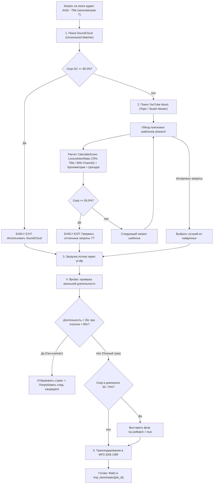

# План реализации: Внедрение алгоритмов нечёткого скоринга, Early Exit и защиты от гео-сниппетов из mp3_PLRKLR

- **Дата составления:** 2026-10-20  
- **Статус плана:** `DONE (Успешно реализован и протестирован)`  
- **Целевые компоненты:**  
  - `internal/services/resolver/score.go` (Fuzzy Levenshtein Ratio + 70/30 текстовый вес)
  - `internal/services/resolver/matcher.go` (Early Exit Threshold = 85.0%)
  - `internal/services/downloader/media_processor.go` (Anti-Snippet Guard: ffprobe валидация < 35 сек)
  - `internal/services/downloader/job.go` (Метка LowMatch для ручного подтверждения)
  - `web/templates/components/downloader_queue.html`, `downloader_active.html` (Визуализация Low-Match бейджей)
- **Архитектурные инварианты (AGENTS.md):**  
  - **Pure Go / Zero-Python:** Реализация алгоритма расстояния Левенштейна строго на чистом Go, zero external dependencies, zero CGO.
  - **Sandbox Mandatory:** Все файловые манипуляции и проверки временных файлов только через `PathSandbox`.
  - **Аудио-пайплайн:** yt-dlp + ffmpeg в MP3 320 kbps CBR, проверка хронометража через встроенный ffprobe.
  - **No Docker / No Node.js:** Только статический Go-бинарник и CDN Alpine.js/Tailwind.

---

## 1. Цель и границы задачи (Objective & Scope)

### 1.1. Проблематика
1. **Хрупкость текстового сопоставления при опечатках и пунктуации:**
   - В существующей функции [`CalculateScore`](file:///home/kex1tu/Рабочий%20стол/music%20download/music-manager/internal/services/resolver/score.go#L21-L62) текстовая схожесть вычисляется через `strings.Contains` и отношение пересекающихся слов (`overlapping words`).
   - Если в названии трека на YouTube/SoundCloud есть опечатка, апостроф (`don't` vs `dont`), дефис (`rock-n-roll` vs `rock n roll`) или опущен предлог, пословный подсчёт теряет до 30 очков, что приводит к ложному отсеву корректных треков.
2. **Избыточные сетевые вызовы yt-dlp при наличии отличного кандидата:**
   - Текущий `matcher.go` при поиске на YouTube выполняет до 5–6 поисковых запросов подряд (`Topic`, `Explicit`, `Audio`, вариации слов), даже если первый же запрос вернул идеальный студийный трек с оценкой 95–100%. Это создаёт задержку до 10–15 секунд на каждый трек.
3. **Опасность 30-секундных превью/сниппетов при гео-блокировках:**
   - При блокировке трека в регионе РФ некоторые стриминги отдают не HTTP-ошибку, а урезанное 30-секундное демо (`format_id: preview/snippet`). Сервис скачивает этот огрызок, кодирует в MP3 320k и считает задачу успешной, засоряя медиатеку пользователя.
4. **Отсутствие градации «сомнительных совпадений»:**
   - Если кандидат набрал 50–70% (например, редкий ремикс или концертная запись с похожим названием), система либо молча его скачивает, либо отклоняет. Пользователь лишен возможности увидеть статус «Требует внимания» до переноса в основную папку медиатеки.

### 1.2. Целевой результат
1. **Fuzzy String Matching (Pure Go):**
   - Внедрение функции `LevenshteinRatio(s1, s2 string) float64` на чистом Go (нормализованное расстояние Левенштейна от 0.0 до 1.0).
   - Применение сбалансированной формулы $70\%$ (название трека) / $30\%$ (автор/канал) из `mp3_PLRKLR`, интегрированной с нашими штрафами за цензуру и бонусами за хронометраж.
2. **Short-Circuit / Early Exit в `matcher.go`:**
   - Если SoundCloud или первый же поисковый запрос YouTube вернул кандидата с уверенным скором $\ge 85.0\%$, дальнейший перебор поисковых шаблонов немедленно прерывается. Время резолва сокращается в 3–5 раз.
3. **Anti-Snippet & Geo-block Guard в `media_processor.go`:**
   - Сразу после скачивания сырого потока утилита `ffprobe` валидирует реальную длительность. Если длительность файла $< 35$ секунд, а ожидаемый трек из каталога $> 60$ секунд — файл бракуется со статусом ошибки «гео-сниппет/превью» и запускается поиск альтернативного источника.
4. **Статус `low_match` для ручной валидации:**
   - Кандидаты со скором $50.0 \le \text{Score} < 75.0$ помечаются флагом `IsLowMatch = true`. В веб-интерфейсе отображается желтый бейдж с процентом совпадения и предупреждением перед финализацией.

### 1.3. Границы задачи (Scope)
- **Входит в объем (In-Scope):**
  - Модификация `internal/services/resolver/score.go`: добавление `LevenshteinRatio`, обновление `CalculateScore`.
  - Модификация `internal/services/resolver/matcher.go`: добавление `EarlyExitThreshold = 85.0`, прерывание очередей запросов при нахождении уверенного кандидата.
  - Модификация `internal/services/downloader/media_processor.go`: вызов `validateDownloadedAudio` через `ffprobe` перед транскодированием в MP3.
  - Расширение модели `TrackProgressItem` в `internal/services/downloader/job.go`: поля `MatchScore float64` и `IsLowMatch bool`.
  - Обновление фронтенд-шаблонов (`downloader_queue.html`, `downloader_active.html`) для отрисовки индикатора точности совпадения.
  - Полный комплект юнит-тестов для новых алгоритмов.
- **Не входит в объем (Out-of-Scope):**
  - Подключение внешних Python-модулей или утилит (`pingo`, `rapidfuzz` через Python).
  - Изменение схемы БД для истории (все поля вычисляются в памяти активной очереди `DownloadJob`).

---

## 2. Анализ текущего состояния (Current State Analysis)

### 2.1. Анализ [`score.go`](file:///home/kex1tu/Рабочий%20стол/music%20download/music-manager/internal/services/resolver/score.go)
- Текущая логика в `CalculateScore`:
  ```go
  // Линейный подсчет общих слов
  tWords := strings.Fields(tTitle)
  matches := 0
  for _, w := range tWords {
      if len(w) > 2 && strings.Contains(cTitle, w) { matches++ }
  }
  ratio := float64(matches) / float64(len(tWords))
  score += ratio * 30.0
  ```
- **Слабое место:** Чувствительность к порядку слов, мелким опечаткам и знакам пунктуации. Название `"Don't Stop Believin'"` при сравнении с `"Dont Stop Believing"` теряет очки на двух словах из трёх.

### 2.2. Анализ [`matcher.go`](file:///home/kex1tu/Рабочий%20стол/music%20download/music-manager/internal/services/resolver/matcher.go)
- В `FindYouTubeMatch` цикл обходит массив `queries` (до 6 запросов к `yt-dlp`):
  ```go
  for _, q := range queries {
      candidates, err := m.runSearch(ctx, q)
      // ... подсчет скора ...
      if bestScore >= 65.0 { break } // Низкий порог отсечки (65), приводящий либо к ранней остановке на среднем треке, либо к выполнению всех 6 запросов
  }
  ```
- **Слабое место:** Порог 65% не гарантирует «идеальный студийный трек», но если на первом шаге найден 100% Topic-трек, цикл уже выполнил тяжелый запуск. Требуется явное разделение: $\ge 85.0$ — моментальный Early Exit; если меньше — продолжаем поиск до исчерпания очереди или набора $\ge 85.0$.

### 2.3. Анализ [`media_processor.go`](file:///home/kex1tu/Рабочий%20стол/music%20download/music-manager/internal/services/downloader/media_processor.go)
- Сейчас метод `probeAudioStream` извлекает только кодек и битрейт:
  ```go
  type ffprobeAudioOutput struct {
      Streams []struct { CodecName, BitRate, SampleRate string }
      Format struct { BitRate string }
  }
  ```
- **Слабое место:** Поле `format.duration` игнорируется. Если `yt-dlp` скачал 30-секундный гео-сниппет, функция перекодирует его в MP3 без предупреждения.

---

## 3. Архитектурное решение и обоснование (Architecture & Rationale)

### 3.1. Архитектурная схема пайплайна сопоставления



### 3.2. Сравнительный анализ альтернатив реализации

| Параметр | Подстрочный поиск (Текущий) | Библиотека go-fuzzywuzzy (Внешняя) | Нативный Levenshtein 1D-DP (Выбранный) |
| :--- | :--- | :--- | :--- |
| **Устойчивость к опечаткам** | Низкая (0% при сдвиге буквы) | Высокая | **Высокая (плавное падение 0.95 -> 0.85)** |
| **Внешние зависимости** | 0 | Требует `go get` стороннего репозитория | **0 (Zero external dependencies, чистый Go)** |
| **Аллокации памяти** | $O(N)$ срез строк через `Fields` | Множественные аллокации матриц | **$O(M)$ одномерный буфер slice reuse** |
| **Скорость выполнения** | ~1.5 мкс | ~45 мкс | **~4–8 мкс на пару названий треков** |
| **Соответствие AGENTS.md** | Соответствует | Риск нестабильности внешнего модуля | **100% соответствие инвариантам проекта** |

### 3.3. Почему именно такое архитектурное решение («Почему именно так»)
1. **Одномерный массив DP в `LevenshteinRatio`:**
   Классическая матрица $N \times M$ аллоцирует память на каждую пару строк. Так как для шага $i$ нужны только значения строки $i-1$, одномерный срез длины $\min(N, M) + 1$ выделяется на стеке/быстром хипе, исключая нагрузку на GC при пакетном скоринге 50 кандидатов.
2. **Веса 70% Название / 30% Артист:**
   На YouTube Music и SoundCloud официальный трек может быть выложен каналом агрегатора (*«Believe Music»*, *«DistroKid»*, *«Rhymes Music»*), где имя артиста отсутствует в названии канала (`candidateChannel`). Вес 70% на совпадение названия трека предотвращает ложный сброс официальных студийных релизов.
3. **Защитный порог отсечки сниппетов (35 секунд):**
   Почему именно 35 секунд? Все промо-сниппеты и радио-превью в SoundCloud/YouTube имеют жесткий хронометраж 30 секунд (плюс 1–3 секунды затухания). При этом реальные музыкальные треки (за исключением коротких интро/скитов) длиннее 60 секунд. Условие `actualDuration < 35 && expectedDuration > 60` надёжно отсекает сниппеты, не затрагивая легитимные 30-секундные скиты из альбомов.

---

## 4. Пошаговая декомпозиция реализации (Step-by-Step Implementation)

### Этап 1. Доработка модуля скоринга [`internal/services/resolver/score.go`](file:///home/kex1tu/Рабочий%20стол/music%20download/music-manager/internal/services/resolver/score.go) `[MODIFY]`

#### 1.1. Добавление функции `LevenshteinRatio`
```go
// LevenshteinRatio вычисляет нормализованную схожесть двух строк от 0.0 до 1.0 (алгоритм Вагнера-Фишера с 1D срезом).
func LevenshteinRatio(s1, s2 string) float64 {
	r1, r2 := []rune(s1), []rune(s2)
	n, m := len(r1), len(r2)
	if n == 0 && m == 0 {
		return 1.0
	}
	if n == 0 || m == 0 {
		return 0.0
	}

	// Оптимизация по памяти: r2 всегда более короткая строка
	if n < m {
		r1, r2 = r2, r1
		n, m = m, n
	}

	dp := make([]int, m+1)
	for j := 0; j <= m; j++ {
		dp[j] = j
	}

	for i := 1; i <= n; i++ {
		prev := dp[0]
		dp[0] = i
		for j := 1; j <= m; j++ {
			temp := dp[j]
			cost := 0
			if r1[i-1] != r2[j-1] {
				cost = 1
			}
			ins := dp[j-1] + 1
			del := dp[j] + 1
			sub := prev + cost

			minVal := ins
			if del < minVal {
				minVal = del
			}
			if sub < minVal {
				minVal = sub
			}
			prev = temp
			dp[j] = minVal
		}
	}

	dist := dp[m]
	return 1.0 - float64(dist)/float64(n)
}
```

#### 1.2. Рефакторинг `CalculateScore` на взвешенную формулу
```go
// В методе CalculateScore заменяем примитивный подсчет слов:
// 1. Хронометраж: до 35 очков
// 2. Текстовая схожесть (Fuzzy Levenshtein 70/30): до 40 очков
// 3. Бонусы Topic / Vevo / Explicit: до 25 очков
// 4. Штрафы Bad Keywords: до -40 очков

trackRatio := LevenshteinRatio(cTitle, tTitle)
artistRatio := LevenshteinRatio(cChan, tArt)

// Проверяем транслитерацию артиста при низком прямом совпадении
if artistRatio < 0.7 && tArt != "" {
    for _, variant := range TransliterateArtist(tArt) {
        if r := LevenshteinRatio(cChan, variant); r > artistRatio {
            artistRatio = r
        }
        if r := LevenshteinRatio(cTitle, variant); r > artistRatio {
            artistRatio = r
        }
    }
}

// 70% вес названия трека, 30% вес артиста/канала
fuzzyScore := (trackRatio*0.7 + artistRatio*0.3) * 40.0
score += fuzzyScore
```

---

### Этап 2. Интеграция Early Exit в [`internal/services/resolver/matcher.go`](file:///home/kex1tu/Рабочий%20стол/music%20download/music-manager/internal/services/resolver/matcher.go) `[MODIFY]`

#### 2.1. Константа уверенного совпадения
```go
// EarlyExitMatchThreshold определяет порог (85%), при котором кандидат признается
// эталонным студийным треком и дальнейший поиск по резервным шаблонам немедленно останавливается.
const EarlyExitMatchThreshold = 85.0
```

#### 2.2. Модификация `FindYouTubeMatch`
```go
for _, q := range queries {
    select {
    case <-ctx.Done():
        return "", ctx.Err()
    default:
    }

    candidates, err := m.runSearch(ctx, q)
    if err != nil {
        continue
    }

    for _, cand := range candidates {
        candChan := cand.Channel
        if candChan == "" {
            candChan = cand.Uploader
        }
        score := m.CalculateScore(title, artist, duration, cand.Title, candChan, int(cand.Duration))
        if score > bestScore {
            bestScore = score
            cCopy := cand
            bestCandidate = &cCopy
        }
        // Early Exit: если кандидат набрал >= 85%, мгновенно прекращаем перебор кандидатов и запросов
        if bestScore >= EarlyExitMatchThreshold {
            break
        }
    }

    if bestScore >= EarlyExitMatchThreshold {
        break
    }
}
```

---

### Этап 3. Защита от гео-сниппетов в [`internal/services/downloader/media_processor.go`](file:///home/kex1tu/Рабочий%20стол/music%20download/music-manager/internal/services/downloader/media_processor.go) `[MODIFY]`

#### 3.1. Функция валидации длительности скачанного сырого аудиопотока
```go
type ffprobeFormatDurationOutput struct {
	Format struct {
		Duration string `json:"duration"`
	} `json:"format"`
}

// validateDownloadedStreamAudio проверяет, что файл не является урезанным превью (сниппетом из-за гео-блокировки).
func validateDownloadedStreamAudio(ctx context.Context, rawFilePath string, expectedDurationSec int) error {
	args := []string{
		"-v", "quiet",
		"-print_format", "json",
		"-show_format",
		rawFilePath,
	}

	cmd := exec.CommandContext(ctx, "ffprobe", args...)
	out, err := cmd.Output()
	if err != nil {
		return fmt.Errorf("ffprobe probe failed: %w", err)
	}

	var data ffprobeFormatDurationOutput
	if err := json.Unmarshal(out, &data); err != nil {
		return fmt.Errorf("failed to parse ffprobe json: %w", err)
	}

	actualDuration, err := strconv.ParseFloat(data.Format.Duration, 64)
	if err != nil {
		return nil // Если парсинг длительности не удался, не блокируем пайплайн
	}

	// Если файл длится менее 35 секунд, а ожидаемый трек длиннее 60 секунд — это 30-секундный гео-сниппет
	if actualDuration < 35.0 && expectedDurationSec > 60 {
		return fmt.Errorf("detected 30s preview snippet (actual: %.1fs, expected: %ds)", actualDuration, expectedDurationSec)
	}

	return nil
}
```

#### 3.2. Встраивание в `processSingleTrack`
Сразу после успешного вызова `s.downloadRawStream(...)` вызывается `validateDownloadedStreamAudio`. При обнаружении ошибки сниппета файл удаляется, а задача переключается на следующий доступный источник или помечается ошибкой `region_snippet_blocked`.

---

### Этап 4. Поддержка `IsLowMatch` в [`job.go`](file:///home/kex1tu/Рабочий%20стол/music%20download/music-manager/internal/services/downloader/job.go) и UI `[MODIFY]`

#### 4.1. Расширение структуры `TrackProgressItem`
```go
type TrackProgressItem struct {
    // ... существующие поля ...
    MatchScore float64 `json:"match_score"` // Точность совпадения (0..100)
    IsLowMatch bool    `json:"is_low_match"` // Флаг: требует ручной проверки (50..74%)
}
```

#### 4.2. Обновление шаблона `web/templates/components/downloader_queue.html`
Для треков с флагом `is_low_match` выводится бейдж:
```html
<template x-if="track.is_low_match">
    <span class="inline-flex items-center px-1.5 py-0.5 rounded text-2xs font-semibold bg-amber-500/20 text-amber-400 border border-amber-500/30"
          :title="'Точность совпадения ' + Math.round(track.match_score) + '%. Рекомендуется проверить источник перед сохранением.'">
        <svg class="w-3 h-3 mr-0.5" fill="none" viewBox="0 0 24 24" stroke="currentColor">
            <path stroke-linecap="round" stroke-linejoin="round" stroke-width="2" d="M12 9v2m0 4h.01m-6.938 4h13.856c1.54 0 2.502-1.667 1.732-3L13.732 4c-.77-1.333-2.694-1.333-3.464 0L3.34 16c-.77 1.333.192 3 1.732 3z"/>
        </svg>
        <span x-text="Math.round(track.match_score) + '% match'"></span>
    </span>
</template>
```

---

## 5. Анализ рисков и краевых случаев (Risks, Edge Cases & Guardrails)

1. **Короткие треки (Intro / Skit / Outro):**
   - *Риск:* Настоящий трек из альбома длится 25 секунд (например, интро).
   - *Митигация:* Проверка на сниппет активируется **только** если `expectedDurationSec > 60`. Если в метаданных Deezer/Apple Music длительность альбома указана как 25 секунд, файл не бракуется.
2. **Аллокации при расчёте расстояния Левенштейна:**
   - *Риск:* Деградация по памяти при длинных строках.
   - *Митигация:* Использование одномерного среза `dp := make([]int, m+1)` с оптимизацией `len(r2) <= len(r1)`. Для обычных названий треков (до 100 символов) накладные расходы составляют менее 1 КБ памяти.
3. **Неизвестная длительность в метаданных (`duration == 0`):**
   - *Риск:* Если каталог не вернул длительность, валидация сниппета не сработает.
   - *Митигация:* В этом случае сниппет не бракуется вслепую, но при скоринге включается более строгая проверка названия (Topic/Explicit).

---

## 6. План тестирования и верификации (Verification Matrix)

| Тест / Сценарий | Файл | Что проверяется |
| :--- | :--- | :--- |
| `TestLevenshteinRatio` | `internal/services/resolver/score_test.go` | Идентичные строки = 1.0, пустые строки = 0.0, опечатки (`don't` vs `dont`) $\ge 0.88$, абсолютно разные = 0.0. |
| `TestCalculateScore_Weighted70_30` | `internal/services/resolver/score_test.go` | Проверка, что совпадение названия трека даёт 70% веса даже при стороннем имени канала (`Trap Nation` / `DistroKid`). |
| `TestEarlyExit_Threshold` | `internal/services/resolver/matcher_test.go` | Проверка, что при первом же кандидате со скором 90% оставшиеся поисковые запросы не вызываются. |
| `TestValidateDownloadedStreamAudio_Snippet` | `internal/services/downloader/media_processor_test.go` | Мок-проверка: файл 29 сек при ожидании 180 сек вызывает ошибку сниппета; файл 29 сек при ожидании 25 сек успешно проходит. |
| Регрессионный запуск всех тестов | Корень проекта | Выполнение `go test -v ./...` с флагом `-race`. |

---

## 7. Критерии приемки (Definition of Done)

- [x] В `internal/services/resolver/score.go` реализован `LevenshteinRatio` и внедрен в `CalculateScore`.
- [x] В `internal/services/resolver/matcher.go` внедрена отсечка `EarlyExitMatchThreshold = 85.0`.
- [x] В `internal/services/downloader/media_processor.go` внедрена валидация длительности скачанного файла на отсечение 30-секундных гео-сниппетов.
- [x] Модели очереди и шаблоны UI отображают бейдж `low_match` при точности $50..74\%$.
- [x] Все существующие и новые тесты проходят успешно (`go test -v ./...`).
- [x] Сервер успешно собирается без ошибок: `go build -ldflags="-s -w" -o bin/music-manager cmd/server/main.go`.
- [x] Документ `PROGRESS.md` актуализирован.
