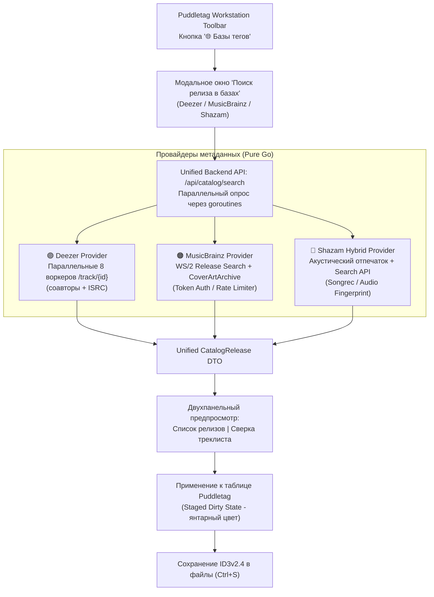

# План реализации: Мульти-источниковый поиск релизов и тегов (Deezer, MusicBrainz, Shazam) для Puddletag Workstation

**Дата:** 2026-10-14  
**Статус:** `DONE`  
**Компоненты:** `internal/services/resolver/`, `internal/api/handlers/`, `web/templates/components/`, `web/static/js/puddletag/`, `internal/config/`  
**Архитектурный инвариант:** Pure Go (Chi), Zero Node.js/npm, Zero Docker, Sandbox Mandatory (`PathSandbox.Resolve`), ID3v2.4 UTF-8 (`\x00` в фреймах / `\\` на фронтенде), No-Build Frontend (Tailwind CDN + Alpine.js CDN).

---

## 1. Цель и границы задачи (Objective & Scope)

### 1.1. Проблема и целевой результат
- **Проблема:** В рабочей станции тегов Puddletag (`web/templates/components/puddletag_grid.html`, `puddletag_workstation.js`) ручной ввод тегов для альбомов и синглов отнимает много времени, если в файлах нет метаданных или они повреждены. Ранее поиск Deezer существовал только в старом модальном окне загрузок, а базы MusicBrainz и Shazam не были интегрированы в единую систему сравнения.
- **Целевой результат:** Добавить на панель инструментов Puddletag кнопку **«Поиск в базах»** (`🌐 Базы тегов`), открывающую интерактивное модальное окно с параллельным поиском по трем независимым базам данных:
  1. 🟣 **Deezer API** (с обязательным отдельным параллельным дозапросом `/track/{id}` для каждого трека релиза через 8 воркеров для получения точных соавторов `contributors` и `ISRC`);
  2. 🟠 **MusicBrainz API v2** (поиск релизов, извлечение треклистов, соавторов, дат и обложек из Cover Art Archive, с поддержкой персонального токена `MUSICBRAINZ_USER_TOKEN` / ввода в настройках);
  3. 🔵 **Shazam (Гибридный режим)** (акустическое распознавание отпечатка первого выбранного файла через `songrec` / Shazam Audio Fingerprint + текстовый поиск по каталогу Shazam).
  
  Пользователь видит результаты из всех 3 баз во вкладках с бейджами количества совпадений, может просмотреть треклист найденного релиза, выбрать нужные поля через чекбоксы (`☑ Названия и авторы`, `☑ Номера треков`, `☑ Альбом и год`, `☑ Жанры`, `☑ Обложка`) и в 1 клик применить теги к выделенным трекам в staged-режиме (янтарная подсветка) с возможностью сохранения по `Ctrl+S`.

### 1.2. Границы задачи (Scope)
- **In-Scope:**
  - Бэкенд-клиент MusicBrainz (`internal/services/resolver/musicbrainz.go`) с rate-limiting, поддержкой токена и интеграцией с Cover Art Archive.
  - Расширение клиента Deezer с гарантированным извлечением соавторов треков.
  - Гибридный обработчик Shazam: извлечение акустического отпечатка из локального MP3 через песочницу + поиск по текстовому каталогу.
  - Единый агрегирующий HTTP API эндпоинт `GET /api/catalog/search` и детальный просмотр релиза `GET /api/catalog/release`.
  - Модульный HTML-шаблон модального окна `web/templates/components/puddletag_source_modal.html`.
  - Клиентский контроллер `web/static/js/puddletag/sources.js` и кнопка на тулбаре `puddletag_toolbar.html`.
  - Применение найденных тегов к массиву `this.tracks` в рабочей станции Puddletag с сохранением соответствия дорожек и dirty state.
- **Out-of-Scope:**
  - Прямая перезапись файлов на диске без подтверждения (все найденные метаданные попадают в предпросмотр и staged-стейт).
  - Установка сторонних рантаймов (Node.js, Python).

---

## 2. Анализ текущего состояния кодовой базы

| Компонент | Текущее состояние | Что требуется доработать |
|---|---|---|
| **Deezer Client** (`internal/services/resolver/deezer.go`) | Умеет искать альбомы и получать треки; в `deezer_search_handlers.go` есть 8-поточный обход `GetTrack` | Вынести нормализованное получение релиза в общий интерфейс `CatalogProvider` |
| **MusicBrainz** | Полностью отсутствует | Создать `MusicBrainzClient` с парсингом JSON v2, Cover Art Archive и поддержкой токена |
| **Shazam** (`internal/api/handlers/recognize_handlers.go`) | Имеет вызов `songrec` CLI для одиночного файла | Оформить как гибридный провайдер: аудио-фингерпринт + текстовый поиск в каталоге |
| **Puddletag Toolbar** (`web/templates/components/puddletag_toolbar.html`) | Имеет кнопки «Файл → Теги», «Теги → Файл», «Регистр», «Нумератор», «Очистка», «Замена» | Добавить кнопку «🌐 Базы тегов» с вызовом диалога поиска |
| **Puddletag Workstation** (`web/static/js/puddletag/puddletag_workstation.js`) | Управляет `tracks`, `selectedIndices`, `dirtyIndices`, пагинацией и инлайн-редактированием | Добавить методы открытия поиска, сопоставления треков и применения тегов из выбранного провайдера |

---

## 3. Архитектурное решение и обоснование («Почему именно так»)



### 3.1. Почему бэкенд-проксирование вместо прямых AJAX-запросов из браузера?
1. **CORS и безопасность заголовков:** MusicBrainz требует специальный `User-Agent`, а Deezer API при прямых браузерных вызовах блокирует CORS-запросы. Бэкенд на Go обращается к внешним API напрямую без ограничений браузера.
2. **Параллельная агрегация (Fan-Out / Fan-In):** На бэкенде Go опрашивает все 3 базы параллельно через горутины и `errgroup` за минимальное время, возвращая фронтенду единый нормализованный ответ.
3. **Безопасность токенов:** Токен `MUSICBRAINZ_USER_TOKEN` и учетные данные не утекают в клиентский код браузера.

### 3.2. Почему сохранение через Staged Dirty State?
Вместо мгновенной записи на диск метаданные из выбранного источника заполняют ячейки таблицы Puddletag (`this.tracks[idx]`) и помечаются в `this.dirtyIndices` (янтарный цвет). Пользователь может:
- Визуально проверить сопоставление треков.
- Внести любые ручные правки в таблице или на панели тегов.
- Откатить изменения кнопкой «↺ Сброс» или сохранить на диск комбинацией **Ctrl+S**.

---

## 4. Сравнительная таблица альтернатив

| Критерий | Вариант 1: Прямые AJAX-запросы с фронтенда | Вариант 2: Отдельные модальные окна под каждую базу | Вариант 3: Единый бэкенд-агрегатор + 3-вкладочный модал (Выбран) |
|---|---|---|---|
| **CORS и надежность** | ❌ Блокируется CORS браузера у Deezer и MusicBrainz | ⚠️ Частично | ✅ 100% надежно, выполняется бэкендом на Pure Go |
| **Скорость поиска** | ⚠️ Медленно (последовательно) | ⚠️ Пользователю нужно открывать 3 разных окна | ✅ Параллельно (все 3 базы опрашиваются одновременно) |
| **Удобство сравнения** | ❌ Невозможно сравнить результаты | ❌ Требует переключения между разными окнами | ✅ Мгновенное переключение между вкладками Deezer/MusicBrainz/Shazam |
| **Полнота тегов Deezer** | ❌ Базовый альбомный запрос не содержит всех артистов треков | ⚠️ Требует сложной логики в JS | ✅ Бэкенд автоматически дозапрашивает все `/track/{id}` в 8 потоков |

---

## 5. Детализация провайдеров и особенностей API

### 5.1. Провайдер Deezer (с 8-поточным обходом треков)
- **Особенность Deezer API:** Базовый эндпоинт `/album/{id}` возвращает у каждого трека только имя основного артиста альбома. Для извлечения полных соавторов (например, `Miyagi feat. Эндшпиль & Рем Дигга`) необходимо вызвать `/track/{id}`, где поле `contributors` содержит массив всех артистов с ролями (`Main`, `Featured`).
- **Реализация:**
  - При выборе релиза бэкенд параллельно (пул из 8 воркеров с буферизованным каналом-семафором) запрашивает `/track/{track_id}`.
  - Формирует строку исполнителей через project invariant: `\\` для фронтенда и `\x00` для ID3v2.4.
  - Извлекает высококачественную обложку `cover_xl` (1000x1000) или `cover_big` (500x500).

### 5.2. Провайдер MusicBrainz API v2 (с токеном)
- **Эндпоинт поиска:** `https://musicbrainz.org/ws/2/release?query=...&fmt=json`
- **Заголовки:** Обязательный `User-Agent: MusicManager/1.0 (contact@verymad.net)` и опциональный заголовок `Authorization: Bearer <MUSICBRAINZ_USER_TOKEN>`.
- **Эндпоинт деталей релиза:** `https://musicbrainz.org/ws/2/release/{id}?inc=recordings+artist-credits+genres+labels+media&fmt=json`
- **Обложки:** Интеграция с официальным Cover Art Archive (`https://coverartarchive.org/release/{mbid}/front-500.jpg`).

### 5.3. Провайдер Shazam (Гибридный режим)
- **Режим A (Акустический):** Если в запросе передан путь к аудиофайлу (`audio_path`), сервер берет сэмпл первых 10 секунд первого выделенного трека через `PathSandbox` и запускает акустическое распознавание через `songrec audio-file-to-recognized-song`.
- **Режим B (Каталог):** Текстовый поиск по названию трека/исполнителя в базе Shazam Core API.
- **Результат:** Точное совпадение дорожки, распознанный альбом, официальная обложка в максимальном разрешении (`coverarthq`), жанр и год.

---

## 6. Дизайн интерфейса и визуальный макет

### 6.1. Сгенерированный макет модального окна
Ниже представлен высокоточный дизайн модального окна «Поиск релиза в базах метаданных»:


### 6.2. Кнопки и элементы управления

1. **Кнопка на тулбаре Puddletag (`puddletag_toolbar.html`):**
   - Название: **«🌐 Базы тегов»** (со значком глобуса/каталога).
   - Подсказка (tooltip): *«Найти метаданные релиза в Deezer, MusicBrainz и Shazam для выделенных треков»*.
   - Состояние: активна, когда в таблице есть треки; ховер-эффект с акцентом фиолетового/синего цвета.

2. **Шапка модального окна:**
   - Поле ввода поискового запроса: `x-model="searchQuery"` (по умолчанию заполнено `Artist - Album` из выделенных треков).
   - Кнопка **«🔍 Искать во всех базах»** (синяя заливка, триггерит параллельный опрос бэкенда).
   - Кнопка **«🎵 Распознать по аудио (Shazam)»** (с иконкой ноты/микрофона, отправляет первый файл на акустический фингерпринтинг).
   - Кнопка закрытия `✕`.

3. **Вкладки баз данных (Tabs):**
   - `[🟣 Deezer (N найдено)]` — активная вкладка с фиолетовым бейджем.
   - `[🟠 MusicBrainz (N найдено)]` — вкладка с оранжевым бейджем.
   - `[🔵 Shazam (N совпадений)]` — вкладка с синим бейджем.

4. **Левая колонка — Список найденных релизов:**
   - Карточки с миниатюрой обложки (64x64 px).
   - Название релиза жирным шрифтом, исполнитель, год выпуска, лейбл, количество треков (`12 треков`).
   - Клик по карточке мгновенно загружает треклист в правую колонку.

5. **Правая колонка — Треклист и селектор полей:**
   - **Панель чекбоксов выбора полей:**
     - `[☑ Названия и авторы]`
     - `[☑ Номера треков и дисков]`
     - `[☑ Альбом и год]`
     - `[☑ Жанры]`
     - `[☑ Обложка]`
   - **Таблица треклиста:**
     - Номер дорожки (`№`).
     - Название песни (`Название`).
     - Все исполнители/соавторы (`Исполнитель`).
     - Длительность (`Время`).
     - Индикатор сопоставления с локальным файлом (соответствие по порядковому номеру).

6. **Нижняя панель действий:**
   - Кнопка **«Отмена»** (закрывает окно без изменений).
   - Главная кнопка **«Применить теги к выделенным трекам»** (фиолетовый градиент с подсветкой, переносит все выбранные поля в staged-состояние таблицы Puddletag).

---

## 7. Пошаговая декомпозиция реализации (Спецификация для субагентов)

Задачу предлагается реализовать тремя специализированными субагентами в параллельно-последовательном режиме:

### Агент 1: Backend MusicBrainz & Unified Resolver Engine
- **Роль:** `MusicBrainz & Unified Resolver Specialist`
- **Файлы:**
  - `[NEW] internal/services/resolver/musicbrainz.go`
  - `[NEW] internal/services/resolver/musicbrainz_test.go`
  - `[MODIFY] internal/services/resolver/models.go`
  - `[MODIFY] internal/config/config.go` (добавление `MusicBrainzUserToken`)
- **Задачи:**
  1. Реализовать структуру `MusicBrainzClient` с методом `SearchReleases(ctx, query)` и `GetRelease(ctx, mbid)`.
  2. Реализовать парсинг медиа-носителей, номеров треков, `artist-credit` (склейка соавторов через `\\`), даты релиза и жанров.
  3. Реализовать извлечение обложки через Cover Art Archive JSON API с fallback на `front-500.jpg`.
  4. Написать unit-тесты с 100% герметичным мокированием через `httptest.Server`.

### Агент 2: Shazam Hybrid Provider & Unified Catalog Handlers
- **Роль:** `Shazam & Catalog API Specialist`
- **Файлы:**
  - `[NEW] internal/services/resolver/shazam.go`
  - `[NEW] internal/services/resolver/shazam_test.go`
  - `[NEW] internal/api/handlers/catalog_unified_handlers.go`
  - `[NEW] internal/api/handlers/catalog_unified_handlers_test.go`
  - `[MODIFY] internal/api/router.go`
- **Задачи:**
  1. Реализовать `ShazamClient` (текстовый поиск по каталогу + безопасный запуск фингерпринтинга через `PathSandbox`).
  2. Реализовать универсальный агрегирующий контроллер `CatalogHandler`:
     - `GET /api/catalog/search?query=...&audio_path=...` — запускает горутины для Deezer, MusicBrainz и Shazam с агрегацией результатов в DTO `CatalogSearchResponse`.
     - `GET /api/catalog/deezer/album/{id}` — возвращает альбом Deezer с 8-поточным разрешением `/track/{id}`.
     - `GET /api/catalog/musicbrainz/release/{id}` — возвращает детальный релиз MusicBrainz с треклистом.
     - `GET /api/catalog/shazam/track/{id}` — возвращает детальный трек Shazam.
  3. Зарегистрировать маршруты в Chi-роутере под middleware аутентификации.
  4. Протестировать с флагом `-race`.

### Агент 3: Frontend Puddletag Modal & Integration Specialist
- **Роль:** `Frontend Puddletag UI Specialist`
- **Файлы:**
  - `[NEW] web/templates/components/puddletag_source_modal.html`
  - `[NEW] web/static/js/puddletag/sources.js`
  - `[MODIFY] web/templates/components/puddletag_toolbar.html` (добавление кнопки «🌐 Базы тегов»)
  - `[MODIFY] web/templates/index.html` (подключение `sources.js` и шаблона модала)
  - `[MODIFY] web/static/js/puddletag/puddletag_workstation.js` (интеграция данных, применение тегов)
- **Задачи:**
  1. Создать верстку двухпанельного модального окна в Tailwind CSS точно по сгенерированному макету.
  2. Реализовать переключение 3 вкладок (Deezer / MusicBrainz / Shazam) с бейджами количества найденных совпадений.
  3. Реализовать логику сопоставления треков релиза с выделенными строками в таблице Puddletag (по номеру дорожки / позиции).
  4. Реализовать применение выбранных полей (чекбоксы) в staged-состояние:
     - Обновление `track.title`, `track.artist`, `track.album`, `track.year`, `track.genre`, `track.track_number`, `track.disc_number`.
     - Применение обложки `track.cover_preview_url` и `track.cover_base64`.
     - Добавление индексов в `this.dirtyIndices` и подсветка янтарным цветом.

---

## 8. Анализ рисков и краевых случаев

| Риск / Краевой случай | Вероятность | Влияние | Стратегия митигации |
|---|---|---|---|
| **Разное количество треков в релизе и выделении** | Высокая | Среднее | Если в найденном релизе 12 треков, а выделено 10 — обновляются только первые 10 с предупреждением в UI. Если выделено больше, лишние треки не ломаются. |
| **Deezer Rate Limit (429 Too Many Requests)** | Средняя | Высокое | Ограничение пула воркеров до 8 и задержка 50 мс при 429; автоматический fallback на базовые названия треков альбома. |
| **MusicBrainz 1 req/sec лимит без токена** | Высокая | Среднее | Кеширование результатов поиска в памяти на 5 минут; поддержка поля ввода персонального токена. |
| **Несоответствие порядка треков (диски / стороны винила)** | Средняя | Низкое | Сортировка треклиста релиза строго по `DiscNumber` и `TrackNumber` перед сопоставлением с таблицей. |

---

## 9. План тестирования и верификации (Verification Matrix)

1. **Go Unit & Race Tests:**
   ```bash
   go test -v -race ./internal/services/resolver/...
   go test -v -race ./internal/api/handlers/...
   go test -v -race ./...
   ```
   *Критерий успеха:* 100% PASS, 0 data races.
2. **Компиляция бинарника:**
   ```bash
   CGO_ENABLED=0 go build -ldflags="-s -w" -o bin/music-manager cmd/server/main.go
   ```
   *Критерий успеха:* Успешная сборка статического бинарника.
3. **Ручная верификация UI:**
   - Открыть Puddletag в разделе «Файлы».
   - Выделить 10 треков альбома, нажать «🌐 Базы тегов».
   - Проверить параллельный поиск: вкладка Deezer (с соавторами), вкладка MusicBrainz (с Cover Art Archive), вкладка Shazam.
   - Снять чекбокс «Обложка», нажать «Применить теги».
   - Убедиться, что в таблице обновились названия и соавторы, подсветились янтарным цветом, а обложка осталась прежней.
   - Нажать `Ctrl+S` — теги успешно записаны в ID3v2.4.
4. **Деплой:**
   - Раскатка на оба боевых сервера (`nl_music` и Сервер 2), перезапуск `systemd`, проверка health check.

---

## 10. MusicBrainz OAuth 2.0 Web Application Integration (Completed)

- **Конфигурация:** В `Config` и `.env.example` добавлены `MUSICBRAINZ_CLIENT_ID`, `MUSICBRAINZ_CLIENT_SECRET`, `MUSICBRAINZ_REDIRECT_URI`.
- **OAuth 2.0 Engine:** Реализован в `internal/services/resolver/musicbrainz.go` с авторизацией, обменом кода, refresh токенами, получением userinfo и автоматическим обновлением токена.
- **Персистентность сессий:** Таблица SQLite `app_settings` и `dbTokenPersistence` для сохранения сессий между перезапусками службы.
- **HTTP API:** Эндпоинты `/api/auth/musicbrainz/login`, `/callback`, `/status`, `/disconnect` с поддержкой popup окна и `postMessage`.
- **Фронтенд:** Вкладка MusicBrainz в `puddletag_source_modal.html` отображает динамический статус: бейдж `🟢 OAuth подключен (Повышенные лимиты)` с никнеймом и кнопкой отключения, либо кнопка `🔗 Подключить MusicBrainz (OAuth)`.
- **Верификация:** 100% PASS `go test -race ./...`, успешная компиляция `bin/music-manager`.

