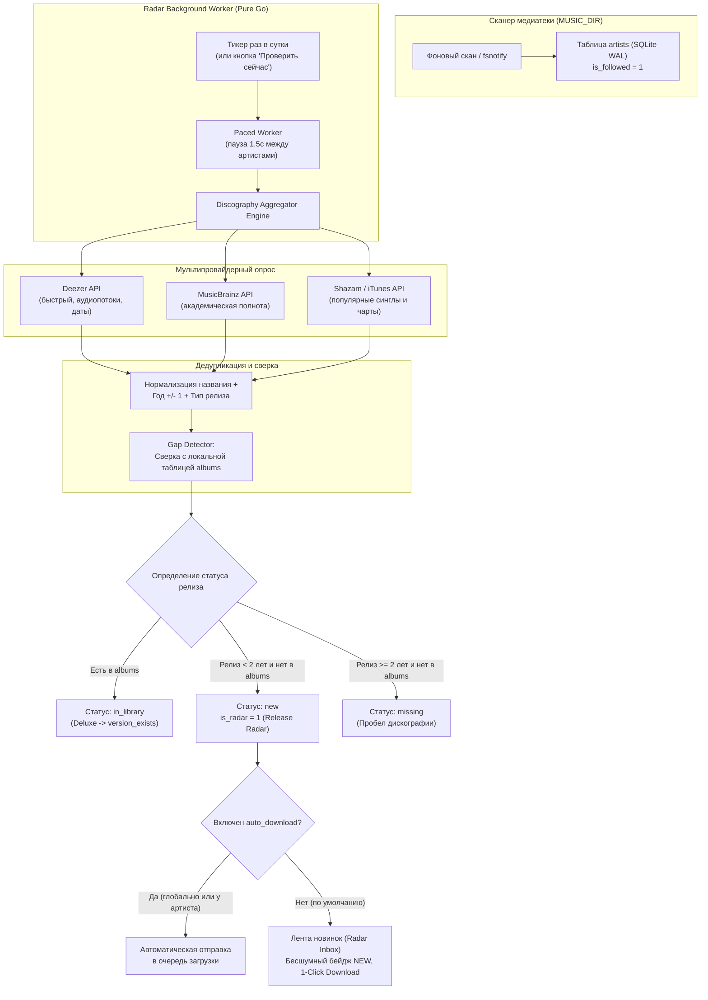

# План реализации: Release Radar (Автозагрузка новинок) и Сверка дискографии артиста (Gap Detector)

**Дата:** 2026-10-14  
**Статус:** `PROPOSED`  
**Компоненты:** `internal/db/`, `internal/services/resolver/`, `internal/services/radar/`, `internal/services/downloader/`, `internal/api/handlers/`, `web/templates/`, `web/static/js/`  
**Архитектурный инвариант:** Pure Go (Chi), Zero Python, Zero Node.js/npm, Zero Docker, Sandbox Mandatory (`PathSandbox.Resolve`), ID3v2.4 UTF-8 (`\x00` в фреймах / `\\` на фронтенде), SQLite (WAL), No-Build Frontend (Tailwind CDN + Alpine.js CDN).

---

## 1. Цель и границы задачи (Objective & Scope)

### 1.1. Проблема и целевой результат
- **Проблема:** 
  1. В медиатеке отсутствуют средства автоматического отслеживания новых треков и альбомов любимых артистов. Пользователю приходится вручную проверять стриминговые платформы и по одной ссылке копировать релизы в загрузчик.
  2. У пользователя нет целостной картины полноты дискографии артистов в медиатеке: невозможно увидеть, какие студийные альбомы, EP или синглы были выпущены исполнителем за всю карьеру, но отсутствуют в локальной папке `MUSIC_DIR` (пробелы в дискографии / Gaps).
- **Целевой результат:**
  1. **Единая система Release Radar & Gap Detector на верхнем уровне навигации:**
     - Создание новой главной вкладки **«📡 Радар и Дискографии»** в шапке `header.html` с двумя рабочими областями:
       - **Под-вкладка 1: «Лента новинок (Radar)»** — единый агрегированный поток свежих незагруженных релизов всех артистов библиотеки за последние 2 года с бесшумными бейджами `NEW`, быстрым скачиванием в 1 клик, кнопкой «Скачать все выбранные» и настройкой автозагрузки.
       - **Под-вкладка 2: «Артисты и дискографии»** — каталог всех артистов медиатеки с переходом в полную дискографию, отображением статусов каждого релиза (`🟢 В медиатеке`, `🟡 Частично`, `⚪ Отсутствует / Gap`), кнопками докачки пробелов и возможностью ручной привязки псевдонимов/ссылок.
  2. **Автоматическое отслеживание всех артистов медиатеки:**
     - Любой исполнитель, найденный в папке `MUSIC_DIR` при сканировании библиотеки, автоматически регистрируется в системе отслеживания (`is_followed = 1`).
     - Пользователь может в 1 клик отключить отслеживание конкретного артиста (Mute/Unfollow) или включить индивидуальную опцию «Автоматически скачивать новинки».
  3. **Мультипровайдерная агрегация каталогов (Deezer + MusicBrainz + Shazam):**
     - Артист не привязывается к единственному поставщику. Система запрашивает каталоги Deezer, открытую базу MusicBrainz и Shazam/Apple Music.
     - Алгоритм кросс-дедупликации склеивает дубликаты по нормализованному названию (`clean_title`), году выпуска $| \Delta \text{Year} | \le 1$ и типу релиза (`album`, `ep`, `single`, `compilation`), сохраняя прямые ссылки на стриминг для скачивания.
  4. **Умная классификация пробелов (Gap Detection):**
     - Полноформатные студийные альбомы и EP считаются ключевыми релизами дискографии. Синглы и сборники вынесены под отдельные переключаемые фильтры.
     - Если в локальной библиотеке уже присутствует оригинальный альбом, Deluxe/Remaster-издания помечаются бейджем «Версия уже есть», исключая ложные пробелы.
  5. **Гибридный режим автоматизации:**
     - По умолчанию новинки попадают в ленту рассмотрения (Radar Inbox) для ручного подтверждения.
     - Глобальный тумблер или переключатель в карточке конкретного артиста позволяет включить режим «Автозагрузка сразу в очередь» (без необходимости ручного клика).
  6. **Фоновый планировщик и ручные триггеры:**
     - Фоновый демон в Go выполняет регулярный обход (по умолчанию раз в 24 часа) с деликатной паузой 1.5 секунды между артистами для защиты от внешних rate-limit (MusicBrainz / Deezer).
     - Кнопка «🔄 Обновить дискографию» в карточке любого артиста для моментальной точечной проверки.
     - Кнопка «🔄 Проверить новинки» в шапке ленты Радара с отображением прогресса обхода.

### 1.2. Границы задачи (Scope)
- **In-Scope:**
  - Расширение схемы SQLite (WAL): таблицы `radar_releases`, добавление полей отслеживания в `artists`, системные настройки `app_settings`.
  - Модуль дедупликации и агрегации каталогов `internal/services/resolver/discography_aggregator.go`.
  - Фоновый сервис `internal/services/radar/` с планировщиком, защитой от банов, очередью задач и ручным триггером с телеметрией прогресса.
  - HTTP API эндпоинты в `internal/api/handlers/radar_handlers.go` и регистрация в `router.go`.
  - HTML-шаблоны `web/templates/components/radar.html`, `radar_feed.html`, `radar_artists.html`, `radar_artist_modal.html`.
  - Модульный фронтенд JavaScript `web/static/js/radar/radar.js` с интеграцией в `Alpine.store('radar')`.
  - Пакетные и точечные тесты в Go (`go test -race ./...`).
- **Out-of-Scope:**
  - Вшивание текстов песен в MP3 (инвариант: только внешние `.lrc`/`.txt`).
  - Сторонние Node.js пакеты или внешние Python-скрипты (Strict Zero-Node, Zero-Python).
  - Всплывающие системные push-уведомления ОС или назойливые звуковые сигналы (согласовано: тихая лента в UI с бейджами `NEW`).

---

## 2. Анализ текущего состояния кодовой базы

| Файл / Компонент | Текущее состояние | Что требуется доработать |
|---|---|---|
| [`internal/db/schema.sql`](file:///home/kex1tu/%D0%A0%D0%B0%D0%B1%D0%BE%D1%87%D0%B8%D0%B9%20%D1%81%D1%82%D0%BE%D0%BB/music%20download/music-manager/internal/db/schema.sql) | Таблица `artists` хранит базовые ID, но не имеет флагов отслеживания; нет таблицы каталожных релизов | Добавить в `artists` поля `is_followed`, `auto_download`, `last_checked_at`, `musicbrainz_id`, `custom_search_alias`. Создать таблицу `radar_releases` |
| [`internal/db/queries.go`](file:///home/kex1tu/%D0%A0%D0%B0%D0%B1%D0%BE%D1%87%D0%B8%D0%B9%20%D1%81%D1%82%D0%BE%D0%BB/music%20download/music-manager/internal/db/queries.go) | Базовые выборки по трекам и альбомам | Реализовать методы работы с `radar_releases`, выборки новинок, обновления статусов и привязки артистов |
| [`internal/services/scanner/artist_album.go`](file:///home/kex1tu/%D0%A0%D0%B0%D0%B1%D0%BE%D1%87%D0%B8%D0%B9%20%D1%81%D1%82%D0%BE%D0%BB/music%20download/music-manager/internal/services/scanner/artist_album.go) | При сканировании создает записи в таблице `artists` | Гарантировать установку `is_followed = 1` по умолчанию для каждого обнаруженного исполнителя |
| [`internal/services/resolver/client_deezer.go`](file:///home/kex1tu/%D0%A0%D0%B0%D0%B1%D0%BE%D1%87%D0%B8%D0%B9%20%D1%81%D1%82%D0%BE%D0%BB/music%20download/music-manager/internal/services/resolver/client_deezer.go) | Умеет отдавать `GetArtistAlbums` по числовому Deezer ID | Добавить метод поиска артиста по имени `SearchArtist(ctx, name)` для получения ID |
| [`internal/services/resolver/client_musicbrainz.go`](file:///home/kex1tu/%D0%A0%D0%B0%D0%B1%D0%BE%D1%87%D0%B8%D0%B9%20%D1%81%D1%82%D0%BE%D0%BB/music%20download/music-manager/internal/services/resolver/client_musicbrainz.go) | Имеет поиск релиз-групп и релизов | Добавить метод выборки дискографии артиста `GetArtistReleaseGroups(ctx, mbid)` |
| [`internal/services/resolver/shazam.go`](file:///home/kex1tu/%D0%A0%D0%B0%D0%B1%D0%BE%D1%87%D0%B8%D0%B9%20%D1%81%D1%82%D0%BE%D0%BB/music%20download/music-manager/internal/services/resolver/shazam.go) | Поиск треков через iTunes API | Добавить выборку релизов артиста через iTunes API (`SearchArtistAlbums`) |
| [`internal/api/handlers/discography_handlers.go`](file:///home/kex1tu/%D0%A0%D0%B0%D0%B1%D0%BE%D1%87%D0%B8%D0%B9%20%D1%81%D1%82%D0%BE%D0%BB/music%20download/music-manager/internal/api/handlers/discography_handlers.go) | Парсит дискографию только по внешней ссылке пользователя и не сопоставляет с файлами на диске | Использовать новый мультипровайдерный агрегатор со сверкой с локальной БД SQLite |
| [`internal/services/downloader/downloader.go`](file:///home/kex1tu/%D0%A0%D0%B0%D0%B1%D0%BE%D1%87%D0%B8%D0%B9%20%D1%81%D1%82%D0%BE%D0%BB/music%20download/music-manager/internal/services/downloader/downloader.go) | Принимает URL для очереди | Подключить вызов автоматической постановки в очередь при включенном `auto_download` |
| [`web/templates/header.html`](file:///home/kex1tu/%D0%A0%D0%B0%D0%B1%D0%BE%D1%87%D0%B8%D0%B9%20%D1%81%D1%82%D0%BE%D0%BB/music%20download/music-manager/web/templates/header.html) | Навигация: Загрузчик, Файлы, Аудит, Плеер | Добавить 5-ю главную вкладку `📡 Радар и Дискографии` (`activeTab === 'radar'`) |

---

## 3. Архитектурное решение и обоснование («Почему именно так»)



### 3.1. Почему единая таблица `radar_releases` и общий движок агрегации?
1. **Устранение дублирования кода:** Пропущенный альбом 2018 года и новинка прошлой недели с точки зрения каталога — это одна и та же сущность (релиз артиста, которого нет в локальной медиатеке).
2. **Динамическая фильтрация:** Release Radar — это срез релизов со статусом `is_radar = 1` (дата релиза за последние 2 года), а полный Gap Detector артиста — это вся хронологическая шкала его дискографии.
3. **Экономия сетевых запросов:** Один обход артиста одновременно актуализирует и его ленту новинок в Радаре, и карту пробелов всей дискографии, избавляя от повторных обращений к внешним API.

### 3.2. Почему мультипровайдерность без жесткой привязки к сервису?
- Артисты могут выпускать эксклюзивы или отсутствовать на отдельных сервисах (например, региональные релизы в Deezer или инди-релизы в MusicBrainz).
- Мультипровайдерный поиск находит максимум совпадений, но за счет дедупликации пользователь видит чистый, объединенный список без задвоений.
- В карточке артиста сохраняется возможность ручной корректировки ID или указания альтернативного поискового имени (alias), что гарантирует 100% точность даже для исполнителей со сложными или менявшимися именами.

### 3.3. Почему деликатный Paced Worker с задержкой 1.5 секунды?
- Мульти-каталожный опрос сотен исполнителей может вызвать блокировку по IP (HTTP 429 Too Many Requests), особенно от MusicBrainz (лимит 1 req/s без OAuth и 4 req/s с OAuth).
- Фоновый воркер работает в отдельной горутине, с детерминированным интервалом между вызовами, не блокируя HTTP-сервер и UI.

---

## 4. Сравнительная таблица альтернатив

| Критерий | Альтернатива А: Два изолированных сервиса (Radar отдельно, Gap отдельно) | Альтернатива Б: Жесткая привязка артиста только к Deezer | Выбранный подход: Единый движок с кросс-дедупликацией (Deezer + MusicBrainz + Shazam) |
|---|---|---|---|
| **Архитектурная чистота** | ❌ Дублирование структур данных и двойные запросы | ⚠️ Просто, но слепо к артистам вне Deezer | ✅ DRY, единая таблица `radar_releases`, срез по дате $\le 2$ года |
| **Полнота дискографии** | ⚠️ Зависит от двух разных баз | ❌ Пропуски релизов, отсутствующих в Deezer | ✅ Максимальное покрытие за счет объединения 3 источников |
| **Защита от дублей** | ❌ Риск рассинхронизации статусов | ✅ Нет дублей, но нет и альтернативных каталогов | ✅ Интеллектуальное слияние карточек по названию, году и типу |
| **Удобство пользователя** | ❌ Необходимость настраивать два разных раздела | ❌ При ошибке Deezer артист не отслеживается | ✅ Единая вкладка «Радар и Дискографии», ручные псевдонимы |

---

## 5. Пошаговая декомпозиция реализации

### Этап 1: Схема базы данных и персистентность (`internal/db/`)
- **[MODIFY] `internal/db/schema.sql`**:
  - Расширение таблицы `artists`:
    ```sql
    ALTER TABLE artists ADD COLUMN is_followed BOOLEAN DEFAULT 1;
    ALTER TABLE artists ADD COLUMN auto_download BOOLEAN DEFAULT 0;
    ALTER TABLE artists ADD COLUMN last_checked_at DATETIME;
    ALTER TABLE artists ADD COLUMN musicbrainz_id TEXT;
    ALTER TABLE artists ADD COLUMN custom_search_alias TEXT;
    ```
  - Создание таблицы `radar_releases`:
    ```sql
    CREATE TABLE IF NOT EXISTS radar_releases (
        id INTEGER PRIMARY KEY AUTOINCREMENT,
        artist_id INTEGER NOT NULL REFERENCES artists(id) ON DELETE CASCADE,
        artist_name TEXT NOT NULL,
        title TEXT NOT NULL,
        clean_title TEXT NOT NULL,
        release_type TEXT NOT NULL, -- 'album', 'single', 'ep', 'compilation'
        release_date TEXT,          -- 'YYYY-MM-DD' or 'YYYY'
        year INTEGER,
        cover_url TEXT,
        track_count INTEGER DEFAULT 1,
        deezer_id TEXT,
        musicbrainz_id TEXT,
        shazam_id TEXT,
        source_url TEXT NOT NULL,
        status TEXT NOT NULL DEFAULT 'new', -- 'new', 'in_library', 'downloaded', 'ignored'
        is_radar BOOLEAN DEFAULT 0,         -- 1 если дата релиза за последние 2 года
        created_at DATETIME DEFAULT CURRENT_TIMESTAMP,
        updated_at DATETIME DEFAULT CURRENT_TIMESTAMP,
        UNIQUE(artist_id, clean_title, release_type)
    );
    CREATE INDEX IF NOT EXISTS idx_radar_releases_artist ON radar_releases(artist_id);
    CREATE INDEX IF NOT EXISTS idx_radar_releases_status ON radar_releases(status);
    CREATE INDEX IF NOT EXISTS idx_radar_releases_is_radar ON radar_releases(is_radar);
    ```
- **[MODIFY] `internal/db/queries.go`**:
  - Методы:
    - `GetFollowedArtists(ctx context.Context) ([]Artist, error)`
    - `SetArtistFollowed(ctx context.Context, artistID int64, followed bool) error`
    - `SetArtistAutoDownload(ctx context.Context, artistID int64, auto bool) error`
    - `UpdateArtistLinks(ctx context.Context, artistID int64, alias, deezerID, mbID, yandexID string) error`
    - `UpsertRadarRelease(ctx context.Context, r *RadarRelease) error`
    - `GetRadarFeed(ctx context.Context, releaseType, search string, limit, offset int) ([]RadarReleaseItem, int, error)`
    - `GetArtistReleasesTimeline(ctx context.Context, artistID int64) ([]RadarReleaseItem, error)`
    - `SetRadarReleaseStatus(ctx context.Context, releaseID int64, status string) error`
- **[MODIFY] `internal/services/scanner/artist_album.go`**:
  - Убедиться, что при добавлении нового исполнителя `is_followed` выставляется в `1`.

### Этап 2: Клиенты каталогов и движок кросс-агрегации (`internal/services/resolver/`)
- **[MODIFY] `internal/services/resolver/client_deezer.go`**:
  - Добавить метод поиска артиста:
    ```go
    func (c *DeezerClient) SearchArtist(ctx context.Context, name string) (*DeezerArtist, error)
    ```
- **[MODIFY] `internal/services/resolver/client_musicbrainz.go`**:
  - Добавить метод получения всех релиз-групп артиста:
    ```go
    func (c *MusicBrainzClient) GetArtistReleaseGroups(ctx context.Context, mbid string) ([]CatalogReleaseSummary, error)
    ```
- **[NEW] `internal/services/resolver/discography_aggregator.go`**:
  - Структура `AggregatedRelease`:
    ```go
    type AggregatedRelease struct {
        Title        string `json:"title"`
        CleanTitle   string `json:"clean_title"`
        Artist       string `json:"artist"`
        ArtistID     int64  `json:"artist_id"`
        Type         string `json:"type"` // album, ep, single, compilation
        Year         int    `json:"year"`
        Date         string `json:"date"`
        CoverURL     string `json:"cover_url"`
        TrackCount   int    `json:"track_count"`
        DeezerID     string `json:"deezer_id,omitempty"`
        MusicBrainzID string `json:"musicbrainz_id,omitempty"`
        ShazamID     string `json:"shazam_id,omitempty"`
        SourceURL    string `json:"source_url"`
        Status       string `json:"status"` // in_library, version_exists, partial, missing, new
    }
    ```
  - Метод `AggregateArtistDiscography(ctx context.Context, artistName, searchAlias string, knownIDs map[string]string) ([]AggregatedRelease, error)`:
    - Параллельный опрос Deezer, MusicBrainz, Shazam.
    - Алгоритм нечеткого слияния дубликатов с сохранением наилучшей обложки и URL аудиоисточника.
    - Сверка с локальной таблицей `albums`:
      - Проверка совпадения `clean_title` и артиста.
      - Проверка подстрок `"deluxe"`, `"remaster"`, `"expanded"`: если базовый альбом найден, пометка `version_exists`.

### Этап 3: Фоновый сервис Release Radar и планировщик (`internal/services/radar/`)
- **[NEW] `internal/services/radar/service.go`**:
  - Структура `Service`:
    ```go
    type Service struct {
        db          *db.Database
        aggregator  *resolver.DiscographyAggregator
        downloader  *downloader.Service
        ticker      *time.Ticker
        stopCh      chan struct{}
        mu          sync.RWMutex
        progress    ScanProgress
    }
    
    type ScanProgress struct {
        IsRunning          bool   `json:"is_running"`
        TotalArtists       int    `json:"total_artists"`
        CurrentIndex       int    `json:"current_index"`
        CurrentArtistName  string `json:"current_artist_name"`
        NewReleasesFound   int    `json:"new_releases_found"`
        StartedAt          string `json:"started_at"`
    }
    ```
  - Методы:
    - `Start(ctx context.Context)`: фоновый цикл опроса по таймеру (раз в 24 часа по умолчанию).
    - `Stop()`: безопасная остановка горутин.
    - `ScanAll(ctx context.Context) error`: последовательный обход всех артистов с `time.Sleep(1500 * time.Millisecond)` между запросами.
    - `ScanArtist(ctx context.Context, artistID int64) error`: моментальное обновление одного исполнителя.
    - Логика автозагрузки: если `status == 'new'` и включен `auto_download`, автоматический вызов `downloader.CreateJob(source_url)`.

### Этап 4: HTTP API хендлеры и маршрутизация (`internal/api/`)
- **[NEW] `internal/api/handlers/radar_handlers.go`**:
  - `GET /api/radar/feed`: пагинированная лента новинок (`?type=...&search=...&page=...&limit=...`).
  - `POST /api/radar/releases/{id}/download`: отправка релиза в загрузку.
  - `POST /api/radar/releases/{id}/ignore`: скрыть релиз из ленты новинок.
  - `POST /api/radar/releases/download-all`: пакетная отправка выбранных новинок.
  - `GET /api/radar/artists`: список артистов с количеством пропусков, флагами `is_followed` и датой последней проверки.
  - `GET /api/radar/artists/{id}/discography`: полная шкала дискографии с пробелами.
  - `POST /api/radar/artists/{id}/toggle-follow`: переключение статуса отслеживания.
  - `POST /api/radar/artists/{id}/toggle-auto-download`: переключение автозагрузки артиста.
  - `POST /api/radar/artists/{id}/link`: привязка псевдонима и прямых ID сервисов.
  - `POST /api/radar/artists/{id}/refresh`: мгновенный точечный опрос.
  - `POST /api/radar/scan-all`: запуск глобального обхода библиотеки.
  - `GET /api/radar/scan-status`: опрос состояния глобального сканирования.
  - `GET /api/radar/settings` / `POST /api/radar/settings`: глобальные настройки Радара (автозагрузка, интервал).
- **[MODIFY] `internal/api/router.go`**:
  - Регистрация маршрутов в группе `/api/radar` под защитой `authMiddleware`.
- **[MODIFY] `cmd/server/main.go`**:
  - Инициализация `radar.Service`, внедрение зависимостей и корректный `defer radarService.Stop()`.

### Этап 5: No-Build Фронтенд компоненты (`web/templates/`, `web/static/js/`)
- **[MODIFY] `web/templates/header.html`**:
  - Добавление вкладки `📡 Радар` в главное меню навигации (`activeTab === 'radar'`).
- **[NEW] `web/templates/components/radar.html`**:
  - Контейнер компонента с переключением под-вкладок `radarSubTab`: `'feed'` («Лента новинок») и `'artists'` («Артисты и дискографии»).
- **[NEW] `web/templates/components/radar_feed.html`**:
  - Шапка ленты: глобальный тумблер автозагрузки, кнопка «Проверить новинки» со встроенным спиннером и прогресс-баром обхода, фильтры по типу (Все, Альбомы, EP, Синглы), поиск.
  - Сетка карточек релизов: обложка, артист, альбом, дата выхода, бейдж `NEW`, кнопки «Скачать в 1 клик» и «Скрыть».
  - Панель массовых действий: чекбоксы выбора, кнопка «Скачать выбранные (N)».
- **[NEW] `web/templates/components/radar_artists.html`**:
  - Каталог артистов: строка поиска, фильтры («Все», «С пропусками», «Отслеживаемые»), статистика медиатеки.
  - Карточки артистов: аватар, имя, счетчик альбомов в медиатеке, бейдж количества пропусков (`⚪ N пропусков`), тумблеры отслеживания и автозагрузки, кнопка «Дискография».
- **[NEW] `web/templates/components/radar_artist_modal.html`**:
  - Модальное окно дискографии артиста:
    - Шапка с кнопкой мгновенного обновления («🔄 Обновить дискографию») и настройкой псевдонимов («⚙️ Связи и ID»).
    - Хронологическая шкала релизов (Timeline) с группировкой по годам.
    - Цветовые бейджи статусов: `🟢 В медиатеке`, `🟡 Частично`, `⚪ Отсутствует`, `🔵 Версия уже есть`.
    - Кнопки скачивания напротив отсутствующих альбомов и мастер-кнопка «Скачать все пропущенные альбомы».
- **[NEW] `web/static/js/radar/radar.js`**:
  - Модуль Alpine.js (`radarComponent`): управление состоянием, реактивные выборки, пагинация, модальные окна, запуск сканирования и пакетная отправка в очередь.
- **[MODIFY] `web/templates/index.html`**:
  - Подключение шаблонов `radar.html` и скрипта `radar.js`.

---

## 6. Анализ рисков и краевых случаев (Risks & Edge Cases)

1. **Блокировки и Rate Limits от каталогов (MusicBrainz / Deezer):**
   - *Риск:* Массовый параллельный опрос сотен исполнителей приведет к блокировке по IP (HTTP 429).
   - *Митигация:* Использование очереди с задержкой 1.5 секунды между запросами к артистам (`time.Sleep`). Кэширование ответов каталогов в SQLite. Использование токена MusicBrainz при его наличии.
2. **Различия в написании имен артистов (КИНО vs Kino, AC/DC vs AC-DC):**
   - *Риск:* Автоматический поиск не находит дискографию или находит однофамильца.
   - *Митигация:* Возможность вручную указать `custom_search_alias` или прямые идентификаторы (Deezer ID / MusicBrainz MBID) в карточке артиста с сохранением в БД.
3. **Ложные пробелы из-за Deluxe / Remaster изданий:**
   - *Риск:* Пользователь скачал обычный альбом, а система навязчиво предлагает скачать Remastered 2024 как отсутствующий.
   - *Митигация:* Интеллектуальный фильтр версий: нормализация названия, отсечение ключевых слов (`Deluxe`, `Remaster`, `Anniversary`, `Expanded`) и присвоение статуса `version_exists` вместо `missing`.
4. **Служебные артисты ("Various Artists", "Soundtrack"):**
   - *Риск:* Попытка найти дискографию для сборных папок.
   - *Митигация:* Черный список служебных имен исполнителей (`"Various Artists"`, `"VA"`, `"Soundtrack"`, `"Unknown Artist"`), автоматически исключаемых из фонового опроса.
5. **Безопасность путей (Path Traversal):**
   - *Риск:* Некорректные имена релизов со спецсимволами (`/`, `\`, `..`).
   - *Митигация:* Строгое соблюдение инварианта: все операции проводятся только через `PathSandbox.Resolve()` и санитизацию имен.

---

## 7. План тестирования и верификации (Verification Matrix)

- [ ] **База данных (`internal/db/db_test.go`):**
  - Тест миграции и структуры таблицы `radar_releases`.
  - Тест upsert логики новинок с дедупликацией по уникальному ключу `(artist_id, clean_title, release_type)`.
  - Тест выборок ленты новинок и шкалы дискографии.
- [ ] **Каталожный агрегатор (`internal/services/resolver/discography_aggregator_test.go`):**
  - Мок-тесты с `httptest.Server` для объединения результатов Deezer, MusicBrainz и Shazam.
  - Тест слияния одинаковых релизов с разницей в год $\le 1$.
  - Тест детекции Deluxe версий (`version_exists`).
- [ ] **Планировщик и воркер (`internal/services/radar/service_test.go`):**
  - Тест темпа опроса (Paced Worker) с контролем таймаутов.
  - Тест триггера автозагрузки новинок при включенном флаге `auto_download`.
- [ ] **HTTP API (`internal/api/handlers/radar_handlers_test.go`):**
  - Тесты всех эндпоинтов `/api/radar/*` с проверкой кодов 200, 400, 404, валидацией авторизации и структуры JSON ответов.
- [ ] **Race Detector & Компиляция:**
  - `go test -race ./...` — 100% PASS, 0 data races.
  - `go build -ldflags="-s -w" -o bin/music-manager cmd/server/main.go` — успешная компиляция статического бинарника.

---

## 8. Критерии приемки (Definition of Done)

1. В главной шапке приложения появилась 5-я вкладка «📡 Радар и Дискографии».
2. Все артисты медиатеки автоматически отслеживаются (`is_followed = 1`) с возможностью отключения.
3. Лента новинок (Radar Feed) отображает свежие релизы артистов за последние 2 года с бейджами `NEW`.
4. В ленте новинок работают 1-click скачивание, скрытие релиза, пакетная загрузка и переключатель автозагрузки.
5. Карточка артиста отображает полную шкалу дискографии с подсветкой пробелов (`⚪ Отсутствует`) и кнопками скачивания недостающих альбомов.
6. В карточке артиста можно вручную привязать альтернативное поисковое имя или прямые ID сервисов.
7. Кнопка «🔄 Обновить дискографию» у артиста мгновенно опрашивает каталоги, а кнопка «🔄 Проверить новинки» в Радаре запускает деликатный фоновый обход с индикатором прогресса.
8. Все тесты `go test -race ./...` зеленые, бинарник `bin/music-manager` собирается без внешних зависимостей.
