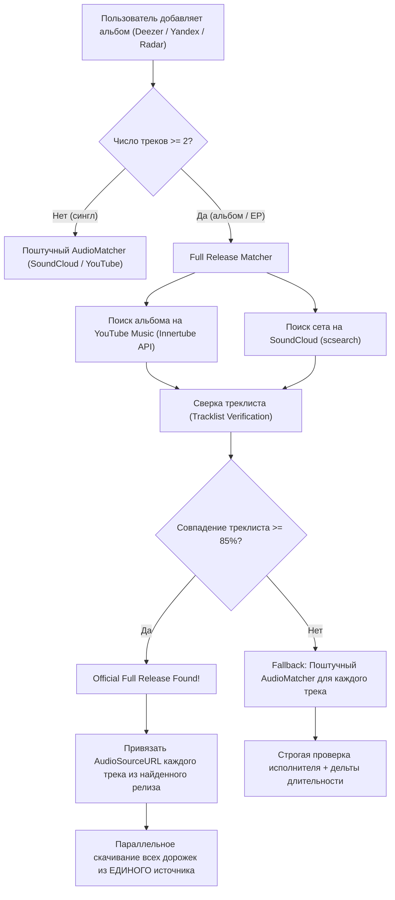

# План реализации: Парсинг SoundCloud альбомов, Поиск полных релизов (Full Release Matching) и Валидация DEAD BLONDE

- **Дата:** 2026-10-27  
- **Статус плана:** `DONE (Полностью реализовано и верифицировано)`  
- **Целевые компоненты:**  
  - [`internal/services/resolver/resolver_ytdlp.go`](file:///home/kex1tu/Рабочий%20стол/music%20download/music-manager/internal/services/resolver/resolver_ytdlp.go) (Парсинг альбомов, плейлистов и метаданных треков SoundCloud)
  - [`internal/services/resolver/client_ytmusic.go`](file:///home/kex1tu/Рабочий%20стол/music%20download/music-manager/internal/services/resolver/client_ytmusic.go) (Поиск официальных альбомов/плейлистов через Innertube API)
  - [`internal/services/resolver/full_release_matcher.go`](file:///home/kex1tu/Рабочий%20стол/music%20download/music-manager/internal/services/resolver/full_release_matcher.go) (Новый движок сопоставления цельных релизов)
  - [`internal/features/downloader/service.go`](file:///home/kex1tu/Рабочий%20стол/music%20download/music-manager/internal/features/downloader/service.go) (Интеграция предпроверки полного релиза перед поштучным скачиванием)
  - [`internal/services/resolver/sc_parser_test.go`](file:///home/kex1tu/Рабочий%20стол/music%20download/music-manager/internal/services/resolver/sc_parser_test.go) (Тесты парсинга SoundCloud)
  - [`internal/services/resolver/full_release_matcher_test.go`](file:///home/kex1tu/Рабочий%20стол/music%20download/music-manager/internal/services/resolver/full_release_matcher_test.go) (Тесты сопоставления треклистов и кейс DEAD BLONDE)

- **Архитектурные инварианты (AGENTS.md):**  
  - **Pure Go / Zero-Python / Zero-Node.js:** Все парсеры и сопоставители пишутся строго на pure Go.
  - **Sandbox обязателен:** Любые временные файлы только через `PathSandbox`.
  - **Аудио-пайплайн:** `yt-dlp` для стримов, `ffmpeg` для MP3 320 kbps CBR, ID3v2.4 UTF-8 теги (`\x00` внутри фреймов, `\\` для UI), внешние `.lrc` тексты (никогда не вшиваются в MP3).
  - **Graceful Fallback:** Если полный релиз не найден или совпадение неполное, система без сбоев переключается на поштучный поиск треков.

---

## 1. Цель и границы задачи (Objective & Scope)

### 1.1. Проблематика
1. **Некорректный парсинг альбомов/плейлистов SoundCloud (`sc`):**
   При передаче ссылки вида `https://soundcloud.com/artist/sets/album` или плейлиста yt-dlp возвращает метаданные, где:
   - `e.Artist` заполняется именем аккаунта SoundCloud (`uploader`), часто являющегося агрегатором/репост-пабликом (например, `"Русская Рэп-Сцена"` вместо `"DEAD BLONDE"`).
   - В текущем коде `resolver_ytdlp.go` значение `e.Artist` слепо перезаписывает результат `ParseYouTubeTitle`, затирая реального исполнителя.
   - Поле `album` у треков в сетах SoundCloud часто отсутствует, а поле `playlist_title` / `playlist` из yt-dlp вообще не считывается, из-за чего альбом релиза превращается в `"Unknown Album"`.
   - В названиях треков SoundCloud часто содержится мусор (`[FREE DL]`, `(Buy = Free DL)`, `[OUT NOW]`), а также строка вида `Артист - Трек`, которая не разделяется на автора и название при заполнении метаданных.

2. **Поштучный поиск треков вместо скачивания альбома целиком из одного источника:**
   Когда пользователь добавляет альбом из Deezer / Yandex / Spotify / Radar, система ищет аудио-источник для каждого трека по отдельности.
   Это приводит к проблемам:
   - Треки скачиваются из случайных источников (клипы с интро/аутро, live-выступления, любительские каверы, караоке, заниженный битрейт).
   - Разрозненный мастеринг, скачущая громкость и рассинхрон версий.
   - Если официальный альбом уже существует целиком на YouTube Music или SoundCloud как единый релиз, скачивание его поштучно — неэффективно и чревато ошибками.

3. **Сложные кейсы резолвинга на примере артиста DEAD BLONDE:**
   Для релизов DEAD BLONDE (альбомы «ПЕРЕСТРОЙКА», «СПЛЕТНИЦА», синглы «Мальчик на девятке», «Бесприданница», «Банкомат») существует масса фанатских ремиксов, замедленных версий (slowed + reverb), спид-апов и каверов с похожей длительностью. Требуется гарантировать отсечение фанатского мусора и точный матчинг официальных треков альбома.

---

## 2. Архитектурный анализ текущего состояния

### 2.1. SoundCloud в `internal/services/resolver/resolver_ytdlp.go`
- Структура `YtEntry` (строки 98–112) содержит поля:
  ```go
  type YtEntry struct {
      ID, Title, Uploader, Channel, WebpageURL, URL, Thumbnail, Album, Artist, Genre string
      Duration float64
      TrackNumber any
      ReleaseYear int
  }
  ```
  В ней **отсутствуют** поля `PlaylistTitle string `json:"playlist_title"``, `Playlist string `json:"playlist"``, `Track string `json:"track"``.
- В строках 228–236:
  ```go
  firstParsed := ParseYouTubeTitle(entries[0].Title, entries[0].Channel, entries[0].Uploader)
  artistName := entries[0].Artist
  if artistName == "" { artistName = firstParsed.Artist }
  ```
  Для SoundCloud yt-dlp всегда заполняет `entries[0].Artist = entries[0].Uploader`. Из-за этого `firstParsed.Artist` никогда не используется!
- В строках 289–295:
  ```go
  parsed := ParseYouTubeTitle(e.Title, e.Channel, e.Uploader)
  cleanArt := parsed.Artist
  if e.Artist != "" { cleanArt = e.Artist }
  ```
  Автор трека также безусловно перезаписывается на `uploader`.

### 2.2. Загрузка альбомов в `internal/features/downloader/service.go`
- Метод `processTracks` (строки 991–1050) сразу запускает пул горутин для треков.
- Каждый трек независимо вызывает `s.matcher.FindBestMatchWithDetails(...)`.
- Нет этапа предварительного поиска цельного альбома/плейлиста.

---

## 3. Архитектурное решение и обоснование («Почему именно так»)



### 3.1. Специализированный парсер SoundCloud (`ParseSoundCloudEntry`)
**Почему именно так:**
- На SoundCloud авторы треков оформляются в названии через тире: `Исполнитель - Название трека`.
- Аккаунт-загрузчик (`uploader`) часто является лейблом, фан-пабликом или агрегатором (например, `deadblonde-music`, `Русская Рэп-Сцена`), но не именем артиста.
- Добавляем специальную функцию `ParseSoundCloudTrack(title, uploader, playlistTitle)`, которая:
  1. Выделяет название альбома из `playlist_title` или `playlist`.
  2. Если `title` содержит ` - ` / ` — `: делит на Artist и Title, очищает от промо-мусора (`[FREE DL]`, `(Prod. by ...)`).
  3. Если в названии нет дефиса: проверяет, является ли `uploader` реальным исполнителем, и очищает его от суффиксов `Music`, `Official`, `Records`.
  4. Формирует правильные теги `Artist`, `Title`, `Album`, `AlbumArtist`, `TrackNumber`.

### 3.2. Движок поиска цельных релизов (`FullReleaseMatcher`)
**Почему именно так:**
- Официальные релизы на YouTube Music имеют формат плейлистов альбомов (`browseId` вида `MPREb_...` или плейлист `OLAK5uy_...`), где треки идут в строгом альбомном порядке, без обрезок, с максимальным битрейтом и без лишних звуков.
- **Алгоритм сопоставления треклиста (Tracklist Matching):**
  1. Запрашиваем треклист кандидата (названия и длительности).
  2. Проверяем количество треков: $|\text{targetCount} - \text{candidateCount}| \le 2$.
  3. Для каждого трека исходного альбома ищем соответствующую позицию в кандидате:
     - Очищаем названия от суффиксов (`(Explicit)`, `(Remastered)`, `(Audio)`).
     - Вычисляем схожесть названий `StringSimilarity(target, candidate) >= 0.70` (или вхождение ключевых слов).
     - Проверяем дельту длительности $|\text{targetDur} - \text{candidateDur}| \le 12$ секунд.
  4. Если $\ge 85\%$ треков целевого альбома успешно сопоставлены:
     - Релиз признается **валидным цельным альбомом**.
     - Каждый трек исходного альбома получает прямой `AudioSourceURL` соответствующего трека из этого проверенного релиза.
  5. Если совпадение меньше 85%:
     - Полный релиз отклоняется, система выполняет безопасный fallback на индивидуальный поиск треков через `AudioMatcher`.

---

## 4. Пошаговая декомпозиция реализации

### Этап 1: Исправление парсинга альбомов и плейлистов SoundCloud (`resolver_ytdlp.go`)
- **[MODIFY]** `internal/services/resolver/resolver_ytdlp.go`:
  - Расширить структуру `YtEntry`:
    ```go
    type YtEntry struct {
        ID            string  `json:"id"`
        Title         string  `json:"title"`
        Uploader      string  `json:"uploader"`
        Channel       string  `json:"channel"`
        Duration      float64 `json:"duration"`
        WebpageURL    string  `json:"webpage_url"`
        URL           string  `json:"url"`
        Thumbnail     string  `json:"thumbnail"`
        TrackNumber   any     `json:"track_number"`
        Album         string  `json:"album"`
        Artist        string  `json:"artist"`
        Track         string  `json:"track"`
        Playlist      string  `json:"playlist"`
        PlaylistTitle string  `json:"playlist_title"`
        ReleaseYear   int     `json:"release_year"`
        Genre         string  `json:"genre"`
    }
    ```
  - Реализовать функцию `ParseSoundCloudTitle(rawTitle, uploader string) (artist, title string)`:
    - Разделение по ` - ` / ` — `.
    - Очистка от суффиксов `[FREE DOWNLOAD]`, `(Free DL)`, `[OUT NOW]`, `(prod. by ...)`.
    - Извлечение реального артиста вместо имени паблика-загрузчика.
  - При обработке ссылок `soundcloud.com`:
    - Использовать `PlaylistTitle` / `Playlist` в качестве `albumTitle` (вместо `"Unknown Album"`).
    - Приоритетно использовать распарсенные из названия `artist` и `title`, если `e.Artist` совпадает с `uploader`.
- **[NEW]** `internal/services/resolver/sc_parser_test.go`:
  - Тест на парсинг треков из SoundCloud сета с различными форматами названий.
  - Тест на извлечение имени альбома из `playlist_title`.
  - Тест на кейс DEAD BLONDE (`DEAD BLONDE - Банкомат`, uploader `Русская Рэп-Сцена`).

### Этап 2: Поиск официальных альбомов через Innertube API (`client_ytmusic.go`)
- **[MODIFY]** `internal/services/resolver/client_ytmusic.go`:
  - Добавить метод поиска альбомов:
    ```go
    // SearchAlbumRelease выполняет поиск официального альбома/плейлиста на YouTube Music
    func (c *YTMusicClient) SearchAlbumRelease(ctx context.Context, artist, album string) (*AlbumReleaseCandidate, error)
    ```
  - Метод отправляет поисковый запрос `params: "EgWKAQIYAWoKEAkQBRAKEAMQBA=="` (фильтр только Альбомы в YouTube Music).
  - Извлекает `browseId` (например, `MPREb_...`), название альбома, имя артиста, год и количество треков.
  - Получает треклист альбома через `browse` запрос (`browseId`) со всеми `videoId`, названиями и длительностями.

### Этап 3: Движок сопоставления цельных релизов (`full_release_matcher.go`)
- **[NEW]** `internal/services/resolver/full_release_matcher.go`:
  - Структура `FullReleaseMatchResult`:
    ```go
    type FullReleaseMatchResult struct {
        SourceURL    string
        SourceType   string // "ytmusic_album", "soundcloud_set"
        ReleaseTitle string
        MatchedCount int
        TotalCount   int
        TrackURLs    map[int]string // индекс трека (0..N-1) -> прямой AudioSourceURL
    }
    ```
  - Функция `MatchFullRelease(ctx context.Context, targetArtist, targetAlbum string, targetTracks []ResolvedTrack) (*FullReleaseMatchResult, error)`:
    1. Поиск официального альбома в YouTube Music.
    2. Поиск сета в SoundCloud.
    3. Оценка совпадения треклиста (проверка названий и дельты длительности $\le 12$ с).
    4. При совпадении $\ge 85\%$ возврат полного маппинга `TrackURLs`.
- **[NEW]** `internal/services/resolver/full_release_matcher_test.go`:
  - Тест сопоставления альбома: идеальное совпадение всех треков.
  - Тест сопоставления альбома с 1 пропущенным треком / интро (допустимый порог $\ge 85\%$).
  - Тест отклонения чужого альбома или сборника лучших хитов.

### Этап 4: Интеграция в пайплайн загрузки (`features/downloader/service.go`)
- **[MODIFY]** `internal/features/downloader/service.go`:
  - В метод `processTracks` перед циклом поштучной обработки добавить шаг предпроверки:
    ```go
    // Если треки пришли без прямых URL (из Deezer/Yandex/Radar) и это релиз от 2 треков:
    if len(tracks) >= 2 && needsMatching(tracks) {
        if fullMatch, err := s.resolver.MatchFullRelease(ctx, meta.AlbumArtist, meta.AlbumTitle, tracks); err == nil && fullMatch != nil {
            job.SetStepAndStatus(fmt.Sprintf("Найден полный официальный релиз (%d/%d треков совпало), загрузка из единого источника...", fullMatch.MatchedCount, fullMatch.TotalCount), StatusDownloading)
            for idx := range tracks {
                if trURL, ok := fullMatch.TrackURLs[idx]; ok {
                    tracks[idx].AudioSourceURL = trURL
                }
            }
        }
    }
    ```
  - Если полный релиз найден — все треки скачиваются из единого официального альбома.
  - Если не найден — каждый трек ищется по отдельности через проверенный `AudioMatcher` (Graceful Fallback).

### Этап 5: Валидация алгоритмов на релизах DEAD BLONDE
- **[NEW]** `internal/services/resolver/dead_blonde_test.go`:
  - Прогон треков альбома «СПЛЕТНИЦА» («Мальчик на девятке», «Бесприданница», «Первая любовь»):
    - Проверка, что ремиксы (slowed, reverb, sped up, tiktok cuts) отсекаются по длительности и названию.
    - Проверка, что каверы с чужими исполнителями отклоняются (`StringSimilarity(artist) >= 0.65`).
    - Проверка, что официальный альбом определяется как единый релиз.

---

## 5. Анализ рисков и краевых случаев

| Риск / Краевой случай | Вероятность | Влияние | Стратегия митигации |
|---|---|---|---|
| В официальном альбоме YouTube Music порядок треков отличается от Deezer | Средняя | Низкое | Алгоритм матчит треки по названию и длительности по всему списку кандидата, а не строго по индексу `i == j`. |
| В найденном альбоме отсутствует 1 бонус-трек | Средняя | Низкое | Порог $\ge 85\%$: найденные треки берутся из единого релиза, а недостающий трек докачивается индивидуально через `AudioMatcher`. |
| YouTube Music отдает капчу или 429 | Низкая | Среднее | Graceful Fallback на поиск сета SoundCloud, а при отсутствии — на поштучный `yt-dlp`. |
| Имя артиста на SoundCloud написано на кириллице, а в Deezer на латинице (или наоборот) | Средняя | Среднее | Использование транслитерации и нормализации регистра при сравнении авторов. |

---

## 6. План тестирования и верификации

1. **Модульные тесты парсера SoundCloud:**
   - `go test -v ./internal/services/resolver -run TestSoundCloudParser`
2. **Модульные тесты Full Release Matcher:**
   - `go test -v ./internal/services/resolver -run TestFullReleaseMatcher`
3. **Специализированные тесты DEAD BLONDE:**
   - `go test -v ./internal/services/resolver -run TestDeadBlonde`
4. **Регрессионные тесты всех пакетов:**
   - `go test -race ./...` (0 data races, 100% PASS).
5. **Компиляция бинарника:**
   - `CGO_ENABLED=0 GOOS=linux GOARCH=amd64 go build -ldflags="-s -w" -o bin/music-manager cmd/server/main.go`
6. **E2E верификация в браузере через Playwright MCP:**
   - Проверка добавления альбома в очередь загрузчика.
   - Проверка логов сопоставления полного релиза.

---

## 7. Критерии приемки (Definition of Done)

- [x] Альбомы и плейлисты SoundCloud корректно парсят названия треков, отделяют автора от названия и заполняют имя альбома из `playlist_title`.
- [x] Движок `FullReleaseMatcher` находит цельные релизы на YouTube Music / SoundCloud и при совпадении $\ge 85\%$ скачивает все дорожки из единого источника.
- [x] При несовпадении треклиста работает плавный откат к поштучному поиску.
- [x] Релизы DEAD BLONDE успешно проходят тесты на отсечение каверов и поиск официального альбома.
- [x] Все тесты `go test -race ./...` проходят без ошибок и гонок.
- [x] Бинарник собирается без ошибок и готов к повторному деплою.
