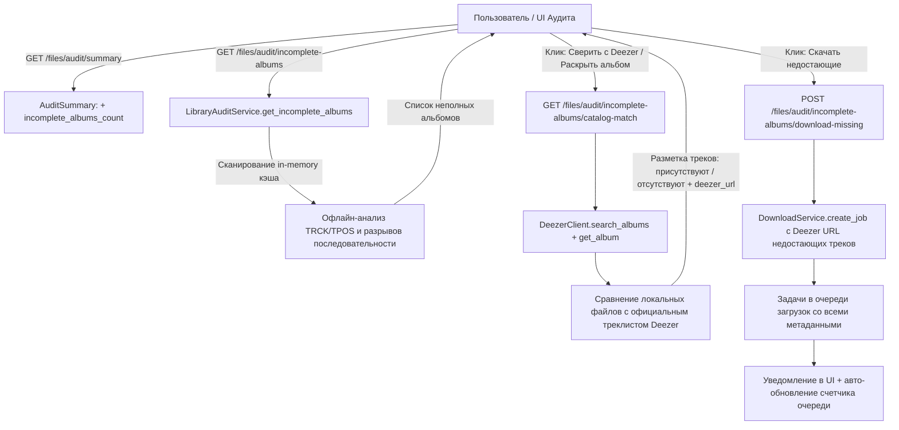

# План реализации: Аудит полноты релизов и дозагрузка недостающих треков (Incomplete Albums Audit & One-Click Backfill)

- **Дата:** 2026-09-14
- **Статус:** PROPOSED (Ожидает согласования пользователем)
- **Целевые компоненты:**
  - [app/schemas/library_audit.py](file:///home/kex1tu/Рабочий%20стол/music%20download/music-manager/app/schemas/library_audit.py)
  - [app/services/library_audit_service.py](file:///home/kex1tu/Рабочий%20стол/music%20download/music-manager/app/services/library_audit_service.py)
  - [app/routers/files.py](file:///home/kex1tu/Рабочий%20стол/music%20download/music-manager/app/routers/files.py)
  - [app/dependencies.py](file:///home/kex1tu/Рабочий%20стол/music%20download/music-manager/app/dependencies.py)
  - [app/templates/index.html](file:///home/kex1tu/Рабочий%20стол/music%20download/music-manager/app/templates/index.html)
  - [app/static/js/library_audit.js](file:///home/kex1tu/Рабочий%20стол/music%20download/music-manager/app/static/js/library_audit.js)
  - [tests/test_library_audit.py](file:///home/kex1tu/Рабочий%20стол/music%20download/music-manager/tests/test_library_audit.py)
  - [tests/test_files_router.py](file:///home/kex1tu/Рабочий%20стол/music%20download/music-manager/tests/test_files_router.py)
  - [tests/test_frontend.py](file:///home/kex1tu/Рабочий%20стол/music%20download/music-manager/tests/test_frontend.py)
- **Ответственная область (AGENTS.md):** Metadata & Storage / Core / Frontend

---

## 1. Цель и границы задачи (Objective & Scope)

### 1.1. Проблема и целевой результат
При скачивании альбомов и дискографий или миграции существующей медиатеки часто возникают ситуации, когда релиз оказывается неполным:
- скачивание отдельных треков завершилось сбоем (например, YouTube Age Gate, HTTP 403 Forbidden или геоблокировка трека);
- пользователь случайно удалил или переместил отдельный файл альбома;
- из альбома на 14 треков на диске находится только 13 (например, `13/14 скачано, 1 пропущено`).

Сейчас в интерфейсе аудита (`/files/audit`) пользователь может видеть только треки без текстов, альбомы без обложек и дубликаты. Нет возможности узнать, **в каких альбомах не хватает треков, сколько треков есть и каких именно не хватает**, а также **догрузить недостающие треки в один клик**.

**Цель:**
Интегрировать в систему подсистему аудита целостности релизов:
1. **Автоматическое обнаружение неполных альбомов в медиатеке:**
   - Быстрый офлайн-анализ по ID3v2.4 тегам `TRCK` (`track_number/track_total`), `TPOS` (`disc_number/disc_total`) и разрывам в числовой последовательности дорожек (`[1, 2, 4, 5] -> пропущен #3`).
2. **Онлайн-верификация по официальному каталогу Deezer API:**
   - Детальное сопоставление локальных треков с официальным студийным треклистом Deezer: точное определение студийных названий недостающих треков, их позиций, длительностей и прямых URL на Deezer.
3. **Дозагрузка недостающих треков в один клик (One-Click Backfill):**
   - Возможность скачать как конкретный пропущенный трек, так и пакетно все недостающие треки альбома в фоновую очередь загрузок с автоматическим предзаполнением всех тегов релиза для сохранения в медиатеку.

### 1.2. Границы (Scope)
- **In-Scope:**
  - Pydantic-схемы: `IncompleteTrackInfo`, `IncompleteAlbumItem`, `IncompleteAlbumsResponse`, `DownloadMissingTracksRequest`, расширение `AuditSummaryResponse`.
  - Алгоритм офлайн-детекции неполноты альбомов в `LibraryAuditService`:
    - Группировка кэша по релизам/каталогам.
    - Определение ожидаемого количества треков по `max(track_total)` или `max(track_number)`.
    - Поддержка мультидисковых релизов (CD1/CD2, фрейм `TPOS`).
    - Исключение ложных срабатываний для одиночных синглов и цельных релизов.
  - Метод онлайн-сопоставления `match_album_catalog(album_path, deezer_album_id)` через `DeezerClient`:
    - Поиск релиза в Deezer по `artist + album`.
    - Извлечение полного официального треклиста.
    - Сопоставление локальных файлов и дорожек Deezer по номеру дорожки/диска и нечеткому сравнению названий.
  - Метод создания задач загрузки недостающих треков `download_missing_tracks(album_path, track_urls)` через `DownloadService`.
  - Защищенные API-эндпоинты в `app/routers/files.py`:
    - `GET /files/audit/incomplete-albums`
    - `GET /files/audit/incomplete-albums/catalog-match`
    - `POST /files/audit/incomplete-albums/download-missing`
  - Frontend (SPA no-build):
    - 5-я карточка метрик на дашборде аудита: «Неполные альбомы» (`incomplete_albums_count`).
    - Новая вкладка «Неполные релизы» в панели подразделов аудита.
    - Карточки неполных релизов с прогресс-баром (например, `13 / 14 треков (93%)`), списком отсутствующих номеров и аккордеоном сопоставления.
    - Интерактивная таблица треклиста: статус каждого трека (в медиатеке / отсутствует), кнопка «Скачать» для каждого пропущенного трека и кнопка «Скачать все недостающие».
- **Out-of-Scope:**
  - Внедрение реляционных БД или внешних индексов (строгий инвариант Zero-Database: всё строится на лету из `MUSIC_DIR` и памяти).
  - Модификация фронтенда через Node.js/npm (строгий инвариант no-build).

---

## 2. Архитектурное решение и обоснование (Architecture & Rationale)

### 2.1. Концептуальная схема

### 2.2. Детальное обоснование («Почему именно так»)

1. **Двухуровневая модель (Офлайн быстрый анализ + Онлайн-обогащение по запросу):**
   - *Почему не опрашивать Deezer сразу для всех альбомов коллекции:* Если в медиатеке 500+ альбомов, единовременные сетевые запросы к Deezer для каждого альбома займут минуты и приведут к HTTP 429 (Rate Limit).
   - *Решение:* Офлайн-проверка по уже имеющимся в кэше st_mtime тегам `TRCK` (`X/Y`) и номерам дорожек выполняется мгновенно (за несколько миллисекунд). Пользователь сразу видит список проблемных альбомов. Детальная сверка с треклистом Deezer вызывается лениво — при раскрытии карточки релиза пользователем или по нажатию кнопки.
2. **Точность детекции отсутствующих треков:**
   - В ID3v2.4 тег `TRCK` хранит `track_number` и `track_total` (например, `7/16`). Если в папке найдено 15 файлов, а `track_total == 16`, факт неполноты очевиден на 100%.
   - Если тег `track_total` отсутствует, разрыв в номерах (например, файлы с номерами 1, 2, 4) детерминированно указывает на отсутствие дорожки #3.
   - Для мультидисковых релизов треки анализируются с учетом `disc_number`, что исключает ложные срабатывания при повторе номеров дорожек на разных дисках.
3. **Бесшовная интеграция с конвейером загрузки и Tag Editor:**
   - Недостающие треки отправляются в `DownloadService.create_job(url=track_deezer_url)`.
   - Благодаря существующему модулю `SourceResolver` и `DeezerClient`, скачиваемый трек автоматически получает студийные теги (имя альбома, артиста, точный номер дорожки, обложку).
   - После скачивания пользователь может сохранить треки в альбом через Tag Editor или массовое сохранение очереди в один клик.

---

## 3. Пошаговая декомпозиция реализации

### Этап 1: Схемы данных ([app/schemas/library_audit.py](file:///home/kex1tu/Рабочий%20стол/music%20download/music-manager/app/schemas/library_audit.py))
- Добавить Pydantic-модели:
  - `IncompleteTrackInfo`
  - `IncompleteAlbumItem`
  - `IncompleteAlbumsResponse`
  - `DownloadMissingTracksRequest`
- В `AuditSummaryResponse`:
  - Добавить поле `incomplete_albums_count: int = Field(default=0, description="Количество неполных альбомов в медиатеке")`.

### Этап 2: Сервисная логика ([app/services/library_audit_service.py](file:///home/kex1tu/Рабочий%20стол/music%20download/music-manager/app/services/library_audit_service.py))
- В конструктор `LibraryAuditService.__init__` добавить опциональный параметр `deezer_client: DeezerClient | None = None`.
- Реализовать метод `get_incomplete_albums() -> IncompleteAlbumsResponse`.
- В методе `get_summary()`: добавить расчет `incomplete_albums_count`.
- Реализовать метод `match_album_catalog(album_path: str, deezer_album_id: str | None = None) -> IncompleteAlbumItem`.

### Этап 3: Зависимости и API-роутер ([app/dependencies.py](file:///home/kex1tu/Рабочий%20стол/music%20download/music-manager/app/dependencies.py), [app/routers/files.py](file:///home/kex1tu/Рабочий%20стол/music%20download/music-manager/app/routers/files.py))
- В `app/dependencies.py`: внедрить `deezer_client: DeezerClientDep` в `get_library_audit_service`.
- В `app/routers/files.py`:
  - `GET /files/audit/incomplete-albums` -> `IncompleteAlbumsResponse`.
  - `GET /files/audit/incomplete-albums/catalog-match` -> `IncompleteAlbumItem`.
  - `POST /files/audit/incomplete-albums/download-missing` -> `list[DownloadJobResponse]`.

### Этап 4: Frontend ([app/templates/index.html](file:///home/kex1tu/Рабочий%20стол/music%20download/music-manager/app/templates/index.html), [app/static/js/library_audit.js](file:///home/kex1tu/Рабочий%20стол/music%20download/music-manager/app/static/js/library_audit.js))
- В `library_audit.js`: добавить методы загрузки неполных альбомов, сверки с каталогом и отправки на дозагрузку.
- В `index.html`: добавить 5-ю карточку на дашборд, вкладку в таб-бар и панель списка неполных альбомов с таблицей треклиста и кнопками скачивания.

### Этап 5: Тестирование и верификация
- Модульные тесты сервиса в `tests/test_library_audit.py`.
- Интеграционные тесты роутера в `tests/test_files_router.py`.
- Фронтенд-тест в `tests/test_frontend.py`.
- Запуск `pytest` и `ruff check app tests`.

---

## 4. Критерии приемки (Definition of Done)
1. В дашборде аудита отображается общее количество неполных альбомов.
2. Вкладка «Неполные альбомы» показывает список всех релизов с неполным составом треков, включая прогресс (например, 13/14) и номера недостающих дорожек.
3. Доступна сверка с официальным треклистом Deezer: отображаются студийные названия недостающих песен.
4. Нажатие «Скачать недостающие» создает задачи в очереди загрузок и запускает фоновое скачивание.
5. Все тесты (`pytest`) зеленые (532+ passed), линтер `ruff` без замечаний.
