# Защита аудио и текстов при очистке — 2026-11-18

- **Аудит №1.** Сохранить группировку по папке и заголовку. Массовая и групповая очистка проверяют SHA‑256 всего MP3 и совместимость сопутствующих файлов до удаления. Уникальные файлы переходят к сохранённому треку.
- **Аудит №2.** Organizer возвращает результат каждого входного трека и удаляет только опустевшие исходные папки. Редактор тегов передаёт результаты через оба HTTP-обработчика. Загрузчики учитывают статус задачи и ожидающие импорта файлы при фоновой очистке. Интерфейс закрывает задачу через условное завершение импорта, когда в staging больше нет аудио и текстов.
- **Приёмка.** Проверить разные записи «Intro», конфликты LRC у побайтных копий, перенос уникального TXT, частичный импорт, повтор запроса и поздний импорт оставшегося файла.

# Публикация текущих изменений — 2026-11-18

- Проверить и отправить изменения в `develop-kex1tu`, создать и слить PR в `main`, проверить автоматическое развёртывание.
- Перед публикацией изолировать сценарии stress-теста аудита, чтобы фоновые задачи предыдущего сценария не влияли на следующий. Повторить Go-тесты, проверку гонок и статическую сборку.

# Декомпозиция крупных файлов — 2026-11-16

- Разделить по обязанностям Go-файлы Радара и Радио, клиента Яндекс Музыки, аудита, редактора тегов, файлового менеджера и загрузчика внутри их пакетов. Сохранить маршруты, JSON, SQL и поведение сервисов.
- Вынести общий медиапайплайн двух загрузчиков в `internal/services/downloadmedia`, сохранив отдельные алгоритмы оценки качества. Подключить модули Puddletag перед его контроллером и Alpine.
- Проверить лимит 1000 строк, Go-тесты, детектор гонок, статическую сборку и сценарии Puddletag в браузере.

---

# Восстановление GitHub Actions в `main` — 2026-11-14

- Области изменений — тесты `internal/testkit`, DevOps и `internal/db`. Тесты явно подготавливают временные JSON-эталоны, чтобы проходить при `CI=true`.
- Чтобы успешный прогон `main` соблюдал правила развёртывания, workflow передаёт проверенный артефакт в `scripts/deploy.sh`. Push выбирает `all`, а ручной запуск использует выбранную цель. Скрипт сверяет SHA256 и выполняет проверку серверов, установку и откат.
- После отката на `nl_music` проверяем очистку SQLite-кэша при старте. Одна транзакция объединяет очистку таблиц, чтобы сократить дисковые фиксации и исключить частично очищенный кэш при сбое. Точка входа отмечает завершение этой фазы в журнале запуска.
- На `nl_music` запуск после отката занял 109 секунд, включая 53 секунды на очистку SQLite-кэша. В `scripts/deploy.sh` увеличено окно проверки готовности локального HTTP после установки и отката до 180 секунд. Скрипт продолжает опрос и завершает ожидание при первом успешном ответе.

---

# Интеграция задач 4, 5 и 9 — 2026-11-11

- **№4. Короткие превью.** В обоих пайплайнах проверяется длительность скачанного аудио до конвертации. При смене источника сравнение опирается на ожидаемую длительность трека. ffprobe ограничен пятью секундами. Пороги эвристики составляют менее 35 секунд фактически и более 60 секунд ожидаемо.
- **№5. Обложки.** В downloader, пакетной обработке обложек и аудите ограничено чтение HTTP-ответов. ID3 проверяет размеры растра перед декодированием и сохраняет до 1 МиБ данных изображения в APIC. Повреждённые изображения пропускаются. Загрузчик сначала запрашивает оригинал Яндекса и при сбое пробует вариант 1000×1000. Ошибка обложки позволяет продолжить обработку аудио.
- **№9. SoundCloud.** Поиск встроен в выбор источника трека и релиза. Resolver проверяет продолжение от SoundCloud и привязывает токены к запросу и категории. Догрузка релизов сохраняет выбор и ручное сопоставление. UI восстанавливает фокус и игнорирует ответы после закрытия или смены контекста.
- **Смежные области.** Изменения HTTP-обработчиков и аудита нужны для лимита сетевой загрузки обложек. Тестовые фикстуры ID3, редактора тегов, organizer и testkit используют декодируемые JPEG. Изменения resolver, HTTP и UI SoundCloud связывают поиск и пагинацию с существующим ручным выбором источника.

---

# Интеграция задач 3, 6, 7 и 8 — 2026-11-11

- **№3. Тексты Яндекс Музыки.** Resolver передаёт точный ID в оба downloader-пайплайна. Сервис текстов обращается к Яндексу, затем к LRCLIB. При отмене запроса поиск прекращается. Тексты сохраняются в staging через `safefs` отдельными `.lrc` / `.txt`.
- **Смежные области №3.** `cmd/server/main.go` связывает сервисы до запуска воркеров, `internal/config/` и `.env.example` задают необязательный `YANDEX_LYRICS_SIGN_KEY`, HTTP-обработчик принимает идентификатор каталога. Без ключа подписи или OAuth-токена работает LRCLIB. Лимиты, допустимые хосты и обработка редиректов находятся в клиенте resolver.
- **№6. Прямой источник Яндекса.** [Исследование и план](docs/YANDEX_DIRECT_SOURCE_RESEARCH.md) готовы. Реализация заблокирована инвариантом AGENTS.md §2.4 до решения владельца.
- **№7. Интерфейс.** Реализованы мобильный инспектор, нижняя навигация и мини-плеер, полноэкранный редактор тегов, настройки плотности и ширины колонок, статусы очереди. Медиатека и окно приёмки релиза обрабатывают собственные события. Проверка ориентируется на 1920, 360, 390, 412 и 430 CSS px.
- **№8. Альтернативы yt-dlp.** [Исследование и критерии PoC](docs/research/download-methods-research.md) готовы. Варианты прямого транспорта описаны как предложения с ограничениями AGENTS.md §2.4.

---

# CI/CD: Canary → ручное продвижение — 2026-11-10

- **Статус:** `PLANNED`, реализация не начата в рамках подготовки документа.
- Единый итоговый план: [CI_CD_PLAN.md](CI_CD_PLAN.md), заменяет редакции v1–v4.1 из переписки.
- Планируемые области: DevOps/CI, lifecycle и DELETE в downloader slice, HTTP-контракты эксплуатации, персистентные pause/hold и совместимость SQLite; legacy downloader — только по необходимости.
- Необходимость смежных изменений: синхронная очистка probe-задач, запрет запуска пользовательской очереди при рестарте и безопасный rollback требуют согласованных изменений сервисного, HTTP- и DB-слоёв. Критерии и порядок реализации приведены в документе.
- Сейчас изменена только документация. Код, workflow, AGENTS.md и серверы этой задачей не изменяются.

---

# Импорт публичных плейлистов Яндекс Музыки (URL и iframe) — 2026-11-10

- **Статус:** `IMPLEMENTED`
- **Основная область:** `internal/services/resolver/` (`client_yandex.go`, `resolver_yandex.go`, `normalize.go`, `resolver.go`, тесты).
- **Обоснование изменений смежных областей:**
  - `internal/features/downloader/` (`service.go`, `types.go`): расширение моделей предпросмотра (`PreflightResponse`, `PreflightReleaseInfo`, `PreflightSummary`) индикатором плейлиста `is_playlist` и счётчиками `fetched_tracks_count` / `skipped_tracks_count`. В пайплайне обработки и тегирования треков (`processSingleTrack`) гарантируется сохранение оригинального альбома каждого трека без подмены заголовком плейлиста, передача корректного имени альбома в поиск текстов LRCLIB и использование индивидуальных обложек треков.
  - `web/` (`downloader.js`, `downloader_preflight_modal.html`): нормализация ввода с извлечением `src` из iframe-кода на фронтенде перед валидацией, отображение статусного бейджа «Плейлист» и счётчиков полученных/пропущенных треков в окне предпросмотра.
- **Ограничения и инварианты:**
  - Pure Go, Zero-Node.js, Zero-Python runtime, без сторонних зависимостей.
  - Безопасное извлечение только атрибута `src` из iframe без исполнения и доверенного рендеринга HTML. Проверка схемы (http/https), хоста (только whitelist Яндекс Музыки) и лимита длины.
  - Разделение форматов: owner/kind (`/users/{owner}/playlists/{kind}`) и UUID (`/playlist/{uuid}`) опрашивают свои подтверждённые эндпоинты; при неполных данных треки догружаются через `POST /tracks` батчами.
  - Сохранение порядка и повторных вхождений: ключ элемента очереди (`TrackID`) формируется уникальным для каждого слота, оригинальный Яндекс-ID сохраняется в `CatalogTrackID`.
  - Скачивание через альтернативные источники (SoundCloud-first / YouTube Music), конвертация ffmpeg MP3 320k CBR, теги ID3v2.4 UTF-8, тексты только во внешние файлы.

---

# Безопасная длина имён файлов и каталогов (UTF-8 / ENAMETOOLONG) — 2026-11-10

- **Статус:** `IMPLEMENTED`
- **Основная область:** `internal/services/organizer/` (`path.go`, `companions.go`, тесты).
- **Обоснование изменений смежных областей:**
  - `internal/core/sandbox/sandbox.go`: добавлены функции `TruncateUTF8Bytes` и `SanitizeFilenameWithBudget` (до 255 байт NAME_MAX). Изменение необходимо, чтобы очистка имён файлов на базовом уровне не возвращала строки длиннее системного лимита файловой системы. `PathSandbox.Resolve` оставлен неизменным (не изменяет переданные клиентом пути автоматически).
  - `internal/services/downloader/` (`pipeline.go`, `switch_version.go`) и `internal/features/downloader/` (`service.go`): при формировании промежуточных имён файлов в staging (`tmp_downloads/{job_id}/converted/`) длина имени файла ограничена бюджетом 255 байт (`255 - len(trackPrefix) - len(".mp3")`). Изменение необходимо, чтобы при конвертации ffmpeg и сохранении companion `.lrc`/`.txt` длинные названия на кириллице и emoji не падали с системной ошибкой `ENAMETOOLONG` ещё до этапа переноса в медиатеку.
- **Ограничения и инварианты:**
  - Лимит одного компонента пути строго не более 255 байт (NAME_MAX для Linux ext4/btrfs/xfs/tmpfs).
  - При обрезке UTF-8 многобайтовые руны не разрываются.
  - Сохранены семантика параметра `maxLength` (число рун) и поведение коротких имён.
  - Каталог «альбом - исполнитель» при превышении бюджета делит доступное место поровну, сохраняя узнаваемость обоих компонентов.
  - При коллизиях имён суффикс ` (%d)` пересчитывает бюджет базового имени с учётом длины расширений companions (до 5 байт для `.jpeg`/`.webp`), исключая превышение 255 байт и перезапись файлов.
  - Массовое переименование старой медиатеки не производилось.

---

# Расширение поиска SoundCloud — 2026-11-09

- **Деплой выполнен:** `./scripts/deploy.sh all`, оба сервера успешно прошли локальные и публичные проверки, запущена одинаковая сборка. Подробности и пути резервных копий — в `PROGRESS.md`.

- Раскатка по явному запросу пользователя: `scripts/deploy.sh all`, локальная статическая сборка со встроенным UI без синхронизации/сброса серверных исходников. Дополнительная область DevOps необходима для установки на оба сервера. Предварительно проверены `nl_music` (`/opt/music-manager`, порт 8010, music:media) и `server2` (`/root/music_service`, порт 3000, root). Скрипт проверяет настройки процесса, локальное и публичное здоровье, новый UI и SHA256 запущенного бинарника; при ошибке установки или проверок откатывает текущий сервер и останавливается.

- По запросу пользователя: отдельный поиск по названию, три группы «Треки», «Альбомы», «Плейлисты», до 30 результатов за запрос и постраничная загрузка следующих результатов.
- Области изменений: resolver (поиск, типы и пагинация), Downloader HTTP feature (защищённый маршрут поиска, лимиты кандидатов), Frontend (поиск, группировка, предпросмотр). Изменения этих областей необходимы для полного пользовательского сценария.
- В существующих окнах источников увеличить выдачу SoundCloud с 10 треков / 3 релизов до 30, разрешить расширение до 100 кандидатов. Альбомы и плейлисты включать на равных до ранжирования.
- Скачивание найденного — через существующий предпросмотр и штатный пайплайн. Поиск не скачивает аудио и не раскрывает треклисты всех найденных плейлистов.
- Проверки: mock HTTP, пагинация и частичные ошибки, `go test -v -race -timeout 60s ./...`, штатная сборка, визуальная проверка desktop/mobile. Конвертация, теги и файловые операции не меняются.

---

# План реализации: Комплексная адаптация существующего интерфейса под Мобильные устройства и ПК (Mobile & Desktop UX Overhaul)

- **Дата:** 2026-10-27  
- **Статус плана:** `PROPOSED (На согласовании)`  
- **Целевые компоненты:**  
  - [`web/templates/components/header.html`](file:///home/kex1tu/Рабочий%20стол/music%20download/music-manager/web/templates/components/header.html) (Мобильный компактный топбар, поиск для смартфона и десктопная консоль)
  - [`web/templates/components/audio_player.html`](file:///home/kex1tu/Рабочий%20стол/music%20download/music-manager/web/templates/components/audio_player.html) (Исправление бага переноса таймкода `w-8`, мобильный Mini-Player и адаптивные тач-кнопки)
  - [`web/templates/components/queue_drawer.html`](file:///home/kex1tu/Рабочий%20стол/music%20download/music-manager/web/templates/components/queue_drawer.html) (Динамическое позиционирование виджета очереди над плеером и навигацией)
  - [`web/templates/components/file_manager.html`](file:///home/kex1tu/Рабочий%20стол/music%20download/music-manager/web/templates/components/file_manager.html) (Исправление порядка отображения на мобилке: скрытие тяжелого инспектора тегов в основной ленте, приоритет папок и сетки треков)
  - [`web/templates/components/puddletag_toolbar.html`](file:///home/kex1tu/Рабочий%20стол/music%20download/music-manager/web/templates/components/puddletag_toolbar.html) (Мобильная лента кнопок тулбара с плавным сенсорным скроллом)
  - [`web/templates/components/audit.html`](file:///home/kex1tu/Рабочий%20стол/music%20download/music-manager/web/templates/components/audit.html) и [`web/templates/components/audit_metrics.html`](file:///home/kex1tu/Рабочий%20стол/music%20download/music-manager/web/templates/components/audit_metrics.html) (Адаптивные кнопки действий `flex-wrap` и сетка метрик 2×2 на экранах `< md`)
  - [`web/templates/components/player_tab.html`](file:///home/kex1tu/Рабочий%20стол/music%20download/music-manager/web/templates/components/player_tab.html) (Мобильная компоновка выделенной вкладки плеера: компактный виниловый картридж, быстрый доступ к караоке-текстам)
  - [`web/templates/index.html`](file:///home/kex1tu/Рабочий%20стол/music%20download/music-manager/web/templates/index.html) (Интеграция Mobile Bottom Navigation Bar, учет Safe Area и отступов подвала)
  - [`web/static/css/style.css`](file:///home/kex1tu/Рабочий%20стол/music%20download/music-manager/web/static/css/style.css) (CSS-утилиты безопасных зон `pb-safe`, `bottom-safe`, тач-таргеты 44px+)
- **Архитектурные инварианты (AGENTS.md):**  
  - **Zero-Node.js / Zero-npm:** Никаких package.json, сборщиков и внешних CSS-библиотек; строго Tailwind CDN и Alpine.js CDN.
  - **Строго один стандарт иконок:** Только инлайновые Google Material Symbols SVG (`stroke-width: 1.75–2`, размеры 20x20 или 16x16, `viewBox="0 0 24 24"`).
  - **Целостность шаблонов:** Сохранение всех 435 зарегистрированных JS-методов и ключей `:key` для прохождения `web/template_validator_test.go`.
  - **Аудио-пайплайн:** MP3 320 kbps CBR, ID3v2.4 UTF-8 с null-разделителями `\x00`, companion `.lrc` рядом с треком.

---

## 1. Цель и границы задачи (Objective & Scope)

### 1.1. Проблематика
Инструментальная инспекция интерфейса через Playwright MCP на разрешениях **Desktop (1280×800, 1920×1080)** и **Mobile (375×812, 423×919)** выявила критические эргономические дефекты:
1. **На смартфонах отсутствует доступ к половине разделов сервиса:** В верхней шапке помещаются только кнопки «Загрузчик» и «Файлы». Вкладки «Аудит», «Радар», «Радио» и «Плеер» уходят за правый край без визуальных индикаторов наличия скрытых пунктов. Поле поиска `Ctrl+K` скрыто (`hidden md:block`), лишая мобильного пользователя глобального поиска.
2. **Баг разметки таймкода плеера:** Ширина контейнера цифр времени жестко зафиксирована на `w-8` (32px), из-за чего значение `--:--` или `04:05` переносится на две строки (`--:` на первой, `__` на второй), ломая линию трек-бара и смещая ползунок.
3. **Коллизия плавающих элементов в нижнем правом углу:** Кнопка «Очередь: 0 акт. ^» накладывается на контроллеры плеера или перекрывает содержимое на узких экранах.
4. **Инверсия приоритетов во вкладке «Файлы» на смартфонах:** Тяжелый блок «Инспектор тегов» (высотой более 500px с полями ввода и заглушкой обложки) отображается над файлами и папками. Пользователь должен долго скроллить вниз, чтобы увидеть свою музыку.
5. **Горизонтальное переполнение в шапке Аудита:** Кнопки «Разложить по альбомам», «Для Navidrome», «Обновить данные» выходят за пределы экрана 375px без переноса. Сетка карточек метрик вытягивается в 1 бесконечную колонку (8 карточек подряд).
6. **Неадаптированная трехпалубная консоль плеера:** На мобильных экранах виниловый картридж квадратной формы (`w-full aspect-square`) занимает весь первый экран смартфона, оттесняя караоке-тексты и управление глубоко вниз.

### 1.2. Границы задачи (Scope)
* **In-Scope:**
  - Внедрение нативного **Mobile Bottom Navigation Bar** на экранах `< md` (5 разделов с крупными тач-зонами 44px+ и Home Indicator Safe Area).
  - Мобильный Top-Bar: компактный логотип, кнопка быстрого поиска (вызов мобильного окна поиска) и вход/профиль.
  - Устранение бага переноса таймкода в стики-плеере (`audio_player.html`), адаптация плеера в компактный тач-бар на мобильных.
  - Динамическое позиционирование плавающего виджета очереди загрузок (`queue_drawer.html`) с гарантией отсутствия наложений.
  - Реструктуризация вкладки «Файлы»: скрытие тяжелого бокового инспектора тегов в основном потоке на мобильных (`hidden lg:flex`), прямой доступ к каталогам и трекам, вызов редактирования тегов через модал/шторку.
  - Адаптация сетки метрик аудита (компактные 2×2 на мобилке) и перенос кнопок в `flex-wrap`.
  - Мобильная оптимизация вкладки «Плеер» (`player_tab.html`): компактный картридж и легкий доступ к синхронизированным караоке-текстам.
  - Проверка всех изменений через `go test -v ./...` и визуальная верификация в Playwright MCP со скриншотами.
* **Out-of-Scope:**
  - Изменение бэкенд-логики конвертации, резолвинга и тегирования (бэкенд работает стабильно, 100% тестов пройдены).
  - Добавление npm/Node.js зависимостей или сторонних иконочных шрифтов.

---

## 2. Анализ текущего состояния и выявленные дефекты

| Файл | Компонент | Текущее состояние | Выявленный дефект на Mobile / Desktop |
|---|---|---|---|
| [`header.html`](file:///home/kex1tu/Рабочий%20стол/music%20download/music-manager/web/templates/components/header.html) | Главная шапка | Единый горизонтальный `nav` strip | На `< md` (375px) вкладки «Аудит», «Радар», «Радио», «Плеер» обрезаются; поиск скрыт `hidden md:block`. |
| [`audio_player.html`](file:///home/kex1tu/Рабочий%20стол/music%20download/music-manager/web/templates/components/audio_player.html) | Стики-плеер | Контейнеры таймкодов `class="w-8 ..."` | 32px не вмещают моноширинный текст `04:05` / `--:--` (требуется $\ge 40$px) $\rightarrow$ перенос на две строки. На мобилке 3 колонки теснятся. |
| [`queue_drawer.html`](file:///home/kex1tu/Рабочий%20стол/music%20download/music-manager/web/templates/components/queue_drawer.html) | Плавающая очередь | `:class="$store.player?.isVisible ? 'bottom-24' : 'bottom-4'"` | На смартфонах без учета нижнего бара накладывается на нижние элементы управления. |
| [`file_manager.html`](file:///home/kex1tu/Рабочий%20стол/music%20download/music-manager/web/templates/components/file_manager.html) | Медиатека | `flex flex-col lg:flex-row` (Tag Panel перед Data Grid) | На смартфонах пустой «Инспектор тегов» (500px) стоит перед файлами, заставляя пользователя скроллить вслепую. |
| [`audit.html`](file:///home/kex1tu/Рабочий%20стол/music%20download/music-manager/web/templates/components/audit.html) | Аудит | `flex items-center space-x-3 shrink-0` | Три длинные кнопки вызывают горизонтальное переполнение экрана 375px. |
| [`audit_metrics.html`](file:///home/kex1tu/Рабочий%20стол/music%20download/music-manager/web/templates/components/audit_metrics.html) | Метрики аудита | `grid-cols-1 sm:grid-cols-2 lg:grid-cols-4` | 8 карточек на мобилке идут в 1 колонку, занимая 3 экрана вертикальной прокрутки. |
| [`player_tab.html`](file:///home/kex1tu/Рабочий%20стол/music%20download/music-manager/web/templates/components/player_tab.html) | Консоль плеера | `w-full aspect-square` для обложки | На экране 375px обложка вытягивается на 340×340px, сдвигая VU-метры и караоке далеко за пределы экрана. |

---

## 3. Архитектурное решение и обоснование («Почему именно так»)

```mermaid
flowchart TD
    subgraph DesktopLayout["Десктопная архитектура (>= 768px / 1280–1920px)"]
        D_Header["Верхняя консоль: Логотип + Глобальный поиск Ctrl+K + Вкладки + Профиль"]
        D_Content["Контентная область max-w-[1600px] (двухколоночный Puddletag, 3-Deck плеер)"]
        D_Player["Стики-плеер 3-колоночный с ползунком громкости и таймкодами min-w-[44px]"]
        D_Header --> D_Content
        D_Content --> D_Player
    end

    subgraph MobileLayout["Мобильная эргономика (< 768px / 375–430px)"]
        M_Top["Компактный Top-Bar: Лого + Иконка быстрого поиска + Профиль"]
        M_Content["Вертикальная лента: Сетка треков/папок на 1 месте, метрики 2x2, кнопки flex-wrap"]
        M_MiniPlayer["Компактный Mini-Player Bar (40x40 обложка + Play/Pause 44x44 + Next)"]
        M_BottomNav["Mobile Bottom Navigation Bar (5 табов с крупными тач-зонами + pb-safe)"]
        M_Top --> M_Content
        M_Content --> M_MiniPlayer
        M_MiniPlayer --> M_BottomNav
    end
```



### 3.1. Разделение навигации: Top-Bar + Bottom Bar на мобильных
* **Почему именно так:**
  Попытка уместить 6 вкладок в горизонтальный верхний скролл на смартфоне противоречит стандартам мобильного UX (закон Фиттса и зоны досягаемости большого пальца). 
  Нижний бар навигации (Bottom Nav) с 5 ключевыми пунктами (`Загрузчик`, `Файлы`, `Аудит`, `Радар`, `Плеер`):
  - Обеспечивает мгновенный доступ к любому разделу в 1 тап большим пальцем.
  - Освобождает верхнюю шапку для логотипа, полноценного вызова поиска и статуса авторизации.
  - На десктопе (`>= md`) нижний бар автоматически скрывается (`hidden md:none`), а верхняя консоль сохраняет текущий привычный вид.

### 3.2. Устранение бага таймкода и адаптация стики-плеера
* **Почему именно так:**
  Вместо жесткого `w-8` задается `min-w-[44px] w-auto text-center whitespace-nowrap font-mono tabular-nums`. 44px гарантируют достаточное пространство для 5 символов (`04:05`, `--:--`) шрифта JetBrains Mono без малейшего риска переноса строки.
  На экранах `< md` стики-плеер переключается в режим **Mini-Player**: скрываются десктопные кнопки громкости и разворачивания, увеличивается кнопка Play/Pause до `w-10 h-10` (40px) с тач-таргетом `44px`, а тап по названию бесшовно переключает на вкладку плеера (`$store.app.activeTab = 'player'`).

### 3.3. Реорганизация приоритетов во вкладке «Файлы»
* **Почему именно так:**
  Боковая панель тегов (`puddletag_tag_panel.html`) полезна на десктопе при одновременной работе с таблицей. На смартфоне пользователь приходит в раздел «Файлы», чтобы найти и воспроизвести трек или перейти в папку альбома. Скрытие инспектора тегов в потоке на мобилке (`hidden lg:flex`) и вызов редактирования тегов по кнопке «Теги» открывают моментальный обзор медиатеки.

---

## 4. Пошаговая декомпозиция реализации

### Этап 1: Нижняя навигация и верхний топбар на смартфонах (`header.html`, `index.html`)
- **[MODIFY]** [`web/templates/components/header.html`](file:///home/kex1tu/Рабочий%20стол/music%20download/music-manager/web/templates/components/header.html):
  - Добавить мобильную кнопку поиска (иконка лупы) рядом с профилем на экранах `< md`.
  - По клику на лупу открывать модальное/выезжающее окно быстрого поиска по коллекции.
  - На десктопе (`hidden md:block`) сохранить текущий инпут поиска `Ctrl+K`.
  - Скрыть десктопную полосу вкладок на экранах `< md` (`hidden md:flex`), исключив обрезание пунктов.
- **[MODIFY]** [`web/templates/index.html`](file:///home/kex1tu/Рабочий%20стол/music%20download/music-manager/web/templates/index.html):
  - Внедрить компонент **Mobile Bottom Navigation Bar** перед закрывающим тегом `</body>`.
  - 5 интерактивных кнопок:
    1. `Загрузчик` (`$store.app.activeTab = 'downloader'`)
    2. `Файлы` (`$store.app.activeTab = 'files'`)
    3. `Аудит` (`$store.app.activeTab = 'audit'`)
    4. `Радар` (`$store.app.activeTab = 'radar'`)
    5. `Плеер` (`$store.app.activeTab = 'player'`)
  - Индикатор активной вкладки (`text-white font-semibold` против `text-content-muted`), бейдж непрочитанных новинок на радаре, пульсирующая точка у плеера при `isPlaying`.
  - Классы: `fixed bottom-0 inset-x-0 z-40 bg-surface-panel/95 backdrop-blur-lg border-t border-surface-border md:hidden pb-safe`.
  - Увеличить нижний отступ основного контейнера `<main>`: `pb-24 sm:pb-32` для предотвращения перекрытия контента нижним баром.

### Этап 2: Починка таймкода и мобильный Mini-Player (`audio_player.html`, `queue_drawer.html`)
- **[MODIFY]** [`web/templates/components/audio_player.html`](file:///home/kex1tu/Рабочий%20стол/music%20download/music-manager/web/templates/components/audio_player.html):
  - Заменить `w-8` в спанах текущего времени и длительности на `min-w-[44px] w-auto whitespace-nowrap font-mono tabular-nums`.
  - На мобильных (`< md`):
    - Стилизовать плеер как плавающий бар над Bottom Navigation (`bottom-[56px] md:bottom-0` с учетом safe area).
    - Левая часть: обложка 40×40 с закруглением 6px, название трека и артист в одну строку с `truncate`.
    - Центральная/правая часть: кнопка Play/Pause `w-10 h-10` (40px) по центру, кнопка «Следующий» `w-9 h-9`, скрытие ползунка громкости на мобильных.
    - Клик по карточке трека открывает `$store.player.openPlayerTab()`.
- **[MODIFY]** [`web/templates/components/queue_drawer.html`](file:///home/kex1tu/Рабочий%20стол/music%20download/music-manager/web/templates/components/queue_drawer.html):
  - Скорректировать отступ плавающей кнопки очереди с учетом мобильного плеера и нижнего бара:
    ```html
    :class="$store.player?.isVisible 
        ? 'bottom-36 md:bottom-24' 
        : 'bottom-20 md:bottom-4'"
    ```
  - Исключить любые перекрытия и наложения элементов в правом нижнем углу.

### Этап 3: Реструктуризация медиатеки на мобильных (`file_manager.html`, `puddletag_toolbar.html`)
- **[MODIFY]** [`web/templates/components/file_manager.html`](file:///home/kex1tu/Рабочий%20стол/music%20download/music-manager/web/templates/components/file_manager.html):
  - В блоке контейнера панелей:
    ```html
    <div class="flex flex-col lg:flex-row gap-3 items-stretch min-w-0">
        <!-- На мобильных панель тегов скрыта в потоке и вызывается кнопкой в тулбаре -->
        <div class="hidden lg:block lg:w-80 shrink-0">
            {{ template "puddletag_tag_panel" . }}
        </div>
        <div class="flex-1 min-w-0">
            {{ template "puddletag_grid" . }}
        </div>
    </div>
    ```
  - Папки и таблица файлов мгновенно доступны при переходе во вкладку.
- **[MODIFY]** [`web/templates/components/puddletag_toolbar.html`](file:///home/kex1tu/Рабочий%20стол/music%20download/music-manager/web/templates/components/puddletag_toolbar.html):
  - Добавить мобильную кнопку «Инспектор тегов» (видна только на `< lg`), вызывающую боковую шторку или модал с инспектором тегов для выбранных треков.
  - Настроить горизонтальную прокрутку тулбара с `no-scrollbar py-1 gap-1.5` и тач-таргетами кнопок.

### Этап 4: Адаптация Аудита и Радара под мобильные экраны (`audit.html`, `audit_metrics.html`)
- **[MODIFY]** [`web/templates/components/audit.html`](file:///home/kex1tu/Рабочий%20стол/music%20download/music-manager/web/templates/components/audit.html):
  - Заменить `flex items-center space-x-3 shrink-0` в блоке кнопок на `flex flex-wrap sm:flex-nowrap items-center gap-2`.
  - Устранить вылезание кнопок «Разложить по альбомам», «Для Navidrome», «Обновить данные» за экран.
- **[MODIFY]** [`web/templates/components/audit_metrics.html`](file:///home/kex1tu/Рабочий%20стол/music%20download/music-manager/web/templates/components/audit_metrics.html):
  - Заменить `grid-cols-1 sm:grid-cols-2 lg:grid-cols-4` на `grid-cols-2 sm:grid-cols-2 lg:grid-cols-4 2xl:grid-cols-8 gap-2.5 sm:gap-4`.
  - 8 карточек метрик выстраиваются в аккуратную сетку 2×2, сокращая высоту блока на смартфоне в 2 раза.
  - Подкорректировать паддинги карточек на мобилке (`p-3 sm:p-5`), чтобы цифры и подписи смотрелись компактно и выразительно.

### Этап 5: Адаптация выделенной вкладки плеера (`player_tab.html`)
- **[MODIFY]** [`web/templates/components/player_tab.html`](file:///home/kex1tu/Рабочий%20стол/music%20download/music-manager/web/templates/components/player_tab.html):
  - Ограничить размер обложки на мобильных экранах: вместо безразмерного `aspect-square` установить `max-w-[260px] mx-auto aspect-square` на экранах `< lg`.
  - Сделать переключатель режима (Караоке LRC / Спектроанализатор / Паспорт) видимым и легкодоступным без бесконечной прокрутки.
  - Кнопки управления воспроизведением увеличить для удобного нажатия пальцем.

### Этап 6: CSS-утилиты и поддержка Safe Area (`web/static/css/style.css`)
- **[MODIFY]** [`web/static/css/style.css`](file:///home/kex1tu/Рабочий%20стол/music%20download/music-manager/web/static/css/style.css):
  - Добавить утилиты безопасных зон для iPhone (Home Indicator):
    ```css
    .pb-safe {
        padding-bottom: max(0.5rem, env(safe-area-inset-bottom));
    }
    .bottom-safe {
        bottom: env(safe-area-inset-bottom);
    }
    ```
  - Обеспечить прецизионную моноширинность и запрет разрыва строк для всех таймкодов.

---

## 5. Анализ рисков и краевых случаев (Risks & Guardrails)

1. **Риск: Нарушение шаблонного валидатора `web/template_validator_test.go`:**
   - *Меры:* Все создаваемые кнопки навигации используют строго существующие методы (`$store.app.activeTab = '...'`, `$store.player.playTrack(...)`), все циклы `<template x-for>` снабжаются уникальными `:key`, прямые вызовы `fetch()` запрещены (только `window.api`).
2. **Риск: Перекрытие контента нижним баром или стики-плеером на смартфонах:**
   - *Меры:* Главному контейнеру `<main>` задается достаточный динамический нижний паддинг (`pb-28 sm:pb-36`), а позиция виджета очереди `queue_drawer` адаптируется через реактивные классы Alpine.js.
3. **Риск: Появление горизонтального скролла на 375px:**
   - *Меры:* Все таблицы снабжаются `table-fixed w-full` и `truncate`, текстовые кнопки в тулбарах переводятся во `flex-wrap` или горизонтальную ленту с `overflow-x-auto no-scrollbar`. Инструментальный замер в Playwright: `document.documentElement.scrollWidth <= window.innerWidth`.

---

## 6. План тестирования и верификации (Verification Matrix)

1. **Статическая валидация шаблонов Go:**
   ```bash
   go test -v ./web/...
   ```
   *Критерий:* 100% PASS (`TestTemplates_AllXForHaveKey`, `TestTemplates_ClickHandlersIntegrity`, `TestTemplates_NoInlineFetch`).
2. **Полный сьют unit и интеграционных тестов:**
   ```bash
   go test -race ./...
   ```
   *Критерий:* 100% PASS по всем 25 пакетам, 0 race conditions.
3. **Сборка бинарника:**
   ```bash
   go build -ldflags="-s -w" -o bin/music-manager cmd/server/main.go
   ```
   *Критерий:* Успешная компиляция без warning и ошибок.
4. **Визуальная E2E-проверка через Playwright MCP:**
   - **Desktop (1280×800 и 1920×1080):** Проверка шапки, таблицы Puddletag, таймкодов плеера (отсутствие переноса на две строки), позиционирования очереди.
   - **Mobile (375×812 и 423×919):** Проверка работы Bottom Navigation Bar (переключение всех 5 вкладок), мгновенного отображения файлов без заслоняющего инспектора тегов, сетки метрик аудита 2×2, работы Mini-Player.
   - Замер отсутствия горизонтального скролла на мобилке.
   - Снятие и сохранение скриншотов до/после.

---

## 7. Критерии приемки (Definition of Done)

- [ ] На смартфонах `< 768px` функционирует Bottom Navigation Bar, открывающий все разделы сервиса.
- [ ] Верхняя шапка на мобилке компактна, оснащена кнопкой быстрого поиска и не обрезает элементы.
- [ ] Баг разметки таймкода (`--:--` и `04:05`) в `audio_player.html` устранен (нет переноса на 2 строки).
- [ ] Виджет очереди не конфликтует и не перекрывает кнопки плеера.
- [ ] Во вкладке «Файлы» на смартфонах папки и треки отображаются сразу, без тяжелого инспектора тегов вверху.
- [ ] Вкладка «Аудит» на мобилке не имеет горизонтального скролла в кнопках, а карточки метрик расположены по 2 в ряд.
- [ ] Тесты `go test -race ./...` и `web/template_validator_test.go` — 100% PASS.
- [ ] Бинарник `bin/music-manager` собирается и протестирован через Playwright на десктопе и мобильном.


---

## Независимое исправление аудита (2026-11-08)

По явному запросу пользователя исправления F01–F12 выполняются отдельно от
предложенной мобильной переработки. Области: Core/Auth/Sandbox, загрузчик,
Metadata/Storage, API, сетевой клиент фронтенда и DevOps. Изменение формы повторной
загрузки нужно для соответствия её текста безопасному API. План и результаты:
[FIXES.md](docs/audit/2026-11-07/FIXES.md). Статус мобильного плана остаётся PROPOSED.

## 2026-11-08 — Единый подбор источников и аудит цензуры (IMPLEMENTED; PILOT PENDING)

Пользователь утвердил изменение resolver/downloader, censorcheck, audit, SQLite,
HTTP API, конфигурации и Alpine UI. Выбор источника всегда ручной; политика
версии задаётся для каждой загрузки. Аудит только читает музыку и внешние тексты.
Тематические приоритеты: наркотики и суицид; проверяются признаки намеренных
изменения слов. Облако выключено по умолчанию, без платного fallback.
Этапы: регрессии и единое ранжирование; глобальное сопоставление; очередь аудита;
необязательные Gemini/Deepgram; UI/API; изолированные тесты и сборка.
Пилот на 200 размеченных треках и проход 11000 файлов запускаются отдельно.

Реализация и проверка кода завершены. Пилот и массовая обработка ожидают
размеченных записей и отдельного запуска владельцем. Проверки не подтвердили
музыкальную точность на реальном каталоге: текущий режим собирает подозрения.
Для race-проверки исправлено время жизни PathSandbox в тестовой фабрике
internal/testkit/mp3.go (runtime.KeepAlive); инварианты production sandbox сохранены.
Полный race-прогон выполняется с -p 1, чтобы независимые SQLite stress-пакеты
не конкурировали за CPU и свои собственные временные бюджеты.

## 2026-11-08 — исправление постобработки yt-dlp

По запросу пользователя исправляется mediaexec (Core/Sandbox), используемый обоими
загрузчиками: закреплённый staging-каталог становится рабочим каталогом yt-dlp,
выходное имя передаётся относительно него. Это сохраняет защиту от подмены
предков каталога и позволяет ffmpeg работать без наследования fd yt-dlp.
Область: mediaexec, регрессионные тесты, существующие пояснения UI очереди;
проверка и установка бинарника на nl_music с резервом и проверкой здоровья.

2026-11-09: по дополнительному запросу пользователя та же проверенная сборка
устанавливается на server2; проверка здоровья использует его PORT=3000.

## Согласование файлов и индекса медиатеки · аудит БД № 4–7, 10, 18

- Сканер и SQLite отвечают за обновление треков, связей жанров, замечаний и альбомных агрегатов. Полный обход перепроверяет кандидатов на удаление и учитывает точечные обновления с начала обхода. Непрочитанные поддеревья сохраняют прежние записи.
- Органайзер, файловый менеджер, редактор тегов и аудит используют журнал операций сканера. Он сохраняет конечный путь перед изменением файлов и восстанавливает индекс по фактическому состоянию при запуске и в фоне.
- `PathSandbox` сохраняет буквальные имена из индекса и файловой системы. Входные пути продолжают проходить обычную декодировку и проверку границ песочницы.
- При запуске сервер переиндексирует медиатеку поверх существующих записей. История радио сохраняется для треков, оставшихся в медиатеке.
