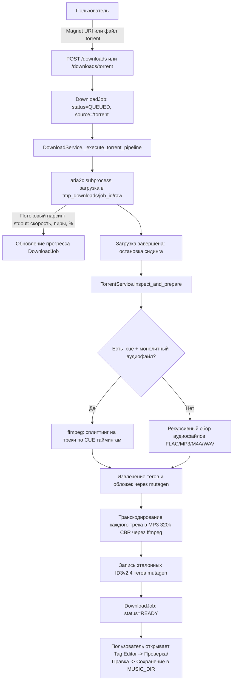

# План реализации: Загрузка музыки с торрентов (BitTorrent / Magnet / .torrent) через aria2c

- **Дата:** 2026-09-10
- **Статус:** PROPOSED (Ожидает согласования пользователем)
- **Целевые компоненты:**
  - [app/config.py](file:///home/kex1tu/Рабочий%20стол/music%20download/music-manager/app/config.py)
  - [app/schemas/download.py](file:///home/kex1tu/Рабочий%20стол/music%20download/music-manager/app/schemas/download.py)
  - [app/services/source_resolver.py](file:///home/kex1tu/Рабочий%20стол/music%20download/music-manager/app/services/source_resolver.py)
  - [app/services/torrent_service.py](file:///home/kex1tu/Рабочий%20стол/music%20download/music-manager/app/services/torrent_service.py) [NEW]
  - [app/services/download_service.py](file:///home/kex1tu/Рабочий%20стол/music%20download/music-manager/app/services/download_service.py)
  - [app/routers/downloads.py](file:///home/kex1tu/Рабочий%20стол/music%20download/music-manager/app/routers/downloads.py)
  - [app/dependencies.py](file:///home/kex1tu/Рабочий%20стол/music%20download/music-manager/app/dependencies.py)
  - [app/templates/index.html](file:///home/kex1tu/Рабочий%20стол/music%20download/music-manager/app/templates/index.html)
  - [app/static/js/downloader.js](file:///home/kex1tu/Рабочий%20стол/music%20download/music-manager/app/static/js/downloader.js)
  - [tests/test_torrent_service.py](file:///home/kex1tu/Рабочий%20стол/music%20download/music-manager/tests/test_torrent_service.py) [NEW]
  - [tests/test_downloads_router.py](file:///home/kex1tu/Рабочий%20стол/music%20download/music-manager/tests/test_downloads_router.py)
- **Ответственная область (AGENTS.md):** Downloader Engine / Core / Frontend

---

## 1. Цель и границы задачи (Objective & Scope)

### 1.1. Проблема и целевой результат
В текущей реализации сервис поддерживает загрузку аудиотреков и альбомов только со стриминговых платформ (YouTube, SoundCloud, Deezer, Spotify, Apple Music, Яндекс Музыка).
Однако огромный пласт редкой музыки, дискографий, японских CD-релизов, виниловых рипов и Hi-Res релизов распространяется исключительно через **BitTorrent-трекеры** (в виде Magnet-ссылок или файлов `.torrent`).

**Цель:**
Интегрировать в систему поддержку загрузки музыкальных релизов по **Magnet-ссылкам** и через загрузку файлов **`.torrent`** с автоматической постобработкой:
1. Скачивание раздачи через сверхлегкий нативный движок `aria2c` (уже установленный в ОС).
2. Автоматическое рекурсивное обнаружение всех аудиофайлов (`.flac`, `.ape`, `.wv`, `.mp3`, `.m4a`, `.wav`, `.ogg`, `.opus`).
3. Поддержка популярных в торрентах монолитных рипов с CUE-разметкой (автоматический сплиттинг `CUE + Single Audio` на индивидуальные треки через `ffmpeg`).
4. Автоматическое извлечение встроенных метаданных (FLAC Vorbis comments, ID3v2, MP4) и графических обложек (`folder.jpg`, `cover.jpg`).
5. Транскодирование в эталонный MP3 320 kbps CBR / 44.1 kHz с записью ID3v2.4 тегов (в строгом соответствии с архитектурным инвариантом #5).
6. Бесшовная передача в существующий интерактивный **Tag Editor**, где пользователь может обогатить данные через Deezer/Shazam и подтвердить сохранение в постоянную медиатеку `MUSIC_DIR`.

### 1.2. Границы (Scope)
- **In-Scope:**
  - Прием Magnet-ссылок (`magnet:?xt=urn:btih:...`) в основном поле ввода URL.
  - Загрузка файлов `.torrent` через перетаскивание (drag-and-drop) или выбор файла в UI (эндпоинт `POST /downloads/torrent`).
  - Управление фоновым процессом `aria2c` через `asyncio.create_subprocess_exec` с потоковым парсингом прогресса (скорость, % загрузки, количество активных пиров).
  - Специфичный для торрентов сервис `TorrentService`:
    - Санитизация файловой структуры внутри `TMP_DIR/{job_id}/raw` с защитой от Path Traversal.
    - Парсинг CUE-файлов и сплиттинг одного большого аудиофайла на треки.
    - Извлечение исходных тегов и обложек через `mutagen`.
  - Предотвращение зависания на «мертвых» торрентах (таймауты отсутствия пиров).
  - Автоматическая остановка раздачи (`--seed-time=0` / настраиваемый seed-ratio).
  - Модульные тесты с моками `aria2c`, парсеров CUE и тегов `mutagen`.
- **Out-of-Scope:**
  - Встроенный поисковик по трекерам (RuTracker/PirateBay) с хранением логинов/паролей пользователей (трекеры требуют капч, сменяемых зеркал и нарушают принцип стабильности и Zero-Database).
  - Долговременный торрент-клиент/сидбокс с постоянной раздачей (сервис является загрузчиком музыки, а не BitTorrent-сервером долгого хранения).
  - Сторонние СУБД или Node.js зависимости (строгие инварианты #1 и #3).

---

## 2. Анализ текущего состояния (Current State Analysis)

### 2.1. Анализ архитектуры загрузчика
1. **[app/services/source_resolver.py](file:///home/kex1tu/Рабочий%20стол/music%20download/music-manager/app/services/source_resolver.py):**
   - Метод `detect_source()` проверяет схему `https?://` и валидирует домен по `ALLOWED_DOWNLOAD_DOMAINS`. Передача Magnet-ссылки (`magnet:?xt=...`) сейчас вызывает `UnsupportedSourceError`, так как протокол `magnet` не обрабатывается.
2. **[app/services/download_service.py](file:///home/kex1tu/Рабочий%20стол/music%20download/music-manager/app/services/download_service.py):**
   - Метод `_execute_pipeline(job_id)` жестко ориентирован на получение списка `tracks` от `SourceResolver` *до* скачивания, после чего скачивает треки по одному через `yt-dlp`.
   - В случае торрентов состав файлов и теги становятся известны **только после** загрузки метаданных торрента или скачивания самих файлов в `TMP_DIR/{job_id}/raw/`.
3. **[app/routers/downloads.py](file:///home/kex1tu/Рабочий%20стол/music%20download/music-manager/app/routers/downloads.py):**
   - Эндпоинты принимают JSON-схему `CreateDownloadRequest` с полем `url`. Нет эндпоинта для загрузки бинарного файла `.torrent` (`multipart/form-data`).
4. **[app/static/js/downloader.js](file:///home/kex1tu/Рабочий%20стол/music%20download/music-manager/app/static/js/downloader.js):**
   - Автоматически дописывает `https://` к строкам с точками (`!/^https?:\/\//i.test(cleanUrl) && cleanUrl.includes('.')`), что сломает Magnet-ссылки, содержащие параметры трекеров (например, `&tr=udp://tracker.opentrackr.org:1337`).

---

## 3. Архитектурное решение и обоснование (Architecture & Rationale)

### 3.1. Концептуальная схема пайплайна



### 3.2. Детальное обоснование («Почему именно так»)

1. **Выбор `aria2c` в качестве движка загрузки:**
   - `aria2c` — высокопроизводительный, надежный C++ BitTorrent-клиент, уже установленный на целевой машине (`/usr/bin/aria2c` v1.37.0).
   - Запускается асинхронно как изолированный дочерний процесс через `asyncio.create_subprocess_exec` — **в точности так же, как в проекте уже работают `yt-dlp` и `ffmpeg`**.
   - Не требует компиляции C++ расширений в virtualenv, в отличие от `libtorrent-rasterbar`.
   - Не требует постоянно работающего фонового демона (в отличие от `qbittorrent-nox` или `transmission-daemon`), что сохраняет нулевое потребление памяти в простое.
   - Позволяет полностью контролировать процесс (мгновенное прерывание по `job.cancel` через `SIGTERM`).
   - Автоматически отключает сидинг по завершении скачивания (`--seed-time=0`).

2. **Двухфазная схема обработки торрента (Download -> Inspect/Transcode):**
   - В торрент-раздачах часто присутствуют посторонние файлы (сканы буклетов в TIFF/BMP, `.log`, `.nfo`, рекламные ссылки, иногда видеоклипы).
   - Пайплайн фильтрует файлы по белому списку аудио-расширений (`.flac`, `.mp3`, `.m4a`, `.wav`, `.ape`, `.wv`, `.ogg`, `.opus`), полностью игнорируя мусор.
   - Если раздача представляет собой редкий образ `CUE + Single FLAC`, парсер CUE автоматически нарезает файл по меткам времени, избавляя пользователя от ручной возни со сторонними утилитами.

3. **Сохранение и извлечение оригинальных тегов:**
   - В отличие от веб-стримингов, файлы в торрентах почти всегда обладают студийными ID3v2/Vorbis тегами.
   - Использование `mutagen.File(..., easy=True)` позволяет извлечь название трека, артиста, альбом, год и номер дорожки непосредственно из исходных файлов до конвертации в MP3.
   - Если в папке торрента присутствует качественная обложка (`cover.jpg`, `folder.jpg`, `front.png`), она автоматически назначается обложкой альбома.

### 3.3. Сравнительная таблица альтернатив (Trade-off Matrix)

| Критерий | Вариант 1: `aria2c` (Выбранный) | Вариант 2: `libtorrent` (Python bindings) | Вариант 3: Демон qBittorrent/Transmission | Вариант 4: Pure Python (torf/pytorrent) |
|---|---|---|---|---|
| **Установка и зависимости** | **Идеально** (уже установлен `/usr/bin/aria2c`, 0 новых пакетов в pip) | Сложно (требует системного пакета `python3-libtorrent` вне venv) | Требует отдельного системного сервиса и конфигурации портов | Устанавливается через pip, но библиотеки заброшены |
| **Соответствие архитектуре** | **100% совпадение** с моделью `yt-dlp` / `ffmpeg` в проекте | Требует отдельного потока или блокирующего цикла событий | Нарушает инвариант автономного легковесного сервиса | Соответствует Python, но имеет плохую производительность |
| **Потребление ресурсов в простое** | **0 МБ** (процесс запускается только на время задачи) | ~15 МБ постоянно в памяти процесса | 50–120 МБ постоянного фонового процесса | 0 МБ |
| **Поддержка DHT / Magnet** | **Полная** (IPv4 DHT, PEX, LPD, uTP) | Полная | Полная | Неполная или отсутствует |
| **Стабильность процесса** | Изоляция в отдельном процессе ОС (краш не роняет FastAPI) | C-расширение в случае segmentation fault роняет весь веб-сервер | Внешний процесс | Частые ошибки сокетов при большой нагрузке |

### 3.4. Инварианты и гарантии безопасности
1. **Строгая изоляция `PathSandbox`:**
   Торренты могут содержать опасные относительные пути внутри метаданных (например, `../../etc/passwd` или скрытые символы). Вся работа с файлами торрента ведется исключительно внутри изолированного подкаталога `TMP_DIR/{job_id}/raw/` с валидацией каждого файла через `PathSandbox`.
2. **Нулевая база данных (Zero-Database):**
   Все параметры задачи, скорость, активные пиры и статус хранятся в существующем in-memory объекте `DownloadJob`.
3. **Строгий формат MP3 320 kbps CBR / ID3v2.4:**
   Все аудиофайлы (FLAC, APE, WAV и др.) транскодируются в эталонный MP3 через `ffmpeg` с разделителем тегов `\x00` внутри фреймов, что на 100% удовлетворяет правилу #5 из `AGENTS.md`.

---

## 4. Пошаговая декомпозиция реализации (Step-by-Step Implementation)

### Этап 1: Настройки и конфигурация (`app/config.py`)
- **Статус:** `[MODIFY]`
- **Файл:** [app/config.py](file:///home/kex1tu/Рабочий%20стол/music%20download/music-manager/app/config.py)
- **Изменения:**
  - Добавить параметры в класс `Settings`:
    ```python
    TORRENT_ENABLED: bool = Field(default=True, description="Включить поддержку загрузки с торрентов")
    ARIA2C_PATH: str = Field(default="aria2c", description="Путь к исполняемому файлу aria2c")
    TORRENT_PEER_PORT: int = Field(default=6881, ge=1024, le=65535, description="Начальный порт для входящих пиров BitTorrent")
    TORRENT_SEED_TIME: int = Field(default=0, ge=0, description="Время сидинга торрента в минутах после завершения (0 = отключен)")
    TORRENT_MAX_PEERS: int = Field(default=55, ge=5, le=200, description="Максимальное количество пиров на задачу")
    TORRENT_TIMEOUT: int = Field(default=300, ge=30, description="Таймаут (сек) ожидания пиров/метаданных до фиксации ошибки")
    ```

### Этап 2: Схемы и валидация источников (`schemas/download.py`, `services/source_resolver.py`)
- **Статус:** `[MODIFY]`
- **Файлы:**
  - [app/schemas/download.py](file:///home/kex1tu/Рабочий%20стол/music%20download/music-manager/app/schemas/download.py)
  - [app/services/source_resolver.py](file:///home/kex1tu/Рабочий%20стол/music%20download/music-manager/app/services/source_resolver.py)
- **Изменения:**
  - В `CreateDownloadRequest` и `CreateBatchDownloadRequest` расширить `source`:
    `Literal["auto", "soundcloud", "youtube", "deezer", "yandex", "spotify", "applemusic", "torrent"]`.
  - В `SourceResolver.detect_source(url)`:
    ```python
    url_clean = url.strip()
    if url_clean.startswith("magnet:?"):
        return "torrent"
    if url_clean.lower().endswith(".torrent"):
        return "torrent"
    ```
  - В `SourceResolver.resolve(url, source_hint)`:
    При `source == "torrent"` возвращать специальный маркер отложенного разрешения метаданных (так как метаданные извлекаются из скачанных файлов).

### Этап 3: Сервис торрентов и CUE-сплиттер (`app/services/torrent_service.py`)
- **Статус:** `[NEW]`
- **Файл:** [app/services/torrent_service.py](file:///home/kex1tu/Рабочий%20стол/music%20download/music-manager/app/services/torrent_service.py)
- **Назначение:**
  - Вызов `aria2c` с параметрами `--enable-dht=true`, `--bt-enable-lpd=true`, `--seed-time=0`, `--summary-interval=1`.
  - Потоковый парсинг stdout через `PROGRESS_REGEX`:
    `\[#([a-f0-9]+)\s+([0-9.]+[A-Za-z]+)/([0-9.]+[A-Za-z]+)\((\d+(?:\.\d+)?)%\)\s+CN:(\d+)\s+DL:([0-9.]+[A-Za-z]+)\]`
  - Обнаружение и нарезка CUE-листов:
    Класс `CueSheetParser`: парсит треки, исполнителя, название, индексы `MM:SS:FF`, рассчитывает отрезки и вызывает `ffmpeg -ss {start} -to {end} -i ...`.
  - Чтение тегов через `mutagen.File(..., easy=True)`: формирование списка `ResolvedTrack`.
  - Поиск файлов обложек `cover.jpg` / `folder.jpg` / `front.png` в каталоге раздачи.

### Этап 4: Интеграция торрент-пайплайна в `DownloadService`
- **Статус:** `[MODIFY]`
- **Файл:** [app/services/download_service.py](file:///home/kex1tu/Рабочий%20стол/music%20download/music-manager/app/services/download_service.py)
- **Изменения:**
  - Внедрить `TorrentService` через DI.
  - В методе `_execute_pipeline`:
    Если `job.source == "torrent"`, запускается специализированная ветка:
    1. `DOWNLOADING`: `aria2c` скачивает раздачу в `raw/`, обновляя `job.progress` (0..70%) и `job.current_step` (скорость, пиры).
    2. `CONVERTING`: `TorrentService` парсит файлы, нарезает CUE при необходимости, извлекает теги.
    3. Цикл конвертации аудиодорожек в MP3 320 kbps CBR через `ffmpeg` (70..95%).
    4. `TAGGING`: запись черновых ID3v2.4 тегов через `mutagen` (95..100%).
    5. Переход в статус `READY`.

### Этап 5: Маршруты API (`app/routers/downloads.py`)
- **Статус:** `[MODIFY]`
- **Файл:** [app/routers/downloads.py](file:///home/kex1tu/Рабочий%20стол/music%20download/music-manager/app/routers/downloads.py)
- **Изменения:**
  - Поддержка `magnet:?` в `POST /downloads`.
  - Новый эндпоинт `POST /downloads/torrent`:
    ```python
    @router.post(
        "/torrent",
        response_model=DownloadJobResponse,
        status_code=status.HTTP_202_ACCEPTED,
        summary="Загрузка .torrent файла",
    )
    async def upload_torrent_file(
        file: UploadFile = File(...),
        download_service: DownloadServiceDep = ...,
        current_user: CurrentUserDep = ...,
    ) -> DownloadJobResponse:
        ...
    ```
    Сохраняет `.torrent` во временный файл задачи и ставит в очередь.

### Этап 6: Пользовательский интерфейс (`index.html`, `downloader.js`)
- **Статус:** `[MODIFY]`
- **Файлы:**
  - [app/templates/index.html](file:///home/kex1tu/Рабочий%20стол/music%20download/music-manager/app/templates/index.html)
  - [app/static/js/downloader.js](file:///home/kex1tu/Рабочий%20стол/music%20download/music-manager/app/static/js/downloader.js)
- **Изменения:**
  - Добавить бейдж и подсказку: «Поддерживаются ссылки YouTube, Deezer, SoundCloud, а также Magnet-ссылки и .torrent файлы».
  - Добавить кнопку/дропзону «Загрузить .torrent» рядом с полем ввода.
  - В `downloader.js`:
    - Предотвратить искажение Magnet-ссылок в `submitDownload`.
    - Добавить метод `uploadTorrentFile(event)`.
    - Отображение расширенной информации в прогресс-баре (скорость скачивания и число пиров).

---

## 5. Анализ рисков и краевых случаев (Risks, Edge Cases & Guardrails)

1. **Мертвые торренты (0 сидов / нет пиров):**
   - *Риск:* Задача зависнет в статусе `DOWNLOADING` бесконечно.
   - *Митигация:* Использование опции `--bt-stop-timeout=300` в `aria2c` и внутреннего асинхронного таймера. Если за отведенный таймаут не получено ни одного байта, задача завершается со статусом `ERROR` («Торрент не содержит доступных сидов»).
2. **Опасные имена файлов и Path Traversal в раздаче:**
   - *Риск:* Злоумышленник может создать торрент с путями `../../etc/cron.d`.
   - *Митигация:* Все файлы торрента извлекаются строго в изолированный `raw/` каталог задачи, а перед обработкой их имена валидируются через `PathSandbox.resolve()` и `validate_filename()`.
3. **Раздачи с огромными не-музыкальными файлами (ISO, видеоклипы 4K):**
   - *Риск:* Переполнение дискового буфера `TMP_DIR`.
   - *Митигация:* В `TorrentService` проверяется MIME-тип и расширение файлов. Обрабатываются только аудиофайлы и обложки. Также выводится понятная ошибка при превышении квоты.
4. **Коллизии портов BitTorrent:**
   - *Риск:* Порт 6881 может быть занят другим процессом на хосте.
   - *Митигация:* Передача диапазона портов в `aria2c` (`--listen-port=6881-6999`) с возможностью переопределения через `.env`.

---

## 6. План тестирования и верификации (Verification Matrix)

1. **Модульные тесты (`tests/test_torrent_service.py`):**
   - Тестирование парсинга регулярных выражений прогресса `aria2c` (проценты, скорость, количество пиров, ETA).
   - Тестирование парсера CUE-листов на корректное извлечение таймкодов треков и расчет секунд.
   - Тестирование извлечения тегов через `mutagen` из тестовых аудиофайлов FLAC и MP3.
   - Тестирование обработки ошибок при отсутствии сидов (timeout mock).
2. **Интеграционные тесты роутера (`tests/test_downloads_router.py`):**
   - Тест постановки задачи по `magnet:?xt=urn:btih:...` (HTTP 202).
   - Тест загрузки валидного `.torrent` файла через `POST /downloads/torrent` (HTTP 202).
   - Тест отклонения невалидных бинарных файлов (HTTP 400).
3. **Сквозная проверка:**
   - Полный прогон существующего тестового набора (`./venv/bin/python -m pytest`) для гарантии отсутствия регрессий в существующих источниках (478+ тестов).
   - Проверка линтером (`./venv/bin/ruff check app tests`).

---

## 7. Критерии приемки (Definition of Done)

- [ ] В `app/config.py` добавлены параметры конфигурации торрентов (`TORRENT_ENABLED`, `ARIA2C_PATH`, `TORRENT_PEER_PORT`, `TORRENT_SEED_TIME`).
- [ ] `SourceResolver` корректно распознает Magnet-ссылки и не блокирует их белым списком доменов.
- [ ] Реализован `TorrentService` с поддержкой запуска `aria2c`, парсингом прогресса, нарезкой CUE и извлечением тегов `mutagen`.
- [ ] Реализован эндпоинт `POST /downloads/torrent` для загрузки `.torrent` файлов.
- [ ] В `DownloadService` реализован пайплайн конвертации скачанных торрент-треков в эталонный MP3 320 kbps CBR с тегами ID3v2.4.
- [ ] В веб-интерфейсе поддержан ввод Magnet-ссылок и загрузка `.torrent` файлов.
- [ ] Все новые тесты написаны и проходят успешно; общий набор тестов зеленый (`pytest`).
- [ ] Отсутствуют замечания `ruff`.
